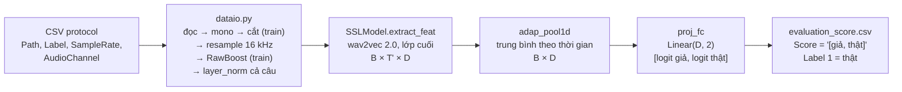

# GĐ2. Backbone SSL và môi trường

Kiến thức chung về wav2vec 2.0, XLS-R, MMS nằm trong `note/Backbone-SSL.md`. File này chỉ giữ phần gắn với đồ án: kết quả lần theo code AntiDeepfake, các phát hiện ảnh hưởng thí nghiệm, cách chạy ngày 2 và nháp câu vấn đáp 3.

## Tiến độ

| Ngày | Việc | Sản phẩm | Trạng thái |
|---|---|---|---|
| 1 | Đọc wav2vec 2.0, XLS-R, MMS | PDF trong `resource/paper/`; `note/Backbone-SSL.md` | Xong |
| 1 | Lần theo code AntiDeepfake | Mục 1–3 dưới đây | Xong (đọc code, chưa chạy) |
| 2 | `evaluate.py` | `src/evaluate.py`, self-test qua 11/11 | Xong trên máy M1 |
| 2 | Dựng môi trường, chạy toy example | `src/setup_antideepfake.sh`, `colab/GD2_toy_example.ipynb` | **Qua** (13/11): EER 6,11% |

Code đã đọc ở commit `86098091c52c5d0e38c44396c95608f93b0f648d` (HEAD của `main` ngày 12/11/2026). Repo đã đổi sau lần kiểm tra trong plan (thêm W&B, GRPO), nên mọi lần chạy phải dùng đúng commit này.

PDF đã tải thêm: `wav2vec2-2006.11477.pdf`, `XLS-R-2111.09296.pdf`, `MMS-2305.13516.pdf`, `AntiDeepfake-2506.21090.pdf` (bài nhóm B của GĐ3, tải sớm để tra dữ liệu pre-train của từng backbone).

## 1. Lần theo code: 4 khối trong plan



| Thứ tự | Khối | Vị trí | Làm gì (theo code) |
|---|---|---|---|
| 1 | `SSLModel.extract_feat` | `models/W2V.py:39-58` | Tạo `Wav2Vec2Model` của fairseq từ cấu hình, **trọng số ngẫu nhiên**; trọng số thật được nạp sau bởi `_init_model` (`main.py:89-123`). Gọi `model(x, mask=False, features_only=True)['x']`: không che, chỉ lấy đầu ra **lớp Transformer cuối** |
| 2 | `adap_pool1d` | `W2V.py:75, 91-95` | `AdaptiveAvgPool1d(1)`: trung bình mọi khung, **kể cả khung đệm 0** khi ghép batch |
| 3 | `proj_fc` | `W2V.py:82` | `Linear(D, 2)`. Cột 0 là giả, cột 1 là thật (nhãn 1 = thật trong `dataio.py:94-97`). Với MMS-300M: 1.024 × 2 + 2 = 2.050 tham số |
| 4 | `global_configs` | `models/W2V_configs.py` | Bảng mục 2 |

**Xử lý dữ liệu (`dataio/dataio.py`):**

| Bước | Huấn luyện, validation | Chấm điểm (test) |
|---|---|---|
| Nhiều kênh | Lấy trung bình về 1 kênh | Như huấn luyện |
| Câu dài hơn 13 giây | Cắt ngẫu nhiên một đoạn 10–13 giây | **Giữ nguyên độ dài** |
| Resample | Về 16 kHz nếu cột `SampleRate` khác 16000 | Như huấn luyện |
| RawBoost | Nếu `use_da: True`, `algo: 5` | Không |
| Chuẩn hoá | `layer_norm` trên cả câu (trung bình 0, phương sai 1) | Như huấn luyện |
| Batch | Dynamic batching: tổng ≤ `max_batch_length` = 100 giây, 20 bucket theo độ dài, đệm 0 | Batch 1, không đệm |

## 2. Bảng backbone đã kiểm chứng

Nguồn: `W2V_configs.py`, giá trị mặc định của fairseq ở commit `862efab` (với khoá không ghi trong cấu hình), bài gốc và README của repo.

| Khoá cấu hình | Khối × chiều | FFN | Layer norm | Dropout / layerdrop khi huấn luyện | Gradient CNN | Pre-train | Ngôn ngữ |
|---|---|---|---|---|---|---|---|
| `w2v_small` | 12 × 768 | 3.072 | Post-LN, group norm ở CNN | dropout 0,1; attention 0,1; layerdrop 0,05; dropout đầu vào 0,1 | × 0,1 | LibriSpeech 960 giờ | Anh |
| `w2v_large` | 24 × 1.024 | 4.096 | Pre-LN, layer norm ở CNN | 0 | × 1 | LV-60K + CV + SWBD + Fisher | Anh |
| `mms_300m` | 24 × 1.024 | 4.096 | Pre-LN, layer norm ở CNN | 0 | × 1 | 491K giờ | 1.406 |
| `mms_1b`, `xlsr_1b` | 48 × 1.280 | 5.120 | Pre-LN | dropout đầu vào 0,1 | × 1 | 491K / 436K giờ | 1.406 / 128 |
| `xlsr_2b` | 48 × 1.920 | 7.680 | Pre-LN | dropout đầu vào 0,1 | × 1 | 436K giờ | 128 |

- **`w2v_large` và `mms_300m` giống nhau ở mọi tham số dùng khi chạy.** So từng khoá: chỉ khác 6 tham số `mask_channel_*` và 2 tham số `quantizer_*`, đều chỉ dùng khi pre-train (khi `mask=False, features_only=True` thì không chạy tới). So sánh B2 với R là sạch.
- **Bảng 2 của bài XLS-R ghi sai** chiều của bản 1B (1.024 thay vì 1.280). Cấu hình code dùng 1.280 và số tham số 965M chỉ khớp với 1.280 (chi tiết trong note).
- Plan mục 6 GĐ2 ghi `mms_1b`, `xlsr_1b` là 48 lớp, 1.280 chiều: **đúng**.
- **Tiếng Việt trong pre-training:** XLS-R có 131 giờ (Bảng 1 của bài). MMS không công bố số giờ theo từng ngôn ngữ; trên ASR tiếng Việt, MMS 1B hơn XLS-R 1B dưới 1 điểm CER (đọc từ Hình 11).

## 3. Phát hiện từ code ảnh hưởng thí nghiệm

| # | Phát hiện | Ảnh hưởng | Việc cần làm |
|---|---|---|---|
| 1 | W2V-Small khác W2V-Large **không chỉ kích thước**: dropout, layerdrop, gradient CNN × 0,1, post-LN, group norm (mục 2) | **B1 so với B2 trộn hai yếu tố**: kích thước và cấu hình kiến trúc đi kèm. Kết luận B1 không được gọi là "chỉ do kích thước" | Giữ nguyên cấu hình (checkpoint đã post-train với cấu hình này). Ghi rõ trong báo cáo. B1 vẫn đứng thứ 2 trong thứ tự cắt |
| 2 | `load_weights` (`utils.py:21-61`) gặp tham số không khớp chỉ **in cảnh báo rồi chạy tiếp** | Dùng nhầm YAML cho checkpoint → mô hình chạy với trọng số ngẫu nhiên một phần, EER gần 50% mà không báo lỗi | Mỗi lần chạy, tìm `is not in the model` và `Wrong para. length` trong log. Script đã làm |
| 3 | `evaluate()` gọi `on_evaluate_start(min_key=...)` của SpeechBrain: **nếu thư mục exp đã có checkpoint thì nạp checkpoint đó**, ghi đè `--ckpt_path` | Chấm zero-shot trùng `exp_name` với một lần fine-tune sẽ ra kết quả của mô hình fine-tune | Mỗi checkpoint zero-shot một `exp_name` riêng |
| 4 | Test dùng batch 1, **giữ nguyên độ dài câu** | Câu dài vài phút có thể tràn bộ nhớ GPU. Bài AntiDeepfake phải cắt DEEP-VOICE và Deepfake-Eval-2024 thành đoạn | GĐ3: kiểm tra độ dài lớn nhất của RADAR tiếng Việt và In-the-Wild trước khi chấm |
| 5 | Cột `SampleRate`, `AudioChannel` trong CSV được dùng nguyên, không đọc lại từ file | Ghi sai tần số lấy mẫu → không resample → sai mà không báo | Khi tạo CSV, đọc bằng `torchaudio.info` như `protocols/toy_example.py` |
| 6 | Huấn luyện: đệm 0 không có mặt nạ, trung bình gồm cả khung đệm | Câu ngắn trong batch có câu dài bị "pha" thêm khung im lặng | Giữ dynamic batching (đã gom câu cùng độ dài). Ghi nhận khi phân tích lỗi theo độ dài |
| 7 | File điểm lưu `[logit giả, logit thật]`; `evaluation.py` dùng softmax P(thật) | Khi hiệu hai logit vượt khoảng 17, float32 làm P = 1,0 cho nhiều câu, tạo điểm hoà | `evaluate.py` dùng log-odds = logit thật − logit giả. EER trùng với repo trừ khi có bão hoà |
| 8 | Tập toy chỉ có **16 câu thật**, 134 câu giả. EER 6,11% của README = (1/16 + 8/134) / 2, tức đúng **1 câu thật** bị xếp sai | Mỗi câu thật lệch làm EER nhảy khoảng 3 điểm. Toy lại thuộc ASVspoof 2019 LA, AntiDeepfake đã dùng để huấn luyện (Train và Eval) | Điều kiện qua giai đoạn nên là **khớp 0,0611**, không phải "gần". Toy chỉ chứng minh code chạy đúng, không phải kết quả |
| 9 | README, mục "Inference": dòng `--test_csv /path/to/your/test.csv` (dòng 274) thiếu `\` | Copy lệnh sẽ bỏ mất `--ckpt_path`, mô hình không được nạp checkpoint | Script dùng lệnh đã sửa |
| 10 | `main.py` có W&B, mặc định `disabled`, chỉ import `wandb` khi bật | Không cần cài thêm | Không |
| 11 | `set_random_seed` bật `torch.use_deterministic_algorithms(True)` | Có thể chậm hơn; một số phép toán CUDA không có bản tất định sẽ báo lỗi | Nếu gặp lỗi, ghi lại thông báo trước khi sửa |

## 4. Ngày 2: cách chạy

### 4.1. `evaluate.py` (đã xong)

```bash
python src/evaluate.py --selftest                       # 11/11 OK trên M1
python src/evaluate.py <evaluation_score.csv>           # file điểm AntiDeepfake
python src/evaluate.py <score.csv> --protocol <test.csv> --group-col Attack   # EER theo hệ thống sinh
python src/evaluate.py <radar.csv> --score-col <cột> --label-col <cột> --higher-is-fake
```

| Tính năng | Ghi chú |
|---|---|
| Điểm | Log-odds, cao là thật |
| EER | Cùng thuật toán với `evaluation.py` của repo (ASVspoof), so được với số công bố |
| minDCF, actDCF | Tham số ASVspoof 5, β = 1,9, ngưỡng actDCF = −ln 1,9 ≈ −0,642 |
| Theo nhóm | `--protocol` + `--group-col`: mọi câu thật so với câu giả của từng nhóm |
| Theo tiền tố ID | `--prefix`, như `evaluation.py` |
| Self-test | Ví dụ 8 đoạn của note Kiến thức nền (EER 25%, minDCF 0,725, actDCF 1,0), so với quét ngưỡng thủ công, bất biến khi đổi thang, đảo chiều điểm |
| Phụ thuộc | Chỉ `numpy`, `pandas`; chạy được trong env Python 3.9 của repo |

Chưa có: hiệu chuẩn (học $a, b$ trên dev), để GĐ6.

Thử trên file điểm giả lập theo đúng protocol toy (16 thật, 134 giả): chạy đủ bảng gộp, theo tiền tố và theo 13 hệ thống A07–A19.

### 4.2. Môi trường và toy example

Chạy bằng notebook `colab/GD2_toy_example.ipynb`. Code đi qua GitHub, kết quả lưu trên Drive (xem README ở gốc repo).

| Ô notebook | Làm gì |
|---|---|
| 1. Cấu hình | `REPO_URL`, thư mục Drive |
| 2–3 | Kiểm tra GPU, nạp Drive |
| 4 | Clone hoặc pull code của nhóm (token lấy từ Colab Secrets) |
| 5 | `setup_antideepfake.sh ... env`: dựng môi trường |
| 6 | `setup_antideepfake.sh ... toy`: chạy toy, in kết quả của `evaluation.py` và `evaluate.py` |
| 7 | Lưu log, file điểm, phiên bản gói, commit code vào `MyDrive/orpheus/runs/` |

Script làm theo `install.sh`, khác ở 4 điểm: dùng micromamba thay conda (Colab không có conda), cố định commit AntiDeepfake, tự kiểm tra cảnh báo nạp trọng số, giữ checkpoint và dữ liệu toy trong cache trên Drive để phiên sau không tải lại. Log ở `<BASE>/setup.log`.

**Kết quả (13/11/2026, Colab T4, notebook ở commit `46e3404`): QUA**

| Mục | Kết quả |
|---|---|
| Phiên bản | Python 3.9.23; torch 2.6.0+cu118, CUDA `True`, Tesla T4 (15 GB); fairseq 1.0.0a0+862efab; speechbrain 1.0.2; numpy 1.21.2; pandas 1.4.3 |
| Nạp trọng số | Không có cảnh báo |
| `evaluation.py` (repo) | EER **0,0611**, AUC 0,993, khớp README |
| `evaluate.py` (nhóm) | EER **6,1101%**, minDCF 0,0597, actDCF 0,1710. Ngưỡng EER −1,2741 (log-odds) = 0,2186 (xác suất) của repo, vì σ(−1,2741) ≈ 0,2186: cùng một điểm |
| Thời gian cài lần đầu | torch ~2,5 phút; build fairseq ~1 phút; tổng một lần cài mới ước khoảng 5 phút (lần chạy cuối dùng lại phần đã cài nên chỉ 1 phút) |
| Tải về | Toy 25 MB: ~40 giây. Checkpoint `mms_300m.ckpt` 1,27 GB: ~9 phút (~2,4 MB/s), đã lưu cache trên Drive |
| Chấm 150 câu | 33 giây, gồm cả nạp mô hình |

**Ước lượng cho GĐ3 (thô):** 33 giây cho 150 câu là chặn trên, vì gồm cả nạp mô hình, tức ~0,22 giây/câu. 13.438 câu RADAR tiếng Việt → **dưới khoảng 50 phút** cho một checkpoint cỡ 300M, chưa tính độ dài câu khác nhau. Checkpoint 1B, 2B chậm hơn nhiều; cần đo riêng.

**Ghi nhận phụ (không phải kết quả, vì toy thuộc dữ liệu huấn luyện của AntiDeepfake):** actDCF 0,171 so với minDCF 0,060, tức điểm log-odds chưa hiệu chuẩn ngay cả trong miền. Đây là lý do GĐ6 có bước hiệu chuẩn.

**Lỗi đã gặp và đã sửa:** xem bảng lịch sử lỗi trong `chore/Quy-Trinh-Chay-Colab.md` (3 lỗi script, 1 lỗi notebook).

**Nếu không dựng được sau 1 ngày** (theo plan): dừng và đánh giá lại. Phương án inference thay thế: script inference trên trang Hugging Face của từng checkpoint (README repo nói mỗi model có sẵn), hoặc wrapper của `SpeechAntiSpoofingBenchmarks`.

Script chỉ chạy trên Linux có GPU NVIDIA (bản torch cu118), không chạy trên M1.

## 5. Nháp câu vấn đáp 3: kiến trúc bên dưới (phần backbone)

> Phần post-training (GĐ3) và công thức GRPO (GĐ6) bổ sung sau.

**Trình bày khoảng 1 phút:**

1. Đầu vào là dạng sóng 16 kHz, chuẩn hoá về trung bình 0, phương sai 1.
2. Encoder CNN 7 khối, tổng stride 320 mẫu: mỗi 20 ms ra một vector, mỗi vector nhìn 25 ms. Câu 4 giây ra 199 vector.
3. Transformer 24 khối, 1.024 chiều (MMS-300M): mỗi vector nhìn được cả câu.
4. Lấy trung bình 199 vector thành 1 vector, qua một lớp FC ra 2 logit giả/thật. Điểm là hiệu hai logit.
5. Gần như toàn bộ 317M tham số nằm ở backbone; lớp FC chỉ có 2.050 tham số. Vì vậy kết quả chủ yếu do backbone quyết định, và đổi backbone là cách trực tiếp để đo vai trò của nó.

**Câu hỏi có thể bị hỏi thêm:**

| Câu hỏi | Trả lời ngắn |
|---|---|
| Backbone học gì trước khi phát hiện giả? | Pre-train tự giám sát: che khoảng 49% số khung, chọn đúng bản lượng tử của khung bị che giữa 101 ứng viên. Không có nhãn thật/giả |
| Vì sao pre-train chưa đủ? | Mục tiêu pre-train hướng tới nội dung; bài wav2vec 2.0 chọn mục tiêu lượng tử chính vì nó bỏ qua chi tiết người nói và nền âm. Dấu vết giả thường nằm ở các chi tiết đó, nên cần post-train có nhãn |
| Vì sao chọn MMS-300M? | Đa ngôn ngữ (1.406), vừa GPU 16 GB (~5 GB khi fine-tune), và có W2V-Large cùng kiến trúc nhưng chỉ học tiếng Anh để tách yếu tố ngôn ngữ |
| Tiếng Việt chiếm bao nhiêu trong pre-train? | XLS-R: 131 giờ trên 436K giờ (~0,03%). MMS không công bố theo ngôn ngữ |
| Đa ngôn ngữ có luôn tốt hơn? | Không. Cùng 317M, wav2vec 2.0 tiếng Anh hơn XLS-R 0.3B trên LibriSpeech (pha loãng năng lực). Đây là lý do cần thí nghiệm B2 |
| Vì sao chỉ lấy lớp cuối, không dùng nhiều lớp như XLSR-SLS? | Giữ back-end tối giản để so sánh phản ánh backbone. Là hạn chế, có thể thử ở hướng phát triển |
| Vì sao không dùng spectrogram? | CNN học bộ lọc từ dạng sóng, giữ cả thông tin pha; spectrogram biên độ bỏ pha |

## 6. Kiểm tra điều kiện qua GĐ2

- [x] Đọc wav2vec 2.0, XLS-R, MMS; viết note
- [x] Lần theo 4 khối code và luồng dữ liệu
- [x] `evaluate.py` có EER, minDCF, actDCF, qua self-test
- [x] Chạy `setup_antideepfake.sh` trên Colab (notebook `colab/GD2_toy_example.ipynb`)
- [x] Toy example cho EER đúng 6,11%, không có cảnh báo nạp trọng số
- [ ] Kiểm tra quota GPU (việc chạy nền ở mục 5 của plan)
