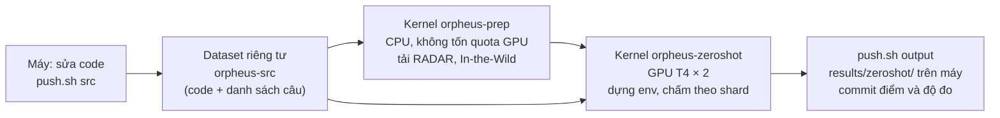

# GĐ3. Post-training và zero-shot

Kiến thức chung nằm trong `note/Post-Training-SSL.md` (bài AntiDeepfake) và `note/RawBoost.md`. File này chỉ giữ phần gắn với đồ án: trang cần đọc kỹ, đối chiếu bài với code và checkpoint, các phát hiện ảnh hưởng thí nghiệm, cách chuẩn bị dữ liệu và chấm zero-shot trên Kaggle, nháp câu vấn đáp 3.

## Tiến độ

| Ngày | Việc | Sản phẩm | Trạng thái |
|---|---|---|---|
| 1 | Tóm tắt AntiDeepfake, RawBoost | `note/Post-Training-SSL.md`, `note/RawBoost.md`, mục 1–3 dưới đây | Có tài liệu (13/11), **chưa đọc** |
| 1 | Tải PDF RawBoost | `resource/paper/RawBoost-2111.04433.pdf` | Xong |
| 2 | Chọn tập kiểm tra | `protocols/ids/*.tsv`, `stats.json` (chạy `prep_data.py select` trên máy) | Xong |
| 2 | Code chuẩn bị dữ liệu và chấm | `src/prep_data.py`, `src/score_zeroshot.py`, `src/score_w2v2_aasist.py`, `kaggle/` | Xong, đã chạy trên Kaggle |
| 2 | Kernel `orpheus-prep` | Output kernel (~10 GB) | Xong (13/11, 33 phút) |
| 2 | Lần 1: kiểm chứng + 3 backbone + baseline | `results/zeroshot/` | **Xong (13/11, 2,42 giờ), qua cả 3 mốc kiểm chứng** (mục 5.6) |
| 2 | Lần 2: NDA của 3 backbone nhỏ, MMS-1B, XLS-R-1B | `results/zeroshot/`, `results/runs/orpheus-zeroshot-v2/` | **Xong (13/11, 2,71 giờ)** (mục 5.6) |
| 2 | Lần 3: HuBERT-XL, XLS-R-2B (cả hai bản) | `results/zeroshot/`, `results/runs/orpheus-zeroshot-v3/` | **Xong (14/11, 5,18 giờ)** (mục 5.6) |
| 2 | Khoảng tin cậy bootstrap | `src/bootstrap_eer.py`, `results/zeroshot/bootstrap_radar_vi.csv` | Xong (14/11, chạy trên máy) |
| 2 | Phân tích lại trên máy (lỗi, độ dài câu, sai trùng, tương quan với bài) | `src/analyze_zeroshot.py`, `results/zeroshot/analysis/` | Xong (14/11), mục 5.7 |
| | **Tổng kết, quyết định, thay đổi kế hoạch** | Mục 8 | Xong (14/11). **GĐ3 qua phần chạy**; đọc kỹ ngày 1 hoãn lại |

Bài AntiDeepfake đọc ở bản **arXiv v4 (21/10/2025)**, tức sau khi repo sửa cách tính EER (16/10/2025). Số MMS-300M trong Bảng II khớp từng ô với bảng trên trang Hugging Face của checkpoint. Code đối chiếu ở commit `86098091` như GĐ2.

## 1. Trang cần đọc kỹ

Đọc kiến trúc tổng thể và kết quả trước; phần dữ liệu chi tiết và siêu tham số để sau.

**AntiDeepfake** (`resource/paper/AntiDeepfake-2506.21090.pdf`, 8 trang, phần chính 5,5 trang):

| Lượt | Phần | Trang | Câu hỏi khi đọc |
|---|---|---|---|
| 1. Tổng thể | Tóm tắt, Hình 1, mục I | 1 | Post-training nằm ở đâu, khác fine-tune thế nào? |
| 1. Tổng thể | Hình 2, mục III-B | 3 | Kiến trúc gồm những khối nào? Khối nào được cập nhật? |
| 1. Kết quả | Mục IV-B, IV-C, **Bảng II** | 3–4 | 6 tập kiểm tra là gì? Mô hình nào tốt nhất trên In-the-Wild? RawBoost giúp ở đâu? |
| 1. Kết quả | Mục IV-D, Hình 3, **Bảng III** | 4–5 | Post-training giúp fine-tune bao nhiêu? Vì sao P3 hơn MMS-300M ở 4 giây? |
| 1. Kết quả | Mục V (hạn chế) | 5–6 | Tác giả tự nhận những điểm yếu nào? |
| 2. Chi tiết | Mục III-A, **Bảng I** | 2 | 5 nhóm dữ liệu; nhóm nào chiếm nhiều giờ nhất? |
| 2. Chi tiết | Mục IV-A | 3 | Learning rate, batch, số bước, cắt câu |
| 2. Chi tiết | Mục IV-E, Hình 4–5 | 5–6 | t-SNE nói gì? |

**RawBoost** (`resource/paper/RawBoost-2111.04433.pdf`, 4 trang nội dung):

| Lượt | Phần | Trang | Câu hỏi khi đọc |
|---|---|---|---|
| 1. Tổng thể | Tóm tắt, mục 1 | 1 | Vì sao cần tăng cường trên dạng sóng? |
| 1. Tổng thể | Hình 1 | 3 | Ba loại nhiễu là gì? |
| 1. Kết quả | **Bảng 2**, mục 4.4 | 4 | Cấu hình nào tốt nhất? Vì sao thêm (3) không giúp? |
| 2. Chi tiết | Mục 3.1–3.3, công thức (1)–(6) | 2 | Mỗi loại nhiễu tính thế nào? |
| 2. Chi tiết | Bảng 1, Hình 2, mục 4.3 | 3 | Khoảng giá trị tham số; nối tiếp và song song |

**Code** (commit `86098091`):

| File | Dòng | Câu hỏi |
|---|---|---|
| `dataio/rawboost.py` | 63–98, 102–206 | `algo = 5` gọi những hàm nào, theo thứ tự nào? |
| `hparams/mms_300m.yaml` | khối `rawboost` | Tham số có khớp Bảng 1 của bài không? |
| `main.py` | `analyze()` | Chế độ `analysis` ghi ra những file nào? |
| `models/W2V.py` | 137–145 | `analysis` trả về embedding ở đâu trong mạng? |

**Tự kiểm tra:** câu hỏi cuối hai note; nháp vấn đáp ở mục 6.

## 2. Đối chiếu bài, code và checkpoint

| Nội dung | Bài | Code / checkpoint | Khớp? |
|---|---|---|---|
| Kiến trúc | SSL → GAP → FC (Hình 2) | `models/W2V.py`: `extract_feat` → `AdaptiveAvgPool1d(1)` → `Linear(D, 2)` | Khớp |
| Cắt câu khi huấn luyện | > 13 s cắt ngẫu nhiên 10–13 s | `dataio.py` | Khớp |
| RawBoost | "cấu hình tốt nhất" của bài RawBoost = (1)+(2) nối tiếp | `algo: 5` = `LnL_convolutive_noise` rồi `ISD_additive_noise`; tham số khớp Bảng 1 của RawBoost | Khớp |
| Learning rate | Tăng tới 1e-7 trong 80K bước, **giảm tuyến tính về 0** ở bước 800K | YAML: `WarmAndExpDecayLRSchedule`, `decay_factor: 0.01` (giảm theo hàm mũ) | **Không khớp**; ảnh hưởng GĐ4 khi chỉnh cấu hình fine-tune |
| Bản Default / NDA | Bảng II: "with RawBoost / no RawBoost" | Model card HF: Default = có tăng cường, NDA = không; card ghi "RawBoost series: (1)+(2)" | Khớp |
| Bảng fine-tune | Bảng III (v4) | README repo có bảng khác ở vài ô, ví dụ MMS-1B không post-train, 10 s: bài 13,57, README 10,32 | **Không khớp**; dùng số trong bài v4 |
| XLS-R + SLS trên In-the-Wild | Bảng II của AntiDeepfake ghi 7,45 | Plan và đề cương ghi 7,46 (lấy từ bài XLSR-SLS) | Cần đối chiếu bài XLSR-SLS (chưa có PDF) |
| Ghi chú `algo` trong YAML | | Ghi "8: 1+3", nhưng code `algo == 8` là (1)+(2) **song song** | Comment sai, code đúng với bài |

**Checkpoint trên Zenodo và Hugging Face:**

| | Zenodo (record 15580543) | Hugging Face (`nii-yamagishilab/*-anti-deepfake[-nda]`) |
|---|---|---|
| Định dạng | `.ckpt` (state_dict PyTorch), repo nạp trực tiếp | `model.safetensors` + `config.json`, nạp bằng `PyTorchModelHubMixin` |
| Tên khoá | `m_ssl.model.*`, `proj_fc.*` | Cùng lớp `DeepfakeDetector` với cùng tên module trong script inference trên card |
| Dung lượng 14 file | 0,38–8,65 GB, tổng ~46 GB | Như Zenodo |
| Tốc độ tải đo được | ~2,4 MB/s trên Colab (GĐ2) → ~5,4 giờ cho 46 GB | **~95 MB/s trên Kaggle** (13/11) |
| Giống nhau? | | **Có**: toy với bản HF ra EER 6,1101%, minDCF 0,0597, actDCF 0,1710, đúng như bản Zenodo ở GĐ2; không cảnh báo nạp trọng số. Từ nay dùng bản HF |

Cách dùng: tải `model.safetensors` từ Hugging Face, chuyển sang `.ckpt` (`torch.save` của state_dict), rồi nạp bằng code gốc. **Kiểm chứng bắt buộc:** chấm toy example với `mms_300m` lấy từ HF phải ra đúng EER 6,11% như GĐ2, và log không có cảnh báo nạp trọng số. Nếu HF lỗi, script tự chuyển sang Zenodo.

## 3. Phát hiện ảnh hưởng thí nghiệm

| # | Phát hiện | Ảnh hưởng | Việc cần làm |
|---|---|---|---|
| 1 | **MMS-300M có RawBoost kém hơn bản không RawBoost trên In-the-Wild** (2,90 so với 2,00) và FoR-norm (5,92 so với 2,70). Trên In-the-Wild, 6/7 backbone được RawBoost giúp; MMS-300M là ngoại lệ duy nhất | Cấu hình mốc R dùng MMS-300M có RawBoost. A0 (bỏ RawBoost khi fine-tune) có thể ra kết quả ngược kỳ vọng | Chấm zero-shot cả Default lẫn NDA của MMS-300M trên RADAR tiếng Việt để biết RawBoost có lợi trên tiếng Việt không, **trước** khi chạy A0 **Đã chấm (lần 2–3):** trên RADAR tiếng Việt cũng vậy, NDA 18,07% so với Default 20,08% (chênh +2,02, KTC 95% [1,43; 2,55]). Cả 3 backbone ≤ 317M đều tốt hơn khi bỏ RawBoost; bản ≥ 1B thì ngang hoặc Default nhỉnh hơn (mục 5.6). **Cần quyết định lại cấu hình mốc R (Default hay NDA) và cách đọc A0 trước GĐ5** |
| 2 | **RADAR dev không dùng được:** tiếng thật lấy từ LibriTTS dev/test (bài RADAR mục III-A); LibriTTS, LibriTTS-R, LibriTTS-Vocoded nằm trong dữ liệu post-training | Nếu lấy "RADAR tiếng Anh" từ dev, mô hình có thể đã thấy chính các câu thật đó | "RADAR tiếng Anh" lấy từ **tập eval** (thật: Common Voice 8.000 + People's Speech 7.000; giả: 10 hệ thống) |
| 3 | RADAR tiếng Việt: thật = Common Voice 3.000 + FOSD 4.000 (Bảng II bài RADAR). Common Voice có trong dữ liệu **pre-train** của XLS-R (v6.1), MMS (v9.0) | Không phải rò rỉ nhãn (pre-train không có nhãn thật/giả), nhưng một phần tiếng thật có thể "quen" với backbone | Ghi chú khi diễn giải; không loại bỏ |
| 4 | RADAR **không có nhãn hệ thống sinh và nguồn tiếng thật theo từng câu**; chỉ có nhãn ngôn ngữ | Không tính được EER theo từng hệ thống trên RADAR | Phân tích theo hệ thống (GĐ5, GĐ6) chỉ làm trên SEA-Spoof và tập tự tạo |
| 5 | Dữ liệu post-training có FLEURS và FLEURS-R (102 ngôn ngữ) và MLAAD (38 ngôn ngữ). Theo danh sách của FLEURS có tiếng Việt; chưa kiểm tra | Mô hình post-trained có thể đã thấy tiếng Việt thật (FLEURS) và tiếng Việt "phục hồi" bị gán nhãn có artifact (FLEURS-R) | Kiểm tra danh sách ngôn ngữ FLEURS và phiên bản MLAAD đã dùng (đã có trong mục 9 của plan) |
| 6 | Độ dài câu: RADAR tiếng Việt dài nhất 45,7 s, RADAR tiếng Anh (tập con) 51,4 s, In-the-Wild 25,0 s | Bẫy số 4 của GĐ2 (câu vài phút tràn bộ nhớ) không xảy ra với các tập này | Không cần cắt đoạn |
| 7 | Chế độ `analysis` ghi cả file điểm lẫn embedding sau lớp trung bình (`.pkl`), nhưng **chỉ ghi khi chạy xong cả tập** | Mất phiên giữa chừng là mất hết | `score_zeroshot.py` chia shard 2.000 câu; shard xong thì lưu ngay |
| 8 | W2V2-AASIST (baseline): repo HF có `LA_model.pth` và bản ONNX; **không có** `w2v2_aasist.py`, `_net.py` mà model card nhắc tới. Chỉ nhìn **4,04 s đầu** của câu (64.600 mẫu, câu ngắn thì lặp lại), không chuẩn hoá biên độ, điểm = logit lớp thật (đã đối chiếu `data_utils_SSL.py` và `main_SSL_LA.py` của repo gốc) | So với AntiDeepfake (nhìn cả câu) là không cùng điều kiện đầu vào. actDCF của baseline vô nghĩa vì điểm không phải log-odds | Dùng ONNX; báo EER và minDCF; ghi rõ khác biệt. Đối chiếu: In-the-Wild đủ bộ phải gần **11,22%** như card công bố |
| 9 | Kết quả có RawBoost / không RawBoost đổi chiều theo tập và theo backbone (note, mục 5) | Không suy được tác dụng trên tiếng Việt từ số tiếng Anh | Bảng zero-shot RADAR tiếng Việt cần đủ Default và NDA (thứ tự cắt số 4 của plan chỉ dùng khi thiếu quota) |
| 10 | **RADAR tiếng Anh khó ngang hoặc khó hơn RADAR tiếng Việt** (lần 1, mục 5.6): MMS-300M 26,2% (EN) so với 20,1% (VI); W2V-Large 23,5% so với 17,8% | Mức giảm từ In-the-Wild (~2–4%) xuống RADAR tiếng Việt (~18–27%) **không chỉ do ngôn ngữ**: phần lớn do các hệ thống sinh của RADAR. Lưu ý: tập EN chỉ 1.000 + 1.000 câu, nguồn tiếng thật khác (Common Voice + People's Speech) | Khi viết câu hỏi nghiên cứu "yếu tố quyết định", phải tách yếu tố ngôn ngữ khỏi yếu tố hệ thống sinh. RADAR VI và EN là cặp so sánh gần nhất hiện có (cùng benchmark, cùng năm) |
| 11 | **W2V-Large (pre-train chỉ tiếng Anh) tốt hơn MMS-300M (đa ngôn ngữ, có tiếng Việt) trên RADAR tiếng Việt**: 17,80% so với 20,08%. Hai mô hình cùng kiến trúc, cùng 317M (GĐ2 mục 2) | Pre-train đa ngôn ngữ **không** tự động có lợi khi zero-shot. Nhưng đây là bản Default (có RawBoost), và MMS-300M Default là ngoại lệ xấu trên In-the-Wild (phát hiện 1) | Chờ bản NDA (lần 2) rồi mới kết luận. Là giả thuyết đáng kiểm tra lại sau fine-tune (B2 so với R ở GĐ5) **Lần 2:** bản NDA vẫn vậy (16,62 so với 18,07; chênh 1,45, KTC 95% [0,80; 2,09]). **Lần 3:** ở ~1B thì ngược lại (HuBERT-XL tiếng Anh kém MMS-1B 6,2 điểm), nhưng HuBERT-XL khác cả cách pre-train lẫn learning rate post-train, không phải cặp sạch |
| 12 | **Lỗi chủ yếu là tiếng giả lọt qua, nhưng điểm đã gần hiệu chuẩn tốt theo DCF** (sửa 14/11). Ở ngưỡng log-odds 0, các mô hình post-trained (trừ HuBERT-XL NDA) nhận nhầm 22–41% câu giả là thật, nhưng chỉ coi 3–11% câu thật là giả (MMS-300M: 37,1% và 4,8%; In-the-Wild: 3,6% và 2,2%). Tuy vậy, với tham số ASVspoof 5 (β ≈ 1,9, ngưỡng Bayes −0,64), actDCF chỉ cao hơn minDCF tối đa 0,018 ở 13/14 checkpoint. Ngoại lệ: HuBERT-XL NDA (0,34) và W2V2-AASIST (0,44, điểm không phải log-odds). Bản 13/11 ghi "lệch hiệu chuẩn" vì so ngưỡng EER (3,69) với 0; đó không phải cách đo hiệu chuẩn theo DCF | Vấn đề chính là **phân biệt** (hai phân bố điểm chồng lên nhau), không phải đặt sai ngưỡng. Hiệu chuẩn (GĐ6 ngày 3) ít có lợi cho mô hình chưa fine-tune | Báo cả hai loại lỗi ở ngưỡng 0 và actDCF − minDCF, trước và sau fine-tune. Hiệu chuẩn chỉ cần nếu fine-tune làm lệch (`results/zeroshot/analysis/errors_radar_vi.csv`) |
| 13 | **W2V2-AASIST gần như đoán ngẫu nhiên trên RADAR**: 30,1% (VI), 43,6% (EN, minDCF 0,998); actDCF > 1 | Baseline chuyên biệt hỏng nặng khi gặp hệ thống sinh mới, khớp với nhận định của bài AntiDeepfake | Ghi vào báo cáo làm luận cứ cho việc dùng mô hình post-trained |
| 14 | Tốc độ không tỉ lệ với kích thước: W2V-Large (317M) chạy 42,9x thời gian thực, W2V-Small (95M) 30,9x, MMS-300M 30,4x | Nút thắt nhiều khả năng ở bước đọc dữ liệu trên CPU, không ở GPU: máy Kaggle T4 × 2 chỉ có **4 nhân** (Intel Xeon 2,0 GHz, log lần 3) cho cả hai GPU. W2V-Small NDA chạy một mình cuối lần 2 đạt 91x. Tốc độ đo được: bản 1B ~15–18x, bản 2B ~8,6x thời gian thực | Khi fine-tune ở GĐ5: tăng số worker đọc dữ liệu có giới hạn (4 nhân); cân nhắc chạy một job mỗi lần cho bản 300M |
| 15 | **Độ dài câu không phải nguyên nhân** (14/11). Chỉ dùng độ dài làm điểm thì EER 41%: RADAR không có lối tắt theo độ dài. Câu ngắn không khó hơn dù mô hình post-train trên đoạn 10–13 s; với bản 1B/2B, câu dưới 3 s còn dễ nhất (XLS-R-2B: 11,8% so với 16,7% ở nhóm 6–10 s) | Loại trừ giả thuyết "cắt câu khi post-train". Nhóm 6–10 s có tỉ lệ câu giả cao hơn (1.849 giả / 936 thật), có thể do hệ thống sinh khác nhau tạo câu dài ngắn khác nhau | Không cần cắt hay ghép câu khi chấm. Báo EER theo độ dài như phân tích phụ (`eer_by_duration.csv`) |
| 16 | **Các mô hình sai trên cùng những câu** (14/11). Ở ngưỡng EER của từng mô hình: 3,7% câu giả lọt qua **cả 7** mô hình Default, và 3,6% câu thật bị cả 7 coi là giả; nếu sai độc lập thì chỉ khoảng 0,001%. Với 4 mô hình 1B/2B tốt nhất: 6,7% và 6,1%. Tổng cộng 493 câu (238 giả, 255 thật) khó với cả 7 mô hình | Lỗi có cấu trúc: có một nhóm tiếng giả (nhiều khả năng vài hệ thống sinh hoặc biến đổi âm thanh) và một nhóm tiếng thật mà dữ liệu post-train chưa phủ tới. Ghép nhiều mô hình (ensemble) sẽ giúp ít | Theo dõi `results/zeroshot/analysis/hard_ids_default7.csv` trước và sau fine-tune ở GĐ5–6. Nghe khoảng 20 câu mỗi loại để mô tả định tính (cho phần phân tích sâu) |
| 17 | **Thứ hạng trên In-the-Wild dự báo tốt thứ hạng trên tiếng Việt** (14/11). Spearman giữa EER RADAR tiếng Việt và EER trong Bảng II của bài, qua 14 checkpoint: In-the-Wild 0,91 (0,88 khi bỏ HuBERT-XL), Deepfake-Eval-2024 0,81, DEEP-VOICE 0,80, ADD 2023 0,78, FoR-norm 0,61, FoR 0,19 | Mô hình tốt trên dữ liệu thực tế tiếng Anh thì cũng tốt trên tiếng Việt. Khác biệt nằm ở **mức EER** (In-the-Wild 1,2–18% so với tiếng Việt 13,7–30,7%), không ở thứ tự. Củng cố ý: khả năng phát hiện chung (cách train, dữ liệu, kích thước) quan trọng hơn yếu tố riêng của ngôn ngữ | Dùng cho câu hỏi 1 trong báo cáo. Giới hạn: chỉ 14 điểm, các cặp Default/NDA không độc lập (`rank_vs_paper.csv`) |
| 18 | **Tổng hợp: "ngôn ngữ" hay "cách train và tài nguyên"** (14/11, trả lời câu hỏi của người dùng). Mức ảnh hưởng đo được trên RADAR tiếng Việt: kích thước mô hình 3,9–9,4 điểm (MMS-300M → MMS-1B; W2V-Small → W2V-Large); RawBoost khi post-train 1,2–4,0 điểm ở bản ≤ 317M, 10 điểm ở HuBERT-XL; cách pre-train và learning rate (HuBERT-XL so với MMS-1B) 6,2 điểm nhưng trộn với ngôn ngữ; ngôn ngữ pre-train (cặp sạch W2V-Large – MMS-300M) 1,5–2,3 điểm, theo chiều có lợi cho tiếng Anh; độ dài câu: không. RADAR tiếng Anh khó hơn tiếng Việt dù dữ liệu post-train thiên về tiếng Anh (MLS chiếm ~90% giờ tiếng thật) | Số liệu **không ủng hộ** giả thuyết "thiếu tài nguyên tiếng Việt là nguyên nhân chính". Nguyên nhân khả dĩ nhất: dữ liệu post-train chưa phủ các hệ thống sinh 2025–2026 và các biến đổi âm thanh của RADAR. Nhưng zero-shot không tách được "hệ thống mới tự nó khó" với "chưa được thấy khi train"; so RADAR EN với VI cũng bị trộn (khác hệ thống sinh, khác nguồn tiếng thật, EN chỉ 1.000 + 1.000 câu) | Đặt lại câu hỏi 1 theo 3 nhóm: mô hình nền, cách train, dữ liệu (plan mục đầu). GĐ5 kiểm tra: fine-tune trên SEA-Spoof (có ElevenLabs, OpenAI) mà RADAR tiếng Việt giảm mạnh thì nguyên nhân là độ phủ dữ liệu |

## 4. Dữ liệu kiểm tra

### 4.1. Các tập

Chọn ngẫu nhiên có cố định seed (2026), danh sách ở `protocols/ids/` (đã commit, nên mọi lần chạy dùng đúng một tập).

| Tập | Câu (thật / giả) | Giờ | Nguồn | Dùng cho |
|---|---|---|---|---|
| `radar_vi` | 13.438 (7.000 / 6.438) | 17,04 | RADAR eval, `VI` | Bảng zero-shot chính; ngoài miền tiếng Việt ở GĐ5–6 |
| `radar_en_sub` | 2.000 (1.000 / 1.000) | 3,02 | RADAR eval, `EN` | Một nửa tập đo mức quên |
| `itw_sub` | 2.000 (1.000 / 1.000) | ~2,43 | In-the-Wild | Nửa còn lại của tập đo mức quên |
| `ood_forget` | 4.000 | ~5,45 | `itw_sub` + `radar_en_sub` | Đo mức quên ở GĐ5–6, báo riêng từng nửa |
| `itw_full` | 31.779 (19.963 / 11.816) | ~37,85 | In-the-Wild đủ bộ | Chỉ để đối chiếu số công bố (MMS-300M 2,90%; W2V2-AASIST 11,22%) |

Giờ của In-the-Wild tính từ kích thước file WAV (16 kHz, float 32-bit) nên có dấu "~"; số đếm câu khớp số công bố. Tập con 1.000 câu mỗi lớp: với EER khoảng 3%, sai số chuẩn khoảng 0,5 điểm, đủ để so cấu hình nhưng không đủ phân biệt chênh lệch dưới 1 điểm.

### 4.2. Lưu trữ

| Thứ | Dung lượng | Cách lấy | Giữ ở đâu |
|---|---|---|---|
| RADAR eval (nén) | 8,75 GB | **Không lưu**: đọc luồng `tar.gz` từ Zenodo, chỉ ghi file cần | |
| RADAR tiếng Việt + tiếng Anh (FLAC) | ~1 GB (ước theo 8,75 GB cho 171 giờ) | Như trên | Output kernel `orpheus-prep` |
| In-the-Wild (zip) | 8,16 GB | Tải vào `/tmp` của kernel, giải nén rồi xoá | |
| In-the-Wild (WAV) | 8,72 GB | | Output kernel `orpheus-prep` |
| Checkpoint | 0,38–8,65 GB mỗi file | Tải từ HF trong kernel GPU, xoá sau khi chấm xong mô hình đó | `/tmp` của kernel (không vào output) |
| Kết quả | Điểm ~1 MB/tập; embedding đến ~100 MB/tập (bản 2B) | | Output kernel `orpheus-zeroshot` → `results/` trên máy; điểm và độ đo commit lên git, embedding thì không |

Output kernel `orpheus-prep` khoảng 10 GB, dưới giới hạn 20 GB của `/kaggle/working`. Không cần Drive.

Nếu phải quay về Colab (Drive 15 GB): bỏ `itw_full`, chỉ lấy `radar_vi`, `radar_en_sub`, `itw_sub` (~1,6 GB). `prep_data.py` lấy `itw_sub` bằng cách đọc từng file trong zip qua HTTP Range, không tải 8 GB.

## 5. Chạy trên Kaggle

### 5.1. Vì sao Kaggle

| | Colab miễn phí | Kaggle |
|---|---|---|
| GPU | 1 × T4, không bảo đảm được cấp | **2 × T4** (`NvidiaTeslaT4`) |
| Phiên | ~4 giờ, phải giữ tab mở | 12 giờ, chạy nền ("Save & Run"), đóng trình duyệt vẫn chạy |
| Quota | Không rõ | **30 giờ GPU/tuần**, làm mới 00:00 UTC thứ Bảy (7 giờ sáng giờ Việt Nam); xem bằng `push.sh quota` (đã kiểm 13/11) |
| Điều khiển từ máy | CLI chập chờn (GĐ2) | Kaggle CLI: đẩy kernel, xem trạng thái, tải kết quả |
| Ổ đĩa | Drive 15 GB | `/kaggle/working` ~20 GB giữ lại sau phiên |

Giới hạn 12 giờ/phiên và ~30 giờ/tuần lấy từ tài liệu thứ cấp; quota thật xem trên tài khoản.

### 5.2. Luồng

Code đưa lên Kaggle dưới dạng **dataset riêng tư** thay vì clone GitHub, nên không cần token trên Kaggle. Hai kernel cũng riêng tư.

### 5.3. Kế hoạch các lần chạy

**Lần 1: kiểm chứng và đo tốc độ** (`kaggle/zeroshot/run.py`, biến `JOBS`):

| Job | Mục đích | Điều kiện qua |
|---|---|---|
| `toy:mms_300m` | Checkpoint lấy từ HF giống Zenodo | EER = 6,11%, không cảnh báo nạp trọng số |
| `itw_full:mms_300m` | Code và dữ liệu khớp bài | Gần 2,90% (Bảng II, có RawBoost) |
| `itw_full:w2v2_aasist` | Baseline chạy đúng | Gần 11,22% (model card) |
| `radar_vi:mms_300m,w2v_small,w2v_large,w2v2_aasist` | Bảng zero-shot, 3 backbone sẽ fine-tune + baseline | |
| `ood_forget:mms_300m,w2v_small,w2v_large,w2v2_aasist` | Mốc đo mức quên cho R, B1, B2 (S0 của từng backbone) | |

Ước lượng thô từ GĐ2 (~0,22 s/câu với bản 300M, gồm cả nạp mô hình): `radar_vi` ~50 phút, `itw_full` ~2 giờ, `ood_forget` ~15 phút cho MMS-300M. Lần 1 khoảng 3–3,5 giờ kể cả dựng môi trường (~5 phút). Mỗi job ghi tốc độ thực tế (`x_realtime` trong `summary.csv`).

**Thực tế lần 1:** 2,42 giờ (dựng môi trường 4 phút), tốn 2,43 giờ quota. Bản 300M chạy ~30–45x thời gian thực, `radar_vi` 21–34 phút mỗi mô hình, `itw_full` ~70 phút. Nhanh hơn ước lượng thô khoảng 30%.

**Lần 2 trở đi:** 11 checkpoint còn lại trên `radar_vi`, chia hai lần vì chưa biết tốc độ bản 1B/2B và một lần vượt 12 giờ thì có thể mất cả output:
- Lần 2 (đẩy 20:35, 13/11): `mms_300m_nda` (đứng đầu, cho phát hiện 1), `mms_1b`, `xlsr_1b`, `mms_1b_nda`, `xlsr_1b_nda`, `w2v_large_nda`, `w2v_small_nda`.
- Lần 3 (đẩy 23:29, 13/11): `hubert_xl`, `hubert_xl_nda` chạy song song, rồi `xlsr_2b`, `xlsr_2b_nda` lần lượt (bản 2B giữ 19 GB trong ngân sách RAM 27 GB nên không chạy song song với bản 1B). Bản 1B đo ở lần 2: ~17,5x thời gian thực, ~58 phút cho `radar_vi`. **Thực tế:** 5,18 giờ; HuBERT-XL ~15,2x thời gian thực (~67 phút), XLS-R-2B ~8,6x (~2 giờ); quota sau 3 lần: đã dùng 10,32 / 30 giờ.

Nếu thiếu quota: bỏ NDA của các bản 1B/2B trước (thứ tự cắt số 4 của plan), giữ NDA của MMS-300M (phát hiện 1).

**Lưu bằng chứng mỗi lần chạy** (cho báo cáo và tái hiện): `results/runs/<kernel>-v<N>/` được commit, gồm `run.py` và `kernel-metadata.json` đúng như đã đẩy, log kernel, môi trường, log `main.py` của từng shard, kết quả riêng của lần đó và `RUN.md` (thông tin chạy, job, kết quả, cách tái hiện, ghi chú). `push.sh push` tạo phần đầu; `push.sh output zeroshot N` bổ sung phần còn lại. Output thô có embedding ở `results/kaggle-raw/orpheus-zeroshot-vN/` (không commit). `summary.csv` trong `results/zeroshot/` được gộp: dòng mới thay dòng cũ cùng (tập, mô hình).

**Chạy hai GPU song song:** mỗi GPU lấy job kế tiếp trong hàng đợi. Script giới hạn RAM để không nạp hai bản 2B cùng lúc (mỗi bản cần ~17 GB RAM khi nạp).

### 5.4. Kết quả và cách đọc

| File | Nội dung |
|---|---|
| `results/zeroshot/summary.csv` | Mỗi dòng một (tập, mô hình): số câu, giờ âm thanh, giây GPU, tốc độ, EER (%), minDCF, actDCF |
| `results/zeroshot/<mô hình>/<tập>/scores.csv` | Điểm từng câu, định dạng của repo `[logit giả, logit thật]` |
| `.../metrics.csv` | Bảng của `evaluate.py`; `ood_forget` có thêm dòng riêng cho In-the-Wild và RADAR |
| `.../emb.npy` | Embedding sau lớp trung bình (không commit), dùng cho tầng 0 nếu cần |
| `results/zeroshot/setup.log`, `versions.txt` | Môi trường thực tế trên Kaggle |

Điểm cao là thật (log-odds); EER thấp hơn là tốt hơn.

### 5.5. Việc người dùng cần làm trước lần chạy đầu

Đã xong hết (13/11): cài Kaggle CLI 2.2.5, đăng nhập `kaggle auth login` (OAuth), xác minh số điện thoại. Hướng dẫn chung: `chore/Quy-Trinh-Chay-Kaggle.md`.

### 5.6. Kết quả zero-shot (lần 1–3, 13–14/11)

**Ba mốc kiểm chứng: qua cả ba.**

| Mốc | Công bố | Đo được | Ghi chú |
|---|---|---|---|
| Toy, MMS-300M (checkpoint HF) | 6,11% (README; GĐ2 đo bằng bản Zenodo) | **6,1101%** | Trùng đến 4 chữ số, cả minDCF và actDCF. Bản HF giống bản Zenodo |
| In-the-Wild đủ bộ, MMS-300M Default | 2,90% (Bảng II, có RawBoost) | **2,9016%** | **Đạt điều kiện qua GĐ3 của plan** |
| In-the-Wild đủ bộ, W2V2-AASIST | 11,22% (model card) | **11,2122%** | Lệch 0,008 điểm %, nhiều khả năng do chi tiết cách tính EER |

**Zero-shot trên RADAR tiếng Việt** (13.438 câu: 7.000 thật / 6.438 giả). EER, minDCF, actDCF: thấp hơn là tốt hơn.

| Mô hình | Tham số | Pre-train | EER (%) | minDCF | actDCF |
|---|---|---|---|---|---|
| **W2V-Large** (Default) | 317M | Anh | **17,80** | **0,384** | **0,389** |
| MMS-300M (Default) | 317M | 1.406 ngôn ngữ | 20,08 | 0,461 | 0,469 |
| W2V-Small (Default) | 95M | Anh | 27,21 | 0,572 | 0,587 |
| W2V2-AASIST (baseline) | chưa kiểm | chưa kiểm | 30,12 | 0,802 | 1,246 (vô nghĩa, mục 3 #8) |

**Đủ 14 checkpoint (lần 1–3): Default (có RawBoost) so với NDA (không RawBoost)** trên RADAR tiếng Việt. EER (%) kèm khoảng tin cậy 95% bootstrap (1.000 lượt, lấy lại câu trong từng lớp, seed 2026; `src/bootstrap_eer.py`, `results/zeroshot/bootstrap_radar_vi.csv`):

| Backbone | Tham số | Pre-train | Default | NDA | Default − NDA [KTC 95%] | Tốt hơn |
|---|---|---|---|---|---|---|
| W2V-Small | 95M | Anh | 27,21 [26,5; 28,0] | 23,24 [22,5; 24,0] | +3,97 [3,30; 4,70] | **NDA** |
| W2V-Large | 317M | Anh | 17,80 [17,1; 18,5] | 16,62 [16,0; 17,3] | +1,18 [0,63; 1,76] | **NDA** |
| MMS-300M | 317M | Đa ngôn ngữ | 20,08 [19,4; 20,8] | 18,07 [17,4; 18,8] | +2,02 [1,43; 2,55] | **NDA** |
| HuBERT-XL | 964M | Anh | 20,49 [19,8; 21,3] | 30,67 [29,9; 31,4] | −10,19 [−10,95; −9,38] | **Default** |
| MMS-1B | 965M | Đa ngôn ngữ | 14,32 [13,7; 14,9] | 14,20 [13,6; 14,8] | +0,12 [−0,33; 0,58] | Ngang |
| XLS-R-1B | 965M | Đa ngôn ngữ | 14,99 [14,4; 15,6] | 15,60 [15,0; 16,3] | −0,61 [−1,07; −0,06] | Default (sát) |
| **XLS-R-2B** | 2,2B | Đa ngôn ngữ | **13,71** [13,1; 14,3] | 14,23 [13,6; 14,9] | −0,51 [−1,00; 0,03] | Ngang (sát Default) |
| W2V2-AASIST (baseline) | | | 30,12 [29,3; 30,9] | | | |

Tham số và ngôn ngữ pre-train theo bài AntiDeepfake (`note/Post-Training-SSL.md`). minDCF đi cùng chiều với EER (`results/zeroshot/summary.csv`). HuBERT-XL NDA có actDCF 0,993: điểm của tiếng thật dồn về gần 0 (trung vị 0,19), 47,6% câu thật bị nhận là giả ở ngưỡng 0. Checkpoint nạp đủ 804 tensor, không cảnh báo; khớp với Bảng II của bài (HuBERT-XL NDA kém hẳn trên mọi tập, In-the-Wild 17,99 so với 5,23), nên không phải lỗi chạy.

**Các so sánh khác** (chênh EER, KTC 95%): MMS-300M − W2V-Large: +2,28 [1,52; 3,00] (Default), +1,45 [0,80; 2,09] (NDA); MMS-1B − XLS-R-1B: −0,67 [−1,24; −0,15]; XLS-R-2B − MMS-1B: −0,60 [−1,14; −0,04]; XLS-R-1B − XLS-R-2B: +1,27 [0,73; 1,85]; HuBERT-XL − MMS-1B: +6,17 [5,54; 6,88].

**Giới hạn của khoảng tin cậy:** chỉ tính độ bất định do chọn câu, coi các câu độc lập. Câu RADAR cùng người nói, cùng hệ thống sinh không độc lập (không có nhãn để lấy mẫu theo cụm, phát hiện 4), nên khoảng thật có thể rộng hơn. Mỗi checkpoint chỉ có một lần huấn luyện, nên không đo được độ bất định do huấn luyện. Chênh lệch dưới ~1 điểm nên coi là "gần ngang".

Nhận xét (đủ 14 checkpoint):
1. **Tác dụng của RawBoost khi dùng thẳng trên tiếng Việt phụ thuộc kích thước.** Bỏ RawBoost tốt hơn rõ ở cả 3 bản ≤ 317M (+1,2 đến +4,0 điểm, KTC không chứa 0). Ở bản ≥ 1B thì ngang hoặc Default nhỉnh hơn (≤ 0,6 điểm); HuBERT-XL là ngoại lệ lớn theo chiều ngược lại, giống trong bài. Khác In-the-Wild, nơi bài báo RawBoost giúp cả W2V-Small và W2V-Large (4,23 so với 4,65; 1,91 so với 2,25). Hệ quả cho GĐ5: cả 3 backbone fine-tune (MMS-300M, W2V-Large, W2V-Small) đều có bản NDA tốt hơn khi zero-shot.
2. **Kích thước giúp rõ, trừ HuBERT-XL:** XLS-R-2B tốt nhất (13,71%), rồi MMS-1B, XLS-R-1B (14,2–15,6%), rồi bản 317M (16,6–20,1%), W2V-Small (23–27%).
3. **Ngôn ngữ pre-train: hai chiều ngược nhau theo kích thước.** Ở 317M, W2V-Large (chỉ tiếng Anh) hơn MMS-300M (đa ngôn ngữ) ở cả hai bản. Ở ~1B, HuBERT-XL (tiếng Anh) kém MMS-1B 6,2 điểm, nhưng HuBERT-XL khác cả cách pre-train (HuBERT so với wav2vec 2.0) lẫn learning rate post-train ($5 \times 10^{-6}$ thay vì $10^{-7}$), nên không phải so sánh sạch về ngôn ngữ. Cặp sạch duy nhất là W2V-Large với MMS-300M (GĐ2).
4. **Mô hình tốt nhất vẫn để lọt nhiều tiếng giả:** XLS-R-2B ở ngưỡng 0 nhận nhầm 28,1% câu giả là thật (3,1% câu thật bị coi là giả).

Front-end và dữ liệu pre-train của W2V2-AASIST cần kiểm trong bài gốc của Tak (2022) trước khi ghi vào báo cáo. Baseline này chỉ nhìn 4 s đầu của câu (mục 3 #8).

**Tập `ood_forget`** (mốc đo mức quên cho GĐ5–6), EER (%):

| Mô hình | Gộp (4.000) | In-the-Wild (1.000 + 1.000) | RADAR EN (1.000 + 1.000) |
|---|---|---|---|
| W2V-Large | 15,3 | 2,0 | 23,5 |
| MMS-300M | 15,5 | 2,6 | 26,2 |
| W2V-Small | 16,2 | 4,0 | 27,2 |
| W2V2-AASIST | 27,1 | 10,8 | 43,6 |

**Tỉ lệ lỗi ở ngưỡng log-odds 0** (ngưỡng tự nhiên của mô hình, chưa hiệu chuẩn):

| Tập | Mô hình | Giả bị nhận là thật | Thật bị nhận là giả |
|---|---|---|---|
| RADAR VI | W2V-Large | 26,8% | 7,1% |
| RADAR VI | MMS-300M | 37,1% | 4,8% |
| RADAR VI | W2V-Small | 40,5% | 10,8% |
| RADAR EN | MMS-300M | 49,0% | 5,5% |
| In-the-Wild | MMS-300M | 3,6% | 2,2% |

Nhận xét lần 1 (phát hiện 10–14 ở mục 3):
1. Mô hình post-trained dùng thẳng tốt hơn baseline chuyên biệt trên tiếng Việt (13,7–27,2% so với 30,1%; trừ HuBERT-XL NDA 30,7%), nhưng còn xa mức In-the-Wild (2–4%). Còn chỗ cho fine-tune.
2. RADAR tiếng Anh còn khó hơn tiếng Việt (đo với 3 backbone 317M trở xuống), nên khoảng cách lớn chủ yếu do hệ thống sinh mới, không chỉ do ngôn ngữ.

Số liệu gốc: `results/zeroshot/summary.csv`, `results/zeroshot/<mô hình>/<tập>/metrics.csv`. Tỉ lệ lỗi ở ngưỡng 0 tính lại từ `scores.csv` (log-odds = logit thật − logit giả, như `src/evaluate.py`).

### 5.7. Phân tích lại trên máy (14/11)

Chạy lại từ các file điểm đã có, không tốn GPU: `python src/analyze_zeroshot.py` (đầu ra ở `results/zeroshot/analysis/`, gồm `analysis_output.txt`). Kết luận ghi ở phát hiện 12 (đã sửa), 15–18.

**Hai loại lỗi và hiệu chuẩn** (RADAR tiếng Việt; FAR: giả bị nhận là thật, FRR: thật bị coi là giả, ở ngưỡng log-odds 0):

| Mô hình | EER | FAR ở 0 | FRR ở 0 | actDCF − minDCF |
|---|---|---|---|---|
| XLS-R-2B | 13,71 | 28,1% | 3,1% | 0,013 |
| MMS-1B NDA | 14,20 | 24,9% | 5,7% | 0,001 |
| W2V-Large NDA | 16,62 | 26,2% | 6,3% | 0,010 |
| MMS-300M NDA | 18,07 | 34,5% | 5,3% | 0,006 |
| MMS-300M (mốc S0 của R) | 20,08 | 37,1% | 4,8% | 0,007 |
| W2V-Small | 27,21 | 40,5% | 10,8% | 0,014 |
| HuBERT-XL NDA | 30,67 | 22,1% | 47,6% | 0,336 |

Đủ 15 mô hình: `errors_radar_vi.csv`.

**EER theo độ dài câu** (số câu thật / giả: < 3 s 2.099 / 1.449; 3–6 s 3.896 / 2.973; 6–10 s 936 / 1.849; > 10 s 69 / 167):

| Mô hình | < 3 s | 3–6 s | 6–10 s | > 10 s |
|---|---|---|---|---|
| XLS-R-2B | 11,8 | 13,7 | 16,7 | 14,4 |
| MMS-1B | 12,1 | 14,4 | 16,3 | 15,8 |
| W2V-Large | 15,7 | 17,2 | 19,7 | 18,7 |
| MMS-300M | 20,5 | 21,2 | 18,9 | 18,7 |
| W2V-Small NDA | 22,9 | 23,2 | 22,8 | 23,3 |

Nhóm > 10 s quá ít câu để kết luận.

**Sai trùng nhau** (ở ngưỡng EER của từng mô hình):

| Nhóm mô hình | Lớp | Lỗi trung bình | Sai bởi tất cả | Nếu sai độc lập | Không mô hình nào sai |
|---|---|---|---|---|---|
| 7 bản Default | Giả | 18,4% | 3,7% | 0,001% | 58,3% |
| 7 bản Default | Thật | 18,4% | 3,6% | 0,001% | 54,0% |
| 4 bản 1B/2B tốt nhất | Giả | 14,1% | 6,7% | 0,04% | 77,2% |
| 4 bản 1B/2B tốt nhất | Thật | 14,1% | 6,1% | 0,04% | 75,9% |

**Tương quan hạng với Bảng II của bài** (Spearman, 14 checkpoint): In-the-Wild 0,91; DFE-2024 0,81; DEEP-VOICE 0,80; ADD 2023 0,78; FoR-norm 0,61; FoR 0,19.

**RADAR tiếng Anh so với tiếng Việt** (EER; FAR ở ngưỡng 0):

| Mô hình | RADAR EN | RADAR VI | FAR EN | FAR VI |
|---|---|---|---|---|
| W2V-Large | 23,5 | 17,8 | 46,0% | 26,8% |
| MMS-300M | 26,2 | 20,1 | 49,0% | 37,1% |
| W2V-Small | 27,2 | 27,2 | 55,9% | 40,5% |
| W2V2-AASIST | 43,6 | 30,1 | | |

## 6. Nháp câu vấn đáp 3: kiến trúc bên dưới (phần post-training)

> Phần backbone ở file GĐ2 mục 5. Công thức GRPO bổ sung ở GĐ6.

**Trình bày khoảng 1 phút:**

1. Backbone SSL (ví dụ MMS-300M) được pre-train tự giám sát trên tiếng thật, chưa hề thấy tiếng giả.
2. Post-training: gắn thêm lớp trung bình theo thời gian và một lớp FC ra 2 logit, rồi huấn luyện **cả mạng** bằng cross-entropy trên 74K giờ: 56K giờ thật, 18K giờ có artifact (TTS, VC, vocoded, restored, codec), hơn 100 ngôn ngữ, có RawBoost.
3. Learning rate rất nhỏ (1e-7), 800K bước trên 8 GPU H100. Nhóm không tự làm lại được, nên dùng checkpoint công bố.
4. Kết quả: dùng thẳng không học thêm đã đạt 1,23% EER trên In-the-Wild (XLS-R-2B), trong khi XLS-R + SLS 7,45%, AASIST 43%.
5. Fine-tune từ bản post-trained tốt hơn fine-tune từ bản pre-train, rõ nhất với đoạn ngắn.

**Câu hỏi có thể bị hỏi thêm:**

| Câu hỏi | Trả lời ngắn |
|---|---|
| Post-training khác fine-tune ở đâu? | Cùng loss, cùng kiến trúc. Post-training: dữ liệu rất lớn, nhiều miền, mục tiêu là biểu diễn chung. Fine-tune: dữ liệu nhỏ, một miền |
| Vì sao coi tiếng qua vocoder hay codec là "giả"? | Bài coi là "có artifact", không phải deepfake. Mục đích là dạy mô hình nhận ra sai khác nhỏ ở dạng sóng. Loại dữ liệu này rẻ: có tiếng thật là tạo được |
| RawBoost là gì? | Tăng cường dữ liệu trên dạng sóng: lọc nhiều dải + méo hài, và làm méo ngẫu nhiên vài % mẫu. Mô phỏng kênh điện thoại, không cần dữ liệu nhiễu ngoài |
| RawBoost có luôn giúp không? | Không. Trong bài AntiDeepfake, giúp trên In-the-Wild ở 6/7 backbone nhưng thường làm kém đi trên FakeOrReal và Deepfake-Eval-2024. Với MMS-300M trên In-the-Wild: 2,90% có RawBoost, 2,00% không |
| Vì sao không tự post-train? | 74K giờ dữ liệu, 8 GPU H100; vượt xa GPU miễn phí. Đồ án dùng checkpoint công bố và tập trung vào fine-tune |
| Hạn chế của post-training? | Kém trên dữ liệu mạng xã hội mới (EER trên 25%); dữ liệu lệch (~90% giờ thật từ MLS); lợi ích không đều giữa backbone |
| Mô hình đã thấy tiếng Việt chưa? | Có thể qua FLEURS, FLEURS-R, MLAAD (đều đa ngôn ngữ); cần kiểm tra. Pre-train của MMS, XLS-R có tiếng Việt |
| Mô hình có sẵn làm tốt đến đâu trên tiếng Việt? | Dùng thẳng trên RADAR tiếng Việt: tốt nhất XLS-R-2B 13,7% EER; bản 300M 16,6–20,1%; baseline W2V2-AASIST 30,1%. Trên In-the-Wild cùng mô hình chỉ 1,2–2,9%. Còn khoảng lớn cho fine-tune |
| Vì sao tiếng Việt khó, có phải do ngôn ngữ? | Số liệu không ủng hộ: RADAR tiếng Anh còn khó hơn (MMS-300M 26,2% so với 20,1%); thứ hạng mô hình trên In-the-Wild dự báo đúng thứ hạng trên tiếng Việt (Spearman 0,91); ngôn ngữ pre-train chỉ chênh 1,5–2,3 điểm, nhỏ hơn kích thước mô hình (3,9–9,4). Khả dĩ nhất: dữ liệu post-train chưa có các hệ thống sinh 2025–2026 và biến đổi âm thanh của RADAR |
| RawBoost có giúp trên tiếng Việt không? | Khi dùng thẳng: không với bản ≤ 317M (bỏ RawBoost tốt hơn 1,2–4,0 điểm, khoảng tin cậy không chứa 0); ở bản ≥ 1B thì ngang hoặc có RawBoost nhỉnh hơn. Khác In-the-Wild, nơi RawBoost giúp 6/7 backbone |
| Số liệu của nhóm tin được không? | Ba mốc kiểm chứng khớp số công bố đến 4 chữ số (toy 6,1101%, In-the-Wild MMS-300M 2,9016%, W2V2-AASIST 11,2122%); có khoảng tin cậy bootstrap; mọi lần chạy có log và code lưu trong `results/runs/` |

## 7. Kiểm tra điều kiện qua GĐ3

- [ ] Đọc kỹ AntiDeepfake và RawBoost theo mục 1; tự trả lời câu hỏi cuối hai note (**hoãn**, 14/11: người dùng ưu tiên chạy code, đọc sau; không chặn GĐ4)
- [x] Chọn tập kiểm tra, cố định danh sách câu (`protocols/ids/`)
- [x] Script chuẩn bị dữ liệu và chấm, thử trên máy với `main.py` giả (chia shard, chạy tiếp, gộp, độ đo theo từng nguồn)
- [x] Kaggle CLI và đăng nhập OAuth (mục 5.5)
- [x] Kernel `orpheus-prep` chạy xong: `radar_vi` đúng 7.000 / 6.438, `itw_full` đúng 19.963 / 11.816
- [x] Toy với checkpoint từ HF: EER đúng 6,11%, không cảnh báo nạp trọng số: 6,1101%
- [x] **In-the-Wild của MMS-300M bản Default gần 2,90%** (điều kiện của plan): 2,9016%
- [x] W2V2-AASIST trên In-the-Wild gần 11,22%: 11,2122%
- [x] Bảng EER zero-shot trên RADAR tiếng Việt: 14 checkpoint và baseline, kèm khoảng tin cậy bootstrap (mục 5.6)
- [x] Mốc `ood_forget` cho MMS-300M, W2V-Large, W2V-Small (và W2V2-AASIST)

## 8. Tổng kết GĐ3 và thay đổi kế hoạch (14/11)

**Trạng thái:** GĐ3 **qua phần chạy**. Điều kiện của plan (In-the-Wild MMS-300M Default gần 2,90%) đạt 2,9016%. Bảng zero-shot đủ 14 checkpoint và baseline, kèm khoảng tin cậy. Phần đọc kỹ ngày 1 hoãn lại theo quyết định của người dùng, không chặn GĐ4. GPU dùng 10,32 giờ quota Kaggle (3 lần chạy) cộng 33 phút CPU cho prep.

**Năm kết quả chính**
1. Dùng thẳng trên RADAR tiếng Việt: XLS-R-2B tốt nhất (13,71%), bản 300M 16,6–20,1%, baseline 30,1%. Còn xa mức In-the-Wild (1,2–2,9%).
2. Bỏ RawBoost khi post-train tốt hơn ở cả 3 bản ≤ 317M (+1,2 đến +4,0 điểm); bản ≥ 1B thì ngang hoặc ngược lại.
3. Ngôn ngữ không phải yếu tố lớn nhất: kích thước, cách train và độ phủ dữ liệu ảnh hưởng nhiều hơn (phát hiện 17, 18).
4. Lỗi có cấu trúc: các mô hình sai trên cùng nhóm câu, cả giả lẫn thật (phát hiện 16).
5. Điểm đã gần hiệu chuẩn tốt theo DCF; vấn đề là phân biệt (phát hiện 12, đã sửa).

**Quyết định** (14/11; người dùng giao ghi vào kế hoạch. Q1, Q2 có thể xem lại trước khi chạy GĐ5)

| # | Quyết định | Lý do |
|---|---|---|
| Q1 | **Giữ R = MMS-300M bản Default** (có RawBoost khi post-train) | So được với bài GRPO: bài báo MMS-300M dùng thẳng trên In-the-Wild 2,91%, gần bản Default (2,90) hơn bản NDA (2,00). File cấu hình GRPO (`mms_300m_pre-post-sft.yaml`) không ghi rõ bản nào |
| Q2 | **Thêm cấu hình N0** = R nhưng khởi tạo từ bản NDA, 1 seed, không bắt buộc | Trả lời phần "RawBoost khi post-train" của câu hỏi 1: lợi thế 2 điểm của bản NDA khi dùng thẳng có còn sau fine-tune không. A0 (bỏ RawBoost khi fine-tune) giữ nguyên ý nghĩa |
| Q3 | **Đặt lại câu hỏi 1 theo 3 nhóm yếu tố:** mô hình nền (kích thước, ngôn ngữ, cách pre-train); cách train (post-train, tăng cường dữ liệu, SFT/GRPO); dữ liệu (độ phủ hệ thống sinh, lượng dữ liệu tiếng Việt) | Phát hiện 18. Đề tài không đổi |
| Q4 | **Thêm dòng tham chiếu XLS-R-2B dùng thẳng (13,71%)** vào bảng kết quả GĐ5–6 | Mốc thực tế: fine-tune mô hình 300M có thắng mô hình 2B không fine-tune không |
| Q5 | **Báo cả hai loại lỗi ở ngưỡng 0 và theo dõi tập câu khó chung** trước và sau fine-tune | Đo trực tiếp rủi ro "tiếng thật nguồn khác bị coi là giả" (tiếng thật SEA-Spoof từ VIVOS) và xem fine-tune có sửa đúng nhóm câu khó không |
| Q6 | **Giảm kỳ vọng vào bước hiệu chuẩn** ở GĐ6 ngày 3 | Mô hình chưa fine-tune đã gần hiệu chuẩn tốt; chỉ hiệu chuẩn nếu fine-tune làm lệch |

**Mang sang GĐ4**
- Chi phí chấm đo được (một T4): `radar_vi` 24–38 phút với bản ≤ 317M (W2V-Small NDA chạy một mình: 11 phút), ~58 phút với bản 1B, ~2 giờ với bản 2B; `ood_forget` ~7–11 phút với bản 300M.
- Máy Kaggle T4 × 2 chỉ có 4 nhân CPU: đo tốc độ đọc dữ liệu khi huấn luyện trước khi tính ngân sách.
- Quota Kaggle 30 giờ/tuần, làm mới 7 giờ sáng thứ Bảy. Hạn nộp 30/11: còn hai tuần trọn (14–20/11, 21–27/11) và vài ngày cuối.
- Tập câu khó chung `results/zeroshot/analysis/hard_ids_default7.csv` (493 câu).

Chi tiết thay đổi: `chore/research-plan.md` (câu hỏi 1, GĐ4–6, thứ tự cắt), `chore/avd-sum-report.md` (mục 4–6), `chore/GD4-Du-Lieu-Va-Pipeline.md`.
