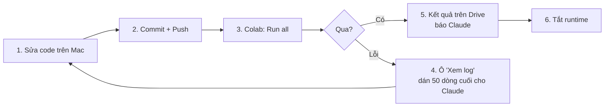

# Quy trình chạy trên Colab

Áp dụng cho mọi bước cần GPU (GĐ2 toy example, GĐ3 zero-shot, GĐ5–6 fine-tune). Cập nhật: 13/11/2026.

## Nguyên tắc

| Thứ | Ở đâu | Ai sửa |
|---|---|---|
| Code, notebook | Mac → GitHub (`beebapcay/orpheus-voice`, private) | Sửa trên VS Code, **không sửa trên Colab** |
| Chạy việc dài (cài môi trường, chấm điểm, huấn luyện) | Notebook trên **trình duyệt** | Bạn bấm chạy |
| Checkpoint, dữ liệu tải về | Drive `MyDrive/orpheus/cache/` | Notebook tự tải, dùng lại giữa các phiên |
| Kết quả mỗi lần chạy | Drive `MyDrive/orpheus/runs/<tên>_<thời gian>/` | Notebook tự lưu |
| **Bằng chứng mỗi lần chạy** | `results/runs/colab-<tên>-<YYYYMMDD>/` trong git (bước 5) | Bạn tải về từ Drive, Claude sắp xếp và commit. **Bắt buộc** |
| Gỡ lỗi | Claude đọc lỗi bạn dán vào, sửa code trên Mac | |

**Vì sao không dùng Colab CLI cho việc dài:** ngày 13/11, kết nối từ Mac tới máy Colab bị reset hoặc treo 5 lần trong khoảng 25 phút, và máy T4 bị thu hồi giữa chừng. CLI chỉ nên dùng cho việc ngắn (dưới vài phút): kiểm tra GPU, chạy thử một lệnh. Mỗi lệnh `colab` phải chạy ngoài sandbox của Claude Code.

**Một GPU mỗi lúc:** tài khoản miễn phí chỉ được một máy GPU. Trước khi mở phiên mới, tắt phiên cũ (Runtime → Disconnect and delete runtime). Không chạy CLI và trình duyệt cùng lúc.

## Vòng làm việc

### Bước 1–2. Sửa và đẩy code (Mac)
1. Claude sửa file trong `src/` hoặc `colab/`.
2. VS Code → **Source Control** (Ctrl+Shift+G) → nhập nội dung commit → **Commit** → **Sync Changes**.

### Bước 3. Chạy trên Colab (trình duyệt)
1. [colab.research.google.com](https://colab.research.google.com) → File → Open notebook → tab **GitHub** → `beebapcay/orpheus-voice` → notebook cần chạy.
   - Nếu notebook đã được sửa: đóng tab cũ và mở lại từ GitHub để lấy bản mới. Nếu chỉ `src/` thay đổi thì không cần, vì ô 4 tự pull code mới.
2. Runtime → Change runtime type → **T4 GPU**.
3. **Runtime → Run all**. Cấp quyền Drive và Secret khi được hỏi.
4. Giữ tab mở. Colab miễn phí ngắt khi không tương tác khoảng 90 phút.

### Bước 4. Khi có ô báo lỗi
1. Chạy ô **"Xem log khi có lỗi"** ở cuối notebook.
2. Dán cho Claude: **tên ô bị lỗi** + **toàn bộ phần in ra của ô đó** + **50 dòng log**.
3. **Chưa tắt runtime** nếu Claude cần hỏi thêm: log trên máy mất khi tắt.

Không cần tóm tắt lỗi, dán nguyên văn.

### Bước 5. Khi chạy xong
1. Ô cuối in đường dẫn `MyDrive/orpheus/runs/...`.
2. Báo Claude các con số in ra (GĐ2: EER, cảnh báo nạp trọng số, thời gian cài, `it/s`).
3. **Lưu bằng chứng vào git** (quy ước chung ở mục "Lưu bằng chứng" của `chore/Quy-Trinh-Chay-Kaggle.md`):
   - File → Download → **Download .ipynb** (notebook có cả output các ô), và tải thư mục `MyDrive/orpheus/runs/<tên>_<thời gian>/` từ Drive (bỏ checkpoint, embedding).
   - Đặt vào `results/runs/colab-<tên>-<YYYYMMDD>-<HHMM>/` (hoặc đưa đường dẫn cho Claude).
   - Claude viết `RUN.md` (commit code lúc chạy, GPU, thời gian, kết quả, ghi chú), thêm vào `results/runs/README.md`, rồi commit.

**Đã có:** 2 lần chạy toy example ở GĐ2 (13/11): `results/runs/colab-gd2-toy-20261113-0848/` (lỗi) và `results/runs/colab-gd2-toy-20261113-0909/` (qua, EER 6,11%). Thiếu notebook `.ipynb` kèm output; không bắt buộc vì log đã đủ.

### Bước 6. Tắt máy
**Runtime → Disconnect and delete runtime.** Đóng tab không đủ, máy vẫn chạy và tính quota.

## Lỗi thường gặp

| Hiện tượng | Xử lý |
|---|---|
| Ô 2: "Chưa bật GPU" | Runtime → Change runtime type → T4 → Restart session |
| "Cannot connect to GPU backend" | Hết quota tạm thời, hoặc còn phiên GPU khác đang mở. Tắt phiên cũ (Runtime → Manage sessions → Terminate) hoặc chờ vài giờ |
| Ô 4: `Authentication failed` | Kiểm tra Secret `GITHUB_TOKEN`, công tắc *Notebook access*, token còn hạn |
| Ô 3: lỗi nạp Drive | Chạy lại ô 3, tích đủ quyền |
| Mất kết nối giữa chừng | Run all lại; script bỏ qua bước đã xong |
| Script in `LỖI ở dòng ...` | Bước 4 |

## Lịch sử lỗi đã sửa

| Ngày | Lỗi | Sửa |
|---|---|---|
| 13/11 | `module 'fairseq' has no attribute '__version__'`: kiểm tra "đã cài" chạy trong thư mục chứa bản clone fairseq, nên bước cài fairseq bị bỏ qua | Kiểm tra từ thư mục `/`, kiểm tra `fairseq.models.wav2vec`; cài lại gói cố định sau fairseq |
| 13/11 | Lỗi `pip` không báo ở bước nào | Script in `LỖI ở dòng ...` kèm lệnh; dự phòng `--no-build-isolation` khi build fairseq lỗi |
| 13/11 | Ô 4: `REPO_URL` còn chỗ trống, và token bị in ra trong thông báo lỗi git | Điền `beebapcay`; token truyền qua biến môi trường của git, lỗi được che token |
| 13/11 | `LỖI: cài fairseq thất bại` dù `pip install` thành công: fairseq dùng `np.float` (bị xoá từ numpy 1.24), nên chỉ import được sau khi numpy về 1.21.2 | Kiểm tra "đã cài" bằng `pip show`; chỉ thử `import` sau bước cài gói cố định, lỗi thì in traceback |
