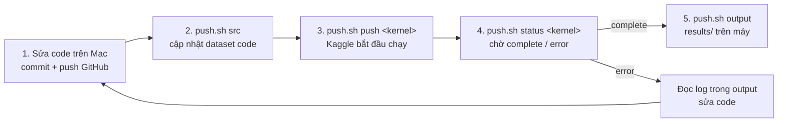

# Quy trình chạy trên Kaggle

Áp dụng từ GĐ3. Colab vẫn dùng được (`chore/Quy-Trinh-Chay-Colab.md`), nhưng Kaggle cho 2 GPU T4, phiên 12 giờ chạy nền, và điều khiển được từ máy. Cập nhật: 13/11/2026.

## Nguyên tắc

| Thứ | Ở đâu | Ai làm |
|---|---|---|
| Code | Mac → GitHub; đồng thời đóng gói thành dataset riêng tư `<user>/orpheus-src` | Claude (`push.sh src`) |
| Dữ liệu kiểm tra | Output của kernel `orpheus-prep` (CPU, không tốn quota GPU) | Claude đẩy kernel, Kaggle tự chạy |
| Chấm điểm, huấn luyện | Kernel GPU (`orpheus-zeroshot`, sau này kernel fine-tune) | Claude đẩy kernel, Kaggle tự chạy |
| Kết quả | Output kernel → `results/` trên máy; điểm và độ đo commit lên git | Claude (`push.sh output`) |
| Token Kaggle | `~/.kaggle/kaggle.json` trên máy | **Người dùng** đặt; Claude không đọc file này |

Dataset và kernel đều để riêng tư. Checkpoint AntiDeepfake (CC BY-NC-SA 4.0) chỉ tải vào máy Kaggle trong lúc chạy, không đưa lên dataset.

## Cài đặt một lần (người dùng)

1. `uv tool install kaggle` (hoặc `pip install --user kaggle`), kiểm tra `kaggle --version`.
2. Kaggle → Settings → API → **Create New Token** → đặt file vào `~/.kaggle/kaggle.json` → `chmod 600 ~/.kaggle/kaggle.json`.
3. Xác minh số điện thoại (cần cho internet và GPU trong kernel).

## Vòng làm việc

| Lệnh | Làm gì |
|---|---|
| `bash kaggle/push.sh src` | Đóng gói `src/*.py`, `src/*.sh`, `protocols/ids/*`, file `VERSION` (commit git) thành dataset `orpheus-src` |
| `bash kaggle/push.sh push prep` | Đẩy kernel chuẩn bị dữ liệu (chỉ cần chạy lại khi đổi danh sách câu) |
| `bash kaggle/push.sh push zeroshot` | Đẩy kernel chấm điểm; danh sách job ở biến `JOBS` trong `kaggle/zeroshot/run.py` |
| `bash kaggle/push.sh status <kernel>` | `running`, `complete`, `error` |
| `bash kaggle/push.sh output zeroshot` | Tải output về `results/kaggle-raw/`, chép phần cần lưu vào `results/zeroshot/` |

Mỗi kernel in ra `VERSION` của dataset code ở đầu log, để biết đang chạy đúng bản nào.

## Giới hạn cần nhớ

| Giới hạn | Giá trị | Ghi chú |
|---|---|---|
| Thời gian một phiên | 12 giờ | Đặt số job mỗi lần dưới ~9 giờ |
| Quota GPU | Thường báo ~30 giờ/tuần | Xem trên tài khoản; chưa kiểm tra |
| `/kaggle/working` | ~20 GB, giữ lại sau phiên | Không để checkpoint ở đây |
| Ổ tạm (`/tmp`) | In ra ở đầu log (`df -h`) | Mất khi hết phiên |
| RAM | In ra ở đầu log (`free -g`) | Script chấm tự giới hạn khi nạp mô hình lớn |

Các con số trên lấy từ tài liệu thứ cấp, cần đối chiếu với log của lần chạy đầu.

## Khi lỗi

| Hiện tượng | Xử lý |
|---|---|
| `push.sh`: không lấy được username | Kiểm tra `~/.kaggle/kaggle.json` và quyền 600 |
| Kernel báo không có internet / GPU | Chưa xác minh số điện thoại |
| `Không thấy ... trong /kaggle/input` | Dataset `orpheus-src` chưa xử lý xong, hoặc kernel `orpheus-prep` chưa chạy xong |
| Một job `THẤT BẠI` | Các job khác vẫn chạy; xem `results/failures.json` và log shard trong `results/<mô hình>/<tập>/shards/` |
| Hết 12 giờ giữa chừng | Chưa rõ Kaggle có giữ output của phiên bị dừng hay không (chưa kiểm tra). Vì vậy mỗi lần chỉ đặt job vừa ~9 giờ. Nếu output còn: `run.py` tự dùng lại mọi `results/summary.csv` tìm thấy trong `/kaggle/input`, nên gắn output cũ làm input là chạy tiếp được |
