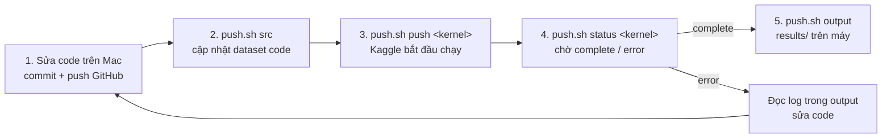

# Quy trình chạy trên Kaggle

Áp dụng từ GĐ3. Colab vẫn dùng được (`chore/Quy-Trinh-Chay-Colab.md`), nhưng Kaggle cho 2 GPU T4, phiên 12 giờ chạy nền, và điều khiển được từ máy. Cập nhật: 13/11/2026.

## Nguyên tắc

| Thứ | Ở đâu | Ai làm |
|---|---|---|
| Code | Mac → GitHub; đồng thời đóng gói thành dataset riêng tư `<user>/orpheus-src` | Claude (`push.sh src`) |
| Dữ liệu kiểm tra | Output của kernel `orpheus-prep` (CPU, không tốn quota GPU) | Claude đẩy kernel, Kaggle tự chạy |
| Chấm điểm, huấn luyện | Kernel GPU (`orpheus-zeroshot`, sau này kernel fine-tune) | Claude đẩy kernel, Kaggle tự chạy |
| Kết quả | Output kernel → `results/` trên máy; điểm và độ đo commit lên git | Claude (`push.sh output`) |
| **Bằng chứng mỗi lần chạy** | `results/runs/<kernel>-v<N>/`, commit lên git (mục "Lưu bằng chứng" dưới đây) | Claude, **bắt buộc** sau mỗi lần chạy |
| Đăng nhập Kaggle | OAuth của CLI (`kaggle auth login`), thông tin lưu sẵn trên máy | **Người dùng** đăng nhập; Claude không đọc token |

Dataset và kernel đều để riêng tư. Checkpoint AntiDeepfake (CC BY-NC-SA 4.0) chỉ tải vào máy Kaggle trong lúc chạy, không đưa lên dataset.

## Cài đặt một lần (người dùng)

1. Cài CLI: `uv tool install kaggle --with six` (gói `kaggle` 2.2.5 thiếu khai báo phụ thuộc `six`). Đã cài trên máy ngày 13/11.
2. Đăng nhập: `kaggle auth login`, xác nhận trên trình duyệt. CLI 2.x không còn dùng `kaggle.json`; cách khác là tạo token ở Settings → API rồi lưu vào `~/.kaggle/access_token`.
3. Xác minh số điện thoại trên Kaggle (cần cho internet và GPU trong kernel).
4. Kiểm tra: `kaggle config view` (có username) và `bash kaggle/push.sh quota`.

## Vòng làm việc

| Lệnh | Làm gì |
|---|---|
| `bash kaggle/push.sh src` | Đóng gói `src/*.py`, `src/*.sh`, `protocols/ids/*`, file `VERSION` (commit git) thành dataset `orpheus-src` |
| `bash kaggle/push.sh push prep` | Đẩy kernel chuẩn bị dữ liệu (chỉ cần chạy lại khi đổi danh sách câu) |
| `bash kaggle/push.sh push zeroshot` | Đẩy kernel chấm điểm; danh sách job ở biến `JOBS` trong `kaggle/zeroshot/run.py` |
| `bash kaggle/push.sh status <kernel>` | `running`, `complete`, `error` |
| `bash kaggle/push.sh logs <kernel> [-f]` | Xem log (`-f`: theo dõi trực tiếp), không phải tải output |
| `bash kaggle/push.sh quota` | Quota GPU còn lại |
| `bash kaggle/push.sh output zeroshot N` | Tải output của version N về `results/kaggle-raw/orpheus-zeroshot-vN/` (có embedding, không commit); lưu bằng chứng vào `results/runs/orpheus-zeroshot-vN/`; chép điểm, độ đo vào `results/zeroshot/` và gộp `summary.csv` |
| `bash kaggle/push.sh archive-log prep N` | Chỉ lưu log và `RUN.md` của version N vào `results/runs/` (không tải output; dùng cho prep vì output ~10 GB) |

Mỗi kernel in ra `VERSION` của dataset code ở đầu log, để biết đang chạy đúng bản nào.

## Lưu bằng chứng các lần chạy (bắt buộc)

Mọi lần chạy GPU, kể cả lần lỗi, đều phải để lại bằng chứng **trong git**. Bằng chứng này dùng để viết báo cáo, trả lời vấn đáp ("số này lấy ở đâu, chạy thế nào"), và tái hiện về sau. Kết quả chỉ nằm trên Kaggle hoặc trong `results/kaggle-raw/` thì coi như chưa lưu.

**Mỗi lần chạy = một thư mục `results/runs/<kernel>-v<N>/`**, với N là số version trên Kaggle (in ra lúc đẩy: `Kernel version N successfully pushed`).

| File | Nội dung | Ai tạo |
|---|---|---|
| `run.py`, `kernel-metadata.json` | Code notebook và cấu hình máy, đúng bản đã đẩy | `push.sh push` tự tạo |
| `pushed.json` | Giờ đẩy, commit git lúc đẩy | `push.sh push` |
| `kernel.log.json`, `kernel.log.txt` | Log đầy đủ (gốc và dạng đọc được) | `push.sh output` / `archive-log` |
| `setup.log`, `versions.txt`, `pip-freeze.txt` | Môi trường thực tế | `push.sh output` |
| `shard_logs/` | Log `main.py` và thời gian từng shard | `push.sh output` |
| `summary.csv`, `quota_after.txt` | Kết quả riêng của lần đó, quota còn lại | `push.sh output` |
| `RUN.md` | Thông tin chạy, job, bảng kết quả, dòng log đáng ngại, cách tái hiện; mục **Ghi chú** viết tay | `kaggle/archive_run.py`; Ghi chú do Claude viết |

**Việc phải làm sau mỗi lần chạy:**
1. `bash kaggle/push.sh output zeroshot N` (kernel prep hoặc kernel có output lớn: `archive-log <kernel> N`).
2. Mở `RUN.md`, xem mục "Dòng log đáng chú ý".
3. Viết mục **Ghi chú**: mục đích lần chạy, kiểm chứng có qua không, quota đã dùng, chỗ để output thô (embedding), điều bất thường.
4. Thêm một dòng vào `results/runs/README.md` (mục lục).
5. Ghi kết quả và nhận xét vào file `chore/GD<n>-...md` của giai đoạn, trỏ về thư mục `results/runs/...`.
6. Commit và push.

**Không commit:** embedding, checkpoint, âm thanh (ghi đường dẫn nơi chúng nằm vào Ghi chú). Output thô ở `results/kaggle-raw/<kernel>-v<N>/` trên máy; bản gốc còn trên Kaggle theo từng version (`kaggle kernels output <user>/<kernel>/<N>`).

**Kernel mới** (ví dụ fine-tune ở GĐ5–6): dùng cùng cơ chế. `push.sh push <kernel>` đã lưu bản đẩy cho mọi kernel; phần `output` cần mở rộng cho kernel mới (hiện chỉ nhận `zeroshot`), và nếu kernel ghi checkpoint thì ghi thêm vào `RUN.md` tên, dung lượng và nơi lưu checkpoint.

**Các lần đã lưu:** xem `results/runs/README.md`.

## Giới hạn cần nhớ

| Giới hạn | Giá trị | Ghi chú |
|---|---|---|
| Thời gian một phiên | 12 giờ | Đặt số job mỗi lần dưới ~9 giờ |
| Quota GPU | 30 giờ/tuần, làm mới 00:00 UTC thứ Bảy (7 giờ sáng VN) | `push.sh quota` (đã kiểm 13/11) |
| `/kaggle/working` | ~20 GB, giữ lại sau phiên | Không để checkpoint ở đây |
| Ổ tạm (`/tmp`) | In ra ở đầu log (`df -h`) | Mất khi hết phiên |
| RAM | In ra ở đầu log (`free -g`) | Script chấm tự giới hạn khi nạp mô hình lớn |

Các con số trên lấy từ tài liệu thứ cấp, cần đối chiếu với log của lần chạy đầu.

## Khi lỗi

| Hiện tượng | Xử lý |
|---|---|
| `push.sh`: không lấy được username | Chạy lại `kaggle auth login`, hoặc đặt `export KAGGLE_USERNAME=<tên>` |
| Kernel báo không có internet / GPU | Chưa xác minh số điện thoại |
| `Không thấy ... trong /kaggle/input` | Dataset `orpheus-src` chưa xử lý xong, hoặc kernel `orpheus-prep` chưa chạy xong |
| Một job `THẤT BẠI` | Các job khác vẫn chạy; xem `results/failures.json` và log shard trong `results/<mô hình>/<tập>/shards/` |
| Hết 12 giờ giữa chừng | Chưa rõ Kaggle có giữ output của phiên bị dừng hay không (chưa kiểm tra). Vì vậy mỗi lần chỉ đặt job vừa ~9 giờ. Nếu output còn: `run.py` tự dùng lại mọi `results/summary.csv` tìm thấy trong `/kaggle/input`, nên gắn output cũ làm input là chạy tiếp được |
