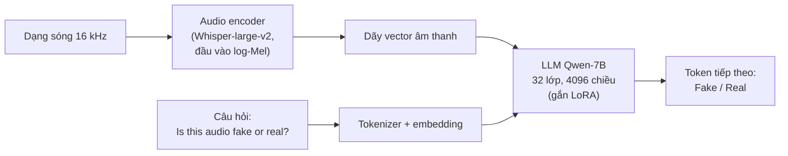

# Audio LLM cho phát hiện tiếng nói giả

**Phạm vi:** dùng mô hình ngôn ngữ lớn có khả năng nghe (Audio LLM) để phân biệt tiếng nói thật và giả. Mô hình đại diện là ALLM4ADD (ACM MM 2025). Mọi số liệu dưới đây là EER (%) trừ khi ghi khác.

## 1. Ý tưởng

Một Audio LLM như Qwen-Audio nhận vào **một đoạn âm thanh và một câu hỏi bằng chữ**, rồi trả lời bằng chữ. Nó đã được huấn luyện cho nhận dạng tiếng nói, mô tả âm thanh, hỏi đáp về âm thanh.

ALLM4ADD đặt bài toán phát hiện thành **hỏi đáp âm thanh**:

| Thành phần | Nội dung |
|---|---|
| Đầu vào | Đoạn âm thanh cần kiểm tra + câu hỏi "Is this audio fake or real?" |
| Đầu ra | Một từ: "Fake" hoặc "Real" |
| Huấn luyện | Fine-tune có giám sát (SFT) với loss mô hình ngôn ngữ: dạy mô hình sinh đúng từ trả lời |

Ý tưởng được mượn từ phát hiện ảnh giả bằng LLM thị giác.

## 2. Kiến trúc

| Khối | Chi tiết | Khi fine-tune |
|---|---|---|
| Audio encoder | Whisper-large-v2 (Qwen-Audio) hoặc v3 (Qwen2-Audio). Đổi dạng sóng thành log-Mel spectrogram rồi thành dãy vector | Hai biến thể: **ALLM4ADD★** giữ băng (frozen), **ALLM4ADD△** cho học (trainable) |
| LLM | Khởi tạo từ Qwen-Audio-Chat, tổng cộng 7,7 tỉ tham số | Giữ băng, chỉ học các ma trận LoRA |
| Định dạng đầu vào | `user: <Audio> [vector âm thanh] </Audio> Is this audio fake or real?` → `assistant: Fake` | |

**Khác với hướng SSL + back-end:** encoder ở đây là Whisper, được huấn luyện cho **nhận dạng tiếng nói** và nhận log-Mel. Các front-end SSL như wav2vec 2.0 nhận thẳng dạng sóng.

### LoRA

Fine-tune toàn bộ 7,7 tỉ tham số quá tốn. LoRA giữ nguyên ma trận gốc $W_0 \in \mathbb{R}^{m \times n}$ và chỉ học phần cập nhật dạng tích hai ma trận nhỏ:

$$
\Delta W = \alpha \, W_A W_B, \qquad W_A \in \mathbb{R}^{m \times r},\; W_B \in \mathbb{R}^{r \times n},\; r \ll \min(m, n)
$$

| Thiết lập trong ALLM4ADD | Giá trị |
|---|---|
| Gắn vào | Các phép chiếu query, key, value, output của LLM |
| Hạng $r$ | 64 |
| $\alpha$ | 16 |
| Dropout | 0,05 |
| Khởi tạo | $W_A$ ngẫu nhiên Gauss, $W_B$ bằng 0, nên lúc đầu $\Delta W = 0$ và mô hình giữ nguyên hành vi cũ |

**Tính thử:** một ma trận 4096 × 4096 có khoảng 16,8 triệu tham số. Với $r = 64$, LoRA chỉ học $2 \times 4096 \times 64 \approx 524$ nghìn tham số, khoảng 3% ma trận gốc.

### Từ câu trả lời bằng chữ sang điểm số

Để tính EER cần một **điểm số liên tục** cho mỗi đoạn, không chỉ một từ. ALLM4ADD lấy logit của LLM ở vị trí trả lời, chỉ giữ hai giá trị ứng với token "Fake" ($s_f$) và "Real" ($s_r$), rồi softmax trên hai giá trị này:

$$
P(\text{giả}) = \frac{e^{s_f}}{e^{s_f} + e^{s_r}}
$$

Như vậy, khi chấm điểm, mô hình thực chất là **một bộ phân loại hai lớp** đặt trên LLM. Hiệu $s_r - s_f$ là log-odds, dùng được như điểm số của các bộ phát hiện thông thường.

## 3. Audio LLM chưa fine-tune không phát hiện được

Bài thử Qwen-Audio và Qwen2-Audio (bản base và chat) trên tập đánh giá ASVspoof 2019 LA, với 5 cách hỏi khác nhau. Câu trả lời tự do được đổi thành nhãn bằng luật; câu nào không rõ thì nhờ GPT-3.5 phân loại.

| Mô hình | Accuracy trung bình 5 prompt |
|---|---|
| Qwen-Audio-base | 11,34% |
| Qwen-Audio-chat | 10,32% (trả lời "thật" cho **mọi** đoạn, với cả 5 prompt) |
| Qwen2-Audio-base | 13,56% |
| Qwen2-Audio-chat | 11,10% |

Tập đánh giá có 7.355 đoạn thật trên 71.933 đoạn, tức khoảng 10% là thật. Accuracy quanh 10–13% nghĩa là mô hình gần như luôn nói "thật". Nguyên nhân bài nêu: mục tiêu huấn luyện của Audio LLM (hiểu nội dung, nhận dạng tiếng nói) không liên quan đến phát hiện giả.

## 4. Kết quả sau fine-tune

**Dữ liệu:** huấn luyện trên ASVspoof 2019 LA (2.580 thật, 22.800 giả). Để thử khi ít dữ liệu, lấy ngẫu nhiên 1/4, 1/8, 1/16 tập huấn luyện, giữ nguyên tập dev và tập đánh giá. Không dùng tăng cường dữ liệu cho mọi mô hình.

**Cùng miền** (tập đánh giá ASVspoof 2019 LA):

| Mô hình | Toàn bộ tập train | 1/16 tập train | Tăng (điểm %) | Tăng (lần) |
|---|---|---|---|---|
| ALLM4ADD△ (encoder học) | **0,41** | **2,45** | +2,04 | ×6,0 |
| ALLM4ADD★ (encoder băng) | 1,30 | 3,13 | +1,83 | ×2,4 |
| AASIST | 0,83 | 5,54 | +4,71 | ×6,7 |
| wav2vec 2.0 + back-end đơn giản, học cả front-end | 2,09 | 4,73 | +2,64 | ×2,3 |
| HuBERT + back-end đơn giản, học cả front-end | 1,94 | 5,60 | +3,66 | ×2,9 |
| LFCC + LCNN | 3,89 | 10,86 | +6,97 | ×2,8 |
| RawNet2 | 4,32 | 15,05 | +10,73 | ×3,5 |

Hai cột cuối là phép tính từ bảng. Bài nói ALLM4ADD "giảm nhẹ hơn" khi ít dữ liệu. Điều này đúng theo **điểm phần trăm tuyệt đối**, nhưng theo **tỉ lệ** thì ALLM4ADD△ tăng gấp 6 lần, ngang AASIST, còn các mô hình SSL với back-end đơn giản chỉ tăng khoảng 2–3 lần.

**Rất ít dữ liệu:** với 1/128 tập train (178 đoạn giả, 20 đoạn thật), ALLM4ADD△ vẫn có EER dưới 5% và accuracy trên 96%.

**Ngoài miền** (huấn luyện trên ASVspoof 2019 LA, kiểm tra trên In-the-Wild):

| Mô hình | Toàn bộ tập train | 1/16 tập train |
|---|---|---|
| ALLM4ADD△ | **26,99** | **33,20** |
| ALLM4ADD★ | 32,04 | 45,12 |
| HuBERT + back-end đơn giản | 30,54 | 39,93 |
| AASIST | 43,02 | 44,50 |
| Rawformer | 49,22 | 52,46 |
| LFCC + LCNN | 78,42 | 75,05 |

**Các loại giả khác:** trên SceneFake (đổi cảnh âm thanh nền), ALLM4ADD△ đạt 8,14% so với tốt nhất của baseline là 11,38%. Trên EmoFake (đổi cảm xúc) đạt 0,86% so với 1,22%.

## 5. Ablation

| Yếu tố | Kết quả |
|---|---|
| Encoder học hay băng | Cho học tốt hơn: trung bình trên 4 mức dữ liệu, EER thấp hơn 0,81 điểm. Trên In-the-Wild: 32,04% → 26,99% |
| Cách hỏi (5 prompt) | Gần như không ảnh hưởng: 1,30–1,39% khi dùng toàn bộ tập train |
| Hạng LoRA (1 đến 256) | Hạng càng cao EER càng thấp, rõ nhất khi dùng toàn bộ tập train |
| Mô hình khởi tạo | Bản chat tốt hơn bản base: 0,41% so với 1,29% (encoder học, toàn bộ tập train) |

## 6. Đọc kỹ các con số

**Cùng miền rất tốt, ngoài miền vẫn kém.** EER tăng từ 0,41% lên 26,99%, gấp khoảng 66 lần, khi chuyển sang In-the-Wild. ALLM4ADD tốt nhất trong bảng, nhưng mọi mô hình ở đây chỉ học trên ASVspoof 2019 LA và không dùng tăng cường dữ liệu, nên đây là so sánh giữa các mô hình cùng yếu ngoài miền.

**EER trên 50%.** LFCC + LCNN có EER 78,42% trên In-the-Wild, tức thứ tự điểm bị đảo: mô hình có hệ thống cho đoạn giả điểm cao hơn đoạn thật.

**Lý do bài dùng thêm accuracy không đứng vững.** Bài cho rằng tập dữ liệu nhiều đoạn giả nên "mô hình có thể đạt EER thấp chỉ bằng cách đoán phần lớn là giả". Thực tế EER không phụ thuộc tỉ lệ thật/giả và không phụ thuộc ngưỡng, nên đoán "giả" cho tất cả không làm EER thấp. Accuracy thì **phụ thuộc** cả hai. Ví dụ bài đưa ra (AASIST có EER 0,83% nhưng accuracy chỉ 95,18%) cho thấy ngưỡng mặc định không hợp với thang điểm của mô hình. Đó là vấn đề hiệu chuẩn, thứ actDCF đo được, không phải điểm yếu của EER.

**Chỗ không khớp trong bài.** Phần lời nói baseline end-to-end tốt nhất trên In-the-Wild là 36,11%, nhưng bảng chỉ có AASIST 43,02% và Rawformer 49,22%. Khi trích, dùng số trong bảng.

**Chưa có phần giải thích.** Dù dùng LLM, đầu ra chỉ là "Fake" hoặc "Real". Việc để mô hình giải thích lý do được bài để cho nghiên cứu sau.

## 7. Ưu và nhược điểm

| Ưu điểm | Nhược điểm |
|---|---|
| Học được từ rất ít dữ liệu: dưới 5% với khoảng 200 đoạn | Nặng: 7,7 tỉ tham số, huấn luyện trên A100 với bfloat16 |
| Một khung chung cho nhiều loại giả (TTS/VC, đổi cảnh nền, đổi cảm xúc) | Ngoài miền vẫn trên 25% |
| Có thể mở rộng sang giải thích bằng lời | Encoder Whisper nhận log-Mel 16 kHz và được huấn luyện cho nhận dạng tiếng nói, không phải để giữ dấu vết sinh |
| Không cần thiết kế back-end riêng | Chỉ thử trên họ Qwen-Audio; khi chấm điểm, thực chất vẫn là phân loại hai lớp |

## 8. Câu hỏi tự kiểm tra

1. Mô hình xuất ra chữ, vậy làm sao tính được EER?
2. Vì sao Qwen-Audio-chat chưa fine-tune có accuracy khoảng 10% trên ASVspoof 2019 LA?
3. ALLM4ADD★ và ALLM4ADD△ khác nhau ở đâu, và khác nhau bao nhiêu trên In-the-Wild?
4. Câu "ALLM4ADD giảm nhẹ hơn khi ít dữ liệu" đúng theo nghĩa nào và sai theo nghĩa nào?
5. Vì sao lập luận "EER thấp có thể do đoán toàn giả" là sai?
