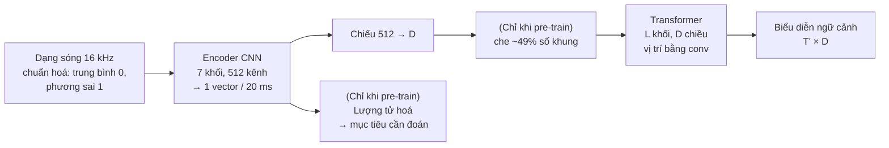
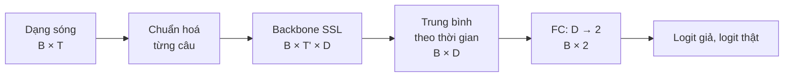

# Backbone tự giám sát: wav2vec 2.0, XLS-R và MMS

**Phạm vi:** các mô hình tự giám sát (SSL) dùng làm front-end trong phát hiện tiếng nói giả. Note giải thích cấu tạo của wav2vec 2.0, cách nó học từ âm thanh không nhãn, hai bản mở rộng đa ngôn ngữ (XLS-R, MMS), và cách gắn backbone vào một bộ phân loại thật/giả. Bài nền: wav2vec 2.0 (NeurIPS 2020), XLS-R (Interspeech 2022, bản arXiv 2111.09296), MMS (arXiv 2305.13516).

## 1. Tự giám sát là gì

Dữ liệu có nhãn đắt, âm thanh không nhãn thì rất nhiều. **Tự giám sát** tạo ra nhãn từ chính dữ liệu: che một phần tín hiệu, bắt mô hình đoán phần bị che từ phần còn lại. Để đoán được, mô hình phải hiểu cấu trúc của tiếng nói.

Quy trình hai bước:

| Bước | Dữ liệu | Học gì |
|---|---|---|
| Pre-training | Hàng chục đến hàng trăm nghìn giờ, không nhãn | Biểu diễn chung của tiếng nói |
| Fine-tune | Ít dữ liệu có nhãn của bài toán đích | Thêm một lớp đầu ra, chỉnh cả mô hình cho bài toán |

**Ví dụ:** wav2vec 2.0 LARGE pre-train trên 53.200 giờ không nhãn, fine-tune chỉ với **10 phút** có nhãn (48 câu, trung bình 12,5 giây) đã đạt WER 4,8% / 8,2% trên LibriSpeech test-clean / test-other (WER: tỉ lệ lỗi từ, thấp hơn là tốt hơn).

## 2. Kiến trúc wav2vec 2.0

### 2.1. Encoder CNN

| Khối | 1 | 2 | 3 | 4 | 5 | 6 | 7 |
|---|---|---|---|---|---|---|---|
| Kernel | 10 | 3 | 3 | 3 | 3 | 2 | 2 |
| Stride | 5 | 2 | 2 | 2 | 2 | 2 | 2 |

- Tổng stride: 5 × 2⁶ = **320 mẫu = 20 ms** ở 16 kHz, tức khoảng **49 vector mỗi giây**.
- Mỗi vector "nhìn" **400 mẫu = 25 ms** âm thanh.
- So với STFT: giống chia khung 25 ms, bước 20 ms, nhưng bộ lọc được **học từ dữ liệu** thay vì cố định là Fourier.

**Số khung đầu ra:** áp dụng lần lượt $L \leftarrow \lfloor (L - k)/s \rfloor + 1$ cho 7 khối.

| Độ dài vào | Số mẫu | Số khung |
|---|---|---|
| 1 giây | 16.000 | 49 |
| 4 giây | 64.000 | 199 |
| ~4 giây | 64.600 | 201 |
| 10 giây | 160.000 | 499 |

### 2.2. Transformer

- Không dùng vị trí tuyệt đối. Một lớp **conv** (kernel 128, 16 nhóm) trên dãy vector đóng vai mã hoá vị trí tương đối, cộng vào đầu vào.
- Mỗi khối gồm self-attention và mạng feed-forward (FFN), như BERT. Self-attention cho mỗi khung nhìn **toàn bộ câu**.
- Đầu ra: mỗi khung 20 ms có một vector $D$ chiều, mang thông tin của cả câu xung quanh.

## 3. Pre-training: học bằng cách đoán phần bị che

### 3.1. Che

Chọn ngẫu nhiên $p = 0{,}065$ số khung làm điểm bắt đầu, che $M = 10$ khung liên tiếp từ mỗi điểm. Các đoạn có thể chồng nhau, nên tổng cộng khoảng **49%** số khung bị che, mỗi đoạn trung bình **299 ms**. Khung bị che được thay bằng một vector học được, dùng chung.

### 3.2. Mục tiêu: chọn đúng giữa 101 ứng viên

Đầu ra CNN (trước khi che) được **lượng tử hoá**: chọn 1 trong 320 mục ở mỗi bảng mã, 2 bảng mã, ghép lại. Tối đa 320 × 320 = **102.400** "đơn vị âm" rời rạc.

Với mỗi khung bị che $t$, mô hình có vector ngữ cảnh $c_t$ và phải chỉ ra vector lượng tử đúng $q_t$ giữa $K = 100$ vector nhiễu lấy từ các khung bị che khác trong cùng câu:

$$
\mathcal{L}_m = -\log \frac{\exp(\text{sim}(c_t, q_t)/\kappa)}{\sum_{\tilde q \in Q_t} \exp(\text{sim}(c_t, \tilde q)/\kappa)}, \qquad \kappa = 0{,}1
$$

$\text{sim}$ là cosine similarity. Nói đơn giản: **đây là bài trắc nghiệm 101 lựa chọn** cho mỗi khung bị che. Thêm một loss phụ (trọng số 0,1) buộc mô hình dùng đều các mục trong bảng mã, tránh dồn vào vài mục.

### 3.3. Vì sao mục tiêu là bản lượng tử, không phải vector gốc

Bài làm ablation (WER trung bình 3 seed, thấp hơn là tốt hơn):

| Đầu vào Transformer | Mục tiêu cần đoán | WER |
|---|---|---|
| Liên tục | Lượng tử (**chọn**) | **7,97** |
| Liên tục | Liên tục | 8,58 |
| Lượng tử | Liên tục | 11,18 |
| Lượng tử | Lượng tử | 12,18 |

Tác giả giải thích: mục tiêu liên tục mang cả **chi tiết của người nói và nền âm**, làm bài đoán dễ đi (độ chính xác khi luyện tăng từ 62% lên 78%) nhưng biểu diễn kém tổng quát cho nhận dạng tiếng nói.

**Hệ quả cho phát hiện giả (suy luận, bài không nói):** pre-training được thiết kế để **bỏ qua** đúng những chi tiết nhỏ không thuộc về nội dung, trong khi dấu vết của tiếng nói giả thường nằm ở đó. Đây là một lý do backbone SSL cần thêm pha huấn luyện có nhãn thật/giả, thay vì dùng nguyên.

### 3.4. Fine-tune cho nhận dạng tiếng nói (cách làm gốc)

- Thêm một lớp tuyến tính khởi tạo ngẫu nhiên trên Transformer, học bằng CTC.
- **Encoder CNN giữ băng** (không cập nhật) suốt quá trình fine-tune.
- 10.000 bước đầu chỉ học lớp đầu ra, sau đó mới học cả Transformer.
- Learning rate cỡ $10^{-5}$ đến $10^{-4}$.

## 4. Hai kích thước gốc: BASE và LARGE

| | BASE | LARGE |
|---|---|---|
| Số khối Transformer | 12 | 24 |
| Số chiều $D$ | 768 | 1.024 |
| FFN | 3.072 | 4.096 |
| Đầu attention | 8 theo bài, 12 trong checkpoint công khai | 16 |
| Tham số | 95M | 317M |
| Dữ liệu pre-train trong bài | LibriSpeech 960 giờ | LibriSpeech 960 giờ hoặc LibriVox 53.200 giờ |

**Hai bản không chỉ khác kích thước.** Bản BASE huấn luyện trên LibriSpeech dùng một encoder hơi khác:

| Chi tiết | BASE (LibriSpeech) | LARGE và các bản đa ngôn ngữ |
|---|---|---|
| Chuẩn hoá dạng sóng đầu vào khi pre-train | Không | Có |
| Chuẩn hoá trong CNN | Chỉ chuẩn hoá đầu ra khối 1 (group norm) | Layer norm ở mọi khối |
| Vị trí layer norm trong Transformer | Sau mỗi khối con (post-LN) | Trước mỗi khối con (pre-LN) |
| Gradient vào CNN | Nhân 0,1 | Giữ nguyên |
| Dropout, layerdrop trong cấu hình lưu kèm checkpoint | Dropout 0,1; layerdrop 0,05 | Bản LARGE "robust", MMS, XLS-R: 0 |

**Layerdrop** là bỏ ngẫu nhiên nguyên một khối Transformer trong mỗi bước huấn luyện. Ví dụ: 12 khối, layerdrop 0,05, nên trung bình mỗi bước bỏ 0,6 khối. **Dropout** là tắt ngẫu nhiên một phần nơ-ron. Cả hai chỉ hoạt động khi huấn luyện, tắt khi chấm điểm, và có tác dụng chống overfit.

Khi so sánh BASE với LARGE trong một thí nghiệm, khác biệt kết quả đến từ **cả kích thước lẫn các chi tiết này**, không chỉ kích thước.

## 5. XLS-R: wav2vec 2.0 cho 128 ngôn ngữ

### 5.1. Dữ liệu

| Kho | Giờ | Ngôn ngữ | Loại |
|---|---|---|---|
| VoxPopuli | 372K | 23 (châu Âu) | Phát biểu ở Nghị viện châu Âu |
| Multilingual LibriSpeech | 50K (44K tiếng Anh) | 8 | Sách nói |
| Common Voice v6.1 | 7K | 60 | Đọc câu Wikipedia |
| VoxLingua107 | 6,6K | 107 | YouTube |
| BABEL | 1K | 17 | Điện thoại hội thoại |
| **Tổng** | **436K** | **128** | |

**Rất lệch:** khoảng 24 ngôn ngữ có trên 1.000 giờ, gần như toàn châu Âu; 88 ngôn ngữ dưới 100 giờ. Tiếng Anh có **69.493 giờ**, **tiếng Việt chỉ 131 giờ** (khoảng 0,03% tổng dữ liệu).

### 5.2. Lấy mẫu cân bằng ngôn ngữ

Nếu lấy theo đúng tỉ lệ dữ liệu, ngôn ngữ ít dữ liệu gần như không xuất hiện. XLS-R lấy mẫu theo:

$$
p_l \propto \left(\frac{n_l}{N}\right)^{\alpha}, \qquad \alpha = 0{,}5
$$

**Ví dụ (đơn giản hoá, bỏ qua bước cân bằng giữa các kho):** tỉ lệ dữ liệu Anh : Việt là 69.493 : 131 ≈ **530 : 1**. Với $\alpha = 0{,}5$, tỉ lệ được lấy mẫu là $\sqrt{530}$ ≈ **23 : 1**. Tiếng Việt được "nghe" nhiều hơn khoảng 23 lần so với lấy tự nhiên, nhưng vẫn ít hơn tiếng Anh rất nhiều.

### 5.3. Các kích thước

| Mô hình | Khối | $D$ | FFN | Tham số |
|---|---|---|---|---|
| XLS-R 0.3B | 24 | 1.024 | 4.096 | 317M |
| XLS-R 1B | 48 | **1.280** (bài ghi 1.024) | 5.120 | 965M |
| XLS-R 2B | 48 | 1.920 | 7.680 | 2.162M |

**Lỗi trong Bảng 2 của bài:** bản 1B được ghi 1.024 chiều và FFN 4.096. Với 48 khối, cấu hình đó chỉ cho khoảng 618M tham số. Muốn đạt 965M thì $D$ phải là 1.280 (cách tính ở mục 8), và cấu hình dùng để nạp checkpoint công khai cũng là 1.280. Bài MMS chép lại cùng lỗi.

### 5.4. Đa ngôn ngữ không miễn phí

Cùng 317M tham số, wav2vec 2.0 chỉ học tiếng Anh **tốt hơn** XLS-R 0.3B trên LibriSpeech ở mọi mức dữ liệu. Tác giả gọi đây là **pha loãng năng lực và giao thoa** giữa các ngôn ngữ: một mô hình cỡ cố định phải chia sức chứa cho 128 ngôn ngữ. Lên 1B thì XLS-R bắt kịp mô hình tiếng Anh.

**Hệ quả khi chọn backbone:** ở cùng kích thước, mô hình đa ngôn ngữ chưa chắc tốt hơn mô hình một ngôn ngữ. Nó có lợi với ngôn ngữ ít dữ liệu, có thể thiệt với ngôn ngữ nhiều dữ liệu.

## 6. MMS: mở rộng lên 1.406 ngôn ngữ

| Đặc điểm | Nội dung |
|---|---|
| Dữ liệu pre-train | Khoảng **491K giờ**, **1.406 ngôn ngữ** |
| Thêm so với XLS-R | MMS-lab-U: 55K giờ, 1.362 ngôn ngữ, là bản ghi **đọc Kinh Tân Ước**; FLEURS; Common Voice v9.0 (89 ngôn ngữ) |
| Giữ lại từ XLS-R | VoxPopuli, MLS, VoxLingua107, BABEL |
| Kiến trúc | Giống hệt XLS-R: 0.3B (317M) và 1B (965M) |
| Cân bằng | Như XLS-R, $\beta_L = \beta_D = 0{,}5$ |

**So với XLS-R** (fine-tune nhận dạng tiếng nói trên 61 ngôn ngữ của FLEURS, CER: tỉ lệ lỗi ký tự, thấp hơn là tốt hơn; giá trị tuyệt đối đọc từ Hình 10, chênh lệch lấy từ lời bài):

| Kích thước | XLS-R | MMS |
|---|---|---|
| 300M | ~17,0 | ~16,4 (tốt hơn 0,6) |
| 1B | ~13,9 | ~13,2 (tốt hơn 0,7) |

- Lợi nhiều nhất ở ngôn ngữ ít dữ liệu (Amharic, Lào, Malayalam).
- Hơi thiệt ở ngôn ngữ nhiều dữ liệu (tiếng Anh, tiếng Tây Ban Nha), cùng hiện tượng pha loãng ở mục 5.4.
- **Tiếng Việt:** MMS tốt hơn XLS-R một chút, chênh dưới 1 điểm CER (đọc từ Hình 11, bản 1B; bài không ghi số chính xác).

**Lưu ý về dữ liệu:** phần mới của MMS phần lớn là **một người đọc một văn bản tôn giáo**, rất hẹp về miền. Số giờ tiếng Việt riêng trong MMS không được công bố.

## 7. Các backbone công khai thường gặp

| Backbone | Khối × chiều | Tham số | Dữ liệu pre-train | Ngôn ngữ |
|---|---|---|---|---|
| wav2vec 2.0 BASE | 12 × 768 | 95M | LibriSpeech 960 giờ | Anh |
| wav2vec 2.0 LARGE (bản "robust") | 24 × 1.024 | 317M | LibriVox 60K + Common Voice + Switchboard + Fisher | Anh |
| MMS-300M | 24 × 1.024 | 317M | 491K giờ | 1.406 |
| XLS-R 0.3B | 24 × 1.024 | 317M | 436K giờ | 128 |
| MMS-1B, XLS-R 1B | 48 × 1.280 | 965M | 491K / 436K giờ | 1.406 / 128 |
| XLS-R 2B | 48 × 1.920 | 2,2B | 436K giờ | 128 |
| HuBERT-XL | 48 × 1.280 | ~1B | LibriLight 60K giờ | Anh |

**Cặp so sánh sạch nhất về ngôn ngữ:** wav2vec 2.0 LARGE và MMS-300M có cùng 24 khối, 1.024 chiều, 317M tham số, cùng pre-LN, chỉ khác dữ liệu pre-train. Cặp BASE – LARGE khác cả kích thước lẫn các chi tiết ở mục 4.

## 8. Số tham số và bộ nhớ

Một khối Transformer có khoảng $12 D^2$ tham số: attention $4D^2$ (ma trận Q, K, V, đầu ra) cộng FFN $2 \cdot D \cdot 4D = 8D^2$.

| Mô hình | Transformer | Conv vị trí | CNN | Tổng tính được | Bài công bố |
|---|---|---|---|---|---|
| BASE (12 × 768) | 85,1M | 4,7M | 4,2M | 94,4M | 95M |
| LARGE (24 × 1.024) | 302,3M | 8,4M | 4,2M | 315,4M | 317M |
| 1B (48 × 1.280) | 944,5M | 13,1M | 4,2M | 962,5M | 965M |
| 1B nếu 48 × 1.024 | 604,6M | 8,4M | 4,2M | 617,7M | không khớp |
| 2B (48 × 1.920) | 2.124,6M | 29,5M | 4,2M | 2.159,2M | 2.162M |

Phần chênh vài triệu còn lại là bộ lượng tử hoá, chỉ dùng khi pre-train.

**Bộ nhớ khi fine-tune toàn bộ với AdamW:** khoảng 16 byte mỗi tham số (trọng số 4, gradient 4, hai trạng thái Adam 8), chưa tính activation. 317M tham số → khoảng 5 GB; 965M → khoảng 15,4 GB. Activation tăng theo độ dài âm thanh và số câu trong batch, nên phải đo thực tế.

## 9. Gắn backbone vào bộ phân loại thật/giả

Cách đơn giản nhất: lấy trung bình theo thời gian rồi qua một lớp fully connected.

| Khối | Kích thước ví dụ (câu 4 giây, $D$ = 1.024) | Tham số |
|---|---|---|
| Dạng sóng | 64.000 mẫu | |
| Backbone | 199 × 1.024 | ~317M |
| Trung bình theo thời gian | 1.024 | 0 |
| FC | 2 | 1.024 × 2 + 2 = 2.050 |

- Gần như toàn bộ tham số nằm trong backbone. Lớp FC chỉ có 2.050 tham số, nên **chất lượng bộ phát hiện phụ thuộc chủ yếu vào biểu diễn của backbone**.
- **Điểm số** nên lấy là hiệu hai logit: $s = z_\text{thật} - z_\text{giả}$ (log-odds). Xác suất softmax của lớp thật là $\sigma(s)$, cùng thứ tự nên cùng EER, nhưng bị dồn sát 0 hoặc 1 khi mô hình tự tin.
- **Chuẩn hoá dạng sóng** (trừ trung bình, chia độ lệch chuẩn của cả câu) làm điểm số không phụ thuộc âm lượng.
- **Khi ghép batch câu dài ngắn khác nhau:** câu ngắn được đệm số 0. Nếu không truyền mặt nạ đệm, các khung đệm cũng được tính vào trung bình. Cách giảm ảnh hưởng: xếp các câu có độ dài gần nhau vào cùng batch.

**So với back-end phức tạp** (AASIST, chọn lớp có trọng số): trung bình + FC chỉ dùng đầu ra của **lớp cuối** và bỏ thứ tự thời gian. Bù lại, ít tham số và ít siêu tham số, nên khi so sánh nhiều backbone thì khác biệt kết quả phản ánh backbone rõ hơn.

## 10. Ưu và nhược điểm của backbone SSL cho phát hiện giả

| Ưu điểm | Nhược điểm |
|---|---|
| Học từ hàng trăm nghìn giờ, nhiều người nói, nhiều điều kiện thu | Mục tiêu pre-train hướng tới nội dung, có xu hướng bỏ qua chi tiết nhỏ nơi dấu vết giả nằm |
| Nhận dạng sóng trực tiếp, không mất thông tin pha như spectrogram biên độ | Nặng: 95M đến 2,2B tham số; bản từ 1B trở lên khó fine-tune trên GPU 16 GB |
| Có sẵn nhiều checkpoint công khai, nhiều ngôn ngữ | Dữ liệu pre-train lệch mạnh về ngôn ngữ châu Âu; ngôn ngữ ít dữ liệu chỉ chiếm phần rất nhỏ |
| Fine-tune được với ít dữ liệu có nhãn | Fine-tune dễ làm quên kiến thức chung (xem note về post-training) |

## 11. Câu hỏi tự kiểm tra

1. Một câu dài 2 giây cho ra bao nhiêu vector ở đầu ra Transformer? Mỗi vector ứng với bao nhiêu ms?
2. Trong pre-training, mô hình phải đoán cái gì cho mỗi khung bị che? Vì sao mục tiêu là bản lượng tử hoá?
3. Vì sao pre-training kiểu wav2vec 2.0 có thể chưa đủ cho phát hiện tiếng nói giả?
4. XLS-R lấy mẫu ngôn ngữ thế nào? Với $\alpha = 0{,}5$, tỉ lệ Anh : Việt là bao nhiêu?
5. MMS khác XLS-R ở đâu? Phần dữ liệu mới của MMS có đặc điểm gì?
6. Vì sao so W2V-Large với MMS-300M "sạch" hơn so W2V-Small với W2V-Large?
7. Vì sao XLS-R 1B không thể có 1.024 chiều nếu có 965M tham số?
8. Trong bộ phân loại "trung bình + FC", lớp FC có bao nhiêu tham số với $D$ = 1.024? Điều đó nói gì về vai trò của backbone?
