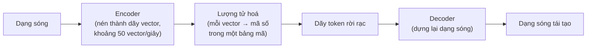
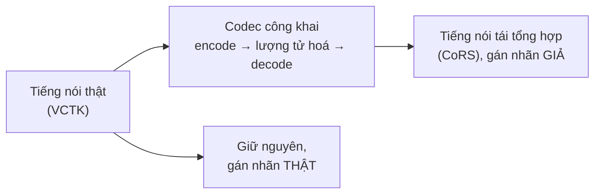

# Tiếng nói giả từ neural codec và truy vết nguồn

**Phạm vi:** thế hệ TTS mới sinh tiếng nói qua neural audio codec. Note này trình bày cách phát hiện loại tiếng nói giả này (CodecFake+, IEEE/ACM TASLP 2026) và cách truy ngược xem nó được sinh bằng loại codec nào (truy vết nguồn, Interspeech 2025). Mọi bảng số liệu là **EER (%), thấp hơn là tốt hơn**, trừ khi ghi khác.

## 1. Neural audio codec là gì

Codec là bộ **nén rồi giải nén** âm thanh. Neural audio codec làm việc này bằng mạng nơ-ron, gồm 3 khối:

**Lượng tử hoá vector (VQ):** có một "bảng mã" (codebook) gồm vài nghìn vector mẫu. Mỗi vector của encoder được thay bằng **số thứ tự** của vector mẫu gần nó nhất. Âm thanh trở thành một dãy số nguyên, giống như văn bản trở thành dãy token.

**Vì sao codec quan trọng với TTS:** khi âm thanh đã thành dãy token, có thể dùng mô hình ngôn ngữ để **sinh token âm thanh** giống như sinh chữ. VALL-E là ví dụ: nhận văn bản và 3 giây giọng mẫu, sinh dãy token EnCodec, rồi đưa qua decoder của EnCodec để ra dạng sóng. Loại hệ thống này gọi là **CoSG** (codec-based speech generation). Tiếng nói giả do CoSG sinh ra gọi là **CodecFake**.

**So với TTS truyền thống** (xem Kiến thức nền, mục 5):

| | TTS truyền thống | CoSG |
|---|---|---|
| Biểu diễn trung gian | Mel-spectrogram (liên tục) | Token codec (rời rạc) |
| Bước cuối dựng dạng sóng | Vocoder (HiFi-GAN, ...) | **Decoder của codec** |
| Ví dụ | Tacotron + HiFi-GAN | VALL-E, NaturalSpeech 3, MaskGCT |

Bộ phát hiện học trên dữ liệu kiểu cũ (ASVspoof 2019, chủ yếu dùng vocoder) có thể không quen dấu vết của decoder codec.

## 2. Ba thuộc tính phân loại codec

CodecFake+ đề xuất phân loại mọi codec theo 3 thuộc tính:

| Thuộc tính | Các loại | Ví dụ |
|---|---|---|
| **Lượng tử hoá** (QUA) | Mvq: nhiều bảng mã nối tiếp, mỗi bảng mã sửa phần sai còn lại của bảng trước | EnCodec, DAC |
| | Svq: một bảng mã duy nhất, ít token hơn | WavTokenizer, BigCodec |
| | Scq: lượng tử hoá từng số vô hướng | SQ-Codec |
| **Mục tiêu phụ** (AUX) khi huấn luyện codec | Sem: ép token mang thông tin ngữ nghĩa (thường nhờ HuBERT) | SpeechTokenizer, Mimi |
| | Disent: tách riêng nội dung, ngữ điệu, âm sắc | FACodec, TiCodec |
| | None: không có | EnCodec |
| **Decoder** (DEC) | Time: tăng độ phân giải trực tiếp trên dạng sóng bằng tích chập chuyển vị | EnCodec, DAC |
| | Freq: dự đoán phổ rồi dùng **STFT ngược** để ra dạng sóng | Vocos, WavTokenizer |

Decoder kiểu Freq làm ngược lại bước STFT trong Kiến thức nền, mục 4: thay vì đi từ dạng sóng sang phổ, nó đi từ phổ (có cả pha) về dạng sóng.

## 3. Ý tưởng chính: tái tổng hợp làm dữ liệu giả thay thế

Hầu hết hệ thống CoSG **không công khai**, nên không tự sinh được dữ liệu giả từ chính chúng để huấn luyện. Cách giải quyết:

**Lý do:** CoSG và CoRS dùng **cùng loại decoder** để dựng dạng sóng, nên để lại dấu vết giống nhau. Ý tưởng này tương tự copy-synthesis với vocoder trước đây.

**Chú ý định nghĩa:** CodecFake+ coi âm thanh đi qua codec là **giả**. ASVspoof 5 thì ngược lại: dùng codec để nén **cả** âm thanh thật lẫn giả, như một kiểu tăng cường dữ liệu. Khi neural codec được dùng để truyền tiếng nói thật (gọi điện, nhắn thoại), bộ phát hiện học theo cách của CodecFake+ có thể coi tiếng thật đã qua codec là giả.

## 4. Dữ liệu CodecFake+

| Phần | Thật | Giả | Ghi chú |
|---|---|---|---|
| CoRS train | 42.965 câu (40,1 giờ) | 42.965 × 31 codec (1.261,6 giờ) | VCTK, tiếng Anh, thu trong phòng thu |
| CoRS validation / evaluation | 735 / 755 câu | × 31 codec | Người nói tách riêng khỏi tập train |
| CoSG evaluation | 850 câu | 931 câu từ **17 hệ thống CoSG** | Tải từ trang demo của các bài báo, đến tháng 2/2025 |
| MaskGCT-VCTK | Như CoRS train | 42.792 câu do MaskGCT sinh | Dùng để so: học trên đúng một hệ thống CoSG thì sao |

Mô hình phát hiện chính: W2V2-AASIST (wav2vec 2.0 + AASIST) với RawBoost.

## 5. Kết quả chính

**Codec nào cho dữ liệu huấn luyện tốt nhất** (mỗi mô hình học trên CoRS của **một** codec, kiểm tra trên CoSG):
- Học trên ASVspoof 2019: 18,9%.
- 6 trên 31 codec cho kết quả tốt hơn ASVspoof 2019. Tốt nhất là Vocos (L1) và FACodec (G), dưới 14%.
- Khó phát hiện nhất là SimpleSpeech 1 và 2: chất lượng cao (UTMOS trên 4,15) và dùng Scq, trong khi phần lớn dữ liệu train dùng Mvq.

**Thuộc tính nào quan trọng:**

| Thuộc tính | Phát hiện |
|---|---|
| Lượng tử hoá | Học và kiểm tra **cùng loại** lượng tử hoá thì tốt, khác loại thì kém |
| Mục tiêu phụ | Học trên codec có Disent tổng quát hoá tốt nhất (trung bình 25,65% so với 31,26–31,36%) |
| Decoder | Học trên codec có decoder Freq tốt hơn. Phân tích phổ phần dư cho thấy decoder và mục tiêu phụ quyết định "hình dạng" dấu vết, còn bitrate chỉ ảnh hưởng độ mạnh |

**Cách chọn dữ liệu huấn luyện** (W2V2-AASIST, EER pooled trên CoSG, trong ngoặc là khoảng tin cậy):

| Dữ liệu huấn luyện | CoSG |
|---|---|
| ASVspoof 2019 | 18,92 (13,89–38,64) |
| ASVspoof 5 | 21,81 |
| **Gộp toàn bộ CoRS của 31 codec** | **khoảng 50** (overfit) |
| CoRS của 3 codec tốt (J, L1, L2) | 14,09 |
| CoRS cân bằng theo loại decoder | 11,91 (6,93–34,01) |
| Như trên, gấp 4 lượng dữ liệu | 10,85 (4,91–35,63) |
| Như trên + ASVspoof 5 | **8,07** (3,32–23,18) |

Bốn bài học:
1. **Gộp hết dữ liệu không tự động tốt hơn.** Gộp 31 codec cho EER khoảng 50%, như đoán bừa. Phải chọn dữ liệu có chủ đích.
2. **Cân bằng theo thuộc tính có ích.** Cân bằng theo decoder cho kết quả tốt nhất trong ba cách cân bằng.
3. **Dữ liệu codec và dữ liệu vocoder bổ sung cho nhau.** Kết hợp với ASVspoof 5 cho EER thấp nhất và khoảng tin cậy hẹp nhất.
4. **Học trên đúng một hệ thống CoSG vẫn overfit.** Học trên MaskGCT sinh từ VCTK: 0% trên MaskGCT-VCTK, nhưng 12,3% trên MaskGCT sinh từ bộ khác (E2), và 23,9% trên toàn bộ CoSG. Mô hình học cả đặc điểm của **nguồn dữ liệu**, không chỉ của hệ thống sinh.

## 6. Truy vết nguồn qua thuộc tính codec

**Bài toán:** không chỉ hỏi "thật hay giả" mà hỏi "giả bằng gì". Thay vì đoán tên hệ thống (không làm được với hệ thống chưa gặp), đoán **thuộc tính** của codec đã dùng: loại lượng tử hoá, loại mục tiêu phụ, loại decoder. Một hệ thống mới vẫn được ghép từ các thuộc tính đã biết.

**Mô hình:** một front-end wav2vec 2.0 (XLS-R 300M) dùng chung, bốn back-end AASIST riêng:

| Back-end | Nhãn |
|---|---|
| Thật/giả | Thật, Giả |
| Lượng tử hoá | Thật, Mvq, Svq, Scq |
| Mục tiêu phụ | Thật, Sem, Disent, None |
| Decoder | Thật, Time, Freq |

Loss tổng là tổng có trọng số của bốn loss. Huấn luyện trên một GPU RTX 4070.

**Kết quả** (F1 %, **cao hơn là tốt hơn**; "ngẫu nhiên" là F1 khi đoán bừa):

| Nhiệm vụ | Codec đã gặp (CoRS) | Hệ thống CoSG, mọi codec | Ngẫu nhiên trên CoSG |
|---|---|---|---|
| Lượng tử hoá | khoảng 96–97 | 35,08–38,78 | 30,79 |
| Mục tiêu phụ | khoảng 96–97 | 15,92–28,18 | 31,04 |
| Decoder | khoảng 96–98 | 10,86–27,26 | 34,37 |

Trên codec đã gặp, truy vết gần như hoàn hảo. Trên hệ thống CoSG thật, đoán mục tiêu phụ và decoder **kém hơn cả đoán bừa**. Bài giải thích bằng hai nguyên nhân: bước sinh token của CoSG làm thay đổi dấu vết, và một số CoSG dùng codec chưa có trong tập train. Ngoài ra, tiếng nói thật ở tập kiểm tra khác nguồn với tập train nên hay bị gán nhầm vào một loại codec.

## 7. Đọc kỹ các con số

**Tập kiểm tra CoSG rất nhỏ.** 931 câu giả cho 17 hệ thống, nhiều hệ thống chỉ có 5–11 câu (ví dụ RALL-E 5 câu, TacoLM 8 câu). EER trên từng hệ thống vì vậy rất dao động: một câu đúng hay sai làm đổi hàng chục điểm phần trăm. Khoảng tin cậy rộng trong bảng (ví dụ 6,93–34,01) phản ánh điều này.

**Tiếng thật ở tập CoSG khác nguồn tiếng thật lúc học.** Tiếng thật lúc học là VCTK. Tiếng thật lúc kiểm tra là câu giọng mẫu lấy từ trang demo, không cùng nội dung với câu giả. Mô hình có thể bị ảnh hưởng bởi khác biệt kho dữ liệu, như đã thấy ở bài truy vết nguồn.

**Dòng "Top-1" trong so sánh CoSG và CoRS** chọn mô hình tốt nhất **riêng cho từng cột của tập kiểm tra**. Đây là mức trần lạc quan, không phải một mô hình dùng được trong thực tế.

**Sai số chuẩn tính trên rất ít mẫu.** Bảng phân tích theo thuộc tính có ô Svq chỉ gồm 6 câu thật và 6 câu giả, cho EER 50%, 0% và 0% ở ba mô hình.

**Chỉ tiếng Anh, thu trong phòng thu.** Bài tự nêu hạn chế này và đề xuất mở rộng sang đa ngôn ngữ, ghi âm có nhiễu, hội thoại tự nhiên.

## 8. Ưu và nhược điểm

| Ưu điểm | Nhược điểm |
|---|---|
| Tạo được dữ liệu huấn luyện quy mô lớn mà không cần hệ thống CoSG thật | Định nghĩa "qua codec là giả" mâu thuẫn với việc dùng codec để truyền tiếng thật |
| Phân loại theo thuộc tính giải thích được vì sao một dữ liệu huấn luyện tốt | Tập kiểm tra CoSG nhỏ, kết quả từng hệ thống kém tin cậy |
| Chỉ ra cách chọn dữ liệu: cân bằng theo decoder, kết hợp với dữ liệu vocoder | Gộp nhiều dữ liệu dễ overfit nếu không chọn lọc |
| Truy vết theo thuộc tính áp dụng được cho hệ thống chưa gặp | Truy vết trên CoSG thật còn kém hơn đoán bừa ở 2/3 nhiệm vụ |

## 9. Câu hỏi tự kiểm tra

1. CoSG khác TTS truyền thống ở bước nào, và vì sao điều đó làm bộ phát hiện cũ kém đi?
2. Vì sao tiếng nói tái tổng hợp qua codec (CoRS) dùng được làm dữ liệu giả thay thế?
3. Gộp CoRS của cả 31 codec cho kết quả thế nào? Rút ra bài học gì về dữ liệu huấn luyện?
4. Học trên đúng hệ thống MaskGCT mà vẫn kém khi kiểm tra MaskGCT sinh từ bộ dữ liệu khác. Vì sao?
5. Truy vết nguồn theo thuộc tính giải quyết vấn đề gì của truy vết theo tên hệ thống? Kết quả trên CoSG thật nói gì?
