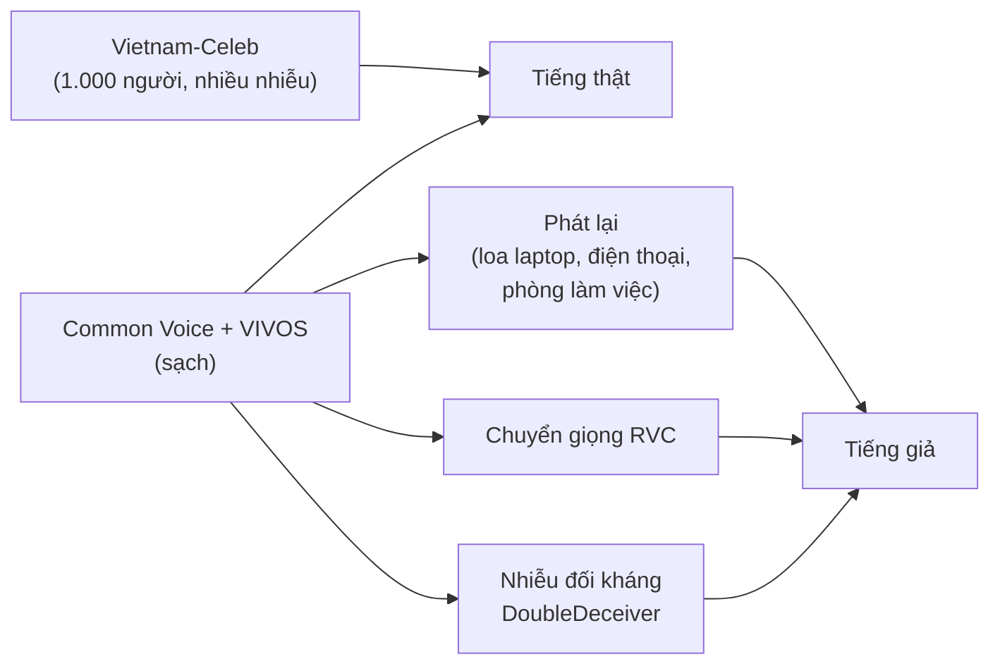

# Phát hiện tiếng nói giả cho tiếng Việt: dữ liệu và kết quả

**Phạm vi:** các bộ dữ liệu tiếng nói giả tiếng Việt, cách chúng được tạo, và các bộ phát hiện hiện có làm được đến đâu trên tiếng Việt. Hai công trình chính là VSASV (Interspeech 2024) và VietPrism (arXiv 2026). Mọi bảng số liệu là **EER (%), thấp hơn là tốt hơn**, trừ khi ghi khác.

## 1. Bức tranh chung

Phần lớn dữ liệu tiếng Việt công khai được làm cho **nhận dạng tiếng nói** (VIVOS, Common Voice, Bud500, GigaSpeech 2, ...). Những bộ này chỉ có cặp âm thanh và văn bản, thường thiếu mã người nói, phương ngữ, và không có tiếng nói giả.

Các bộ có tiếng nói giả tiếng Việt, theo bảng so sánh trong bài VietPrism:

| Bộ dữ liệu | Giờ thật / giả | Số câu thật / giả | Ghi chú |
|---|---|---|---|
| MLAAD (phần tiếng Việt) | – / 10,1 | – / 5K | Chỉ có tiếng giả |
| VSASV (bản công bố) | 199 / 153 | 98K / 123K | Ít hơn số trong bài gốc (xem mục 2) |
| SEA-Spoof (phần tiếng Việt) | 30,5 / 49,1 | 26K / 55K | |
| VietPrism | 993 / 3.190 | 404K / 1,29 triệu | Tiếng giả tính trước khi lọc theo độ giống giọng |

## 2. VSASV: dữ liệu cho xác thực người nói có chống giả mạo

### Mục tiêu

VSASV phục vụ bài toán **SASV** (spoofing-aware speaker verification): hệ thống xác thực người nói phải từ chối cả người khác lẫn giọng giả của đúng người cần xác thực. Đây là bài toán rộng hơn phát hiện thật/giả đơn thuần.

### Cách tạo dữ liệu

| Tấn công | Cách làm | Số giờ | Số người nói |
|---|---|---|---|
| Phát lại (replay) | Phát câu thật qua loa laptop hoặc điện thoại, thu lại bằng chính thiết bị đó; lọc bỏ câu nhiễu nhiều | 30,04 | 46 |
| Chuyển giọng (VC) | RVC fine-tune trên giọng Common Voice và VIVOS; chỉ ghép cặp người nói có giọng gần nhau, chỉ giữ kết quả giống giọng đích | 119,44 | 147 |
| Nhiễu đối kháng (AP) | DoubleDeceiver: lấy giọng **sinh bằng TTS**, rồi cộng nhiễu nhỏ tính từ gradient của bộ xác thực và bộ phát hiện thay thế (ECAPA-TDNN, ResNet34, AASIST, S2pecNet) để đánh lừa cả hai | 35,18 | 317 |

Tổng cộng 541,02 giờ, 1.382 người nói (356,36 giờ thật).

**Về TTS:** VSASV không có nhóm tấn công TTS thuần. TTS chỉ xuất hiện bên trong nhóm nhiễu đối kháng. Nhóm này chỉ có trong tập kiểm tra, và bài không nói dùng hệ thống TTS nào.

**Chia tập:**

| Loại | Train | Test |
|---|---|---|
| Thật | 132.424 | 31.950 |
| VC | 37.292 | 63.272 |
| Phát lại | 23.320 | 34.251 |
| Nhiễu đối kháng | không có | 16.731 |

### Kết quả

Bài đo EER của **cả hệ thống xác thực**, không đo riêng bộ phát hiện:

| Tập kiểm tra | ECAPA-TDNN học trên VoxCeleb2 (tiếng Anh) | ECAPA-TDNN học trên VSASV | ECAPA-TDNN + AASIST |
|---|---|---|---|
| Chỉ tiếng thật | 2,29 | 1,15 | 1,15 |
| Thật + nhiễu đối kháng | 12,87 | 8,96 | 10,31 |
| Thật + VC | 2,60 | 1,07 | 2,24 |
| Thật + phát lại | 20,12 | 15,69 | **2,51** |
| Thật + cả ba | 22,03 | 15,58 | 8,27 |

- Bộ xác thực học trên tiếng Anh kém hẳn trên tiếng Việt.
- Phát lại là tấn công nguy hiểm nhất với bộ xác thực đứng một mình. Thêm AASIST giảm EER từ 15,69% xuống 2,51%.
- Với nhiễu đối kháng, thêm AASIST lại **tệ hơn** (8,96% → 10,31%), vì nhiễu được thiết kế để đánh lừa chính tổ hợp bộ xác thực + bộ phát hiện.

### Đọc kỹ

**Nguy cơ lối tắt do nhiễu nền.** Mọi tiếng giả được tạo từ Common Voice và VIVOS, vốn sạch. Phần lớn tiếng thật lại từ Vietnam-Celeb, thu trên mạng xã hội, SNR chủ yếu 0–20 dB. Bài cũng cho thấy phân bố nhiễu của tiếng giả khác tiếng thật. Mô hình có thể học "sạch hay ồn" thay vì "thật hay giả".

**Thiếu số liệu cho bộ phát hiện riêng.** Bài chỉ báo EER của cả hệ thống SASV, nên không biết AASIST một mình phát hiện tốt đến đâu.

**Mô tả hệ thống không thống nhất.** Phần lời nói hệ thống (a) và (b) có AASIST, nhưng chú thích bảng ghi (a) và (b) chỉ là ECAPA-TDNN. Bài cũng không nói train và test có tách người nói hay không.

**Bản công bố nhỏ hơn bài.** Theo thống kê trong bài VietPrism, bản VSASV công khai có 98K câu thật và 123K câu giả, ít hơn 164K và 174K trong bài gốc.

## 3. VietPrism: dữ liệu lớn có phương ngữ và chêm tiếng Anh

### Dữ liệu

| Mục | Giá trị |
|---|---|
| Tiếng thật | 993,4 giờ, 403.941 câu, 1.262 người nói đã xác minh, từ 8.388 video YouTube |
| Độ dài câu | Trung bình 8,9 giây |
| Phương ngữ (theo thời lượng) | Bắc 50,0%, Nam 46,7%, Trung 2,0%, Tây Nam 0,7%, Việt kiều 0,6% |
| Chêm tiếng Anh | 47,1% thời lượng; trung bình 2,83 từ tiếng Anh mỗi đoạn |
| Hệ thống sinh | MiniMax (thương mại), OmniVoice, Higgs Audio v3, VoxCPM2 (mã nguồn mở) |
| Cặp đối chứng | Mỗi câu giả dùng **cùng nội dung** và **cùng người nói** với một câu thật |

**Cặp đối chứng là điểm mạnh chính.** Câu thật và câu giả chỉ khác nhau ở chỗ thật hay giả, không khác nội dung hay người nói, nên giảm được lối tắt kiểu nội dung hoặc người nói.

**Quy trình xử lý tiếng thật:** chuyển về 16 kHz, chuẩn hoá âm lượng, **khử nhiễu bằng mạng nơ-ron** (ClearerVoice-Studio), rồi dùng Gemini 2.5 Pro để phiên âm và tách đoạn, sau cùng là Montreal Forced Aligner để căn thời gian.

### Kết quả zero-shot

Năm bộ phát hiện đa ngôn ngữ đã huấn luyện sẵn, **không fine-tune**:

| Hệ thống sinh | DF-Arena 1B | DF-Arena 500M | AntiDeepfake W2V2-Large | AntiDeepfake XLS-R-2B | AntiDeepfake MMS-300M |
|---|---|---|---|---|---|
| MiniMax | 13,14 | 16,60 | 47,12 | 56,30 | 52,13 |
| OmniVoice | 10,95 | 15,10 | 0,01 | 0,00 | 50,84 |
| Higgs Audio v3 | 12,74 | 16,48 | 79,97 | 0,02 | 1,35 |
| VoxCPM2 | 34,33 | 38,52 | 0,00 | 0,00 | **99,99** |
| Trung bình | 17,79 | 21,67 | 31,77 | **14,08** | 51,08 |

- **Phụ thuộc mạnh vào hệ thống sinh.** Cùng một mô hình có thể đạt 0% với hệ thống này và gần 100% với hệ thống khác.
- **Độ giống giọng:** giọng giả càng giống giọng thật, DF-Arena 1B càng kém (16,3% → 33,6%). Họ AntiDeepfake ổn định hơn.
- **Phương ngữ:** DF-Arena 1B kém hơn ở Tây Nam (28,7%) và Việt kiều (26,9%) so với Nam (16,6%) và Bắc (18,3%). AntiDeepfake XLS-R-2B gần như không đổi (13,1–14,4%).
- **Chêm tiếng Anh:** MiniMax khó phát hiện hơn khi câu có chêm tiếng Anh, tăng tới 7,1 điểm với DF-Arena 500M.

### Đọc kỹ

**EER 99,99% nghĩa là thứ tự bị đảo gần như hoàn toàn.** Với VoxCPM2, AntiDeepfake MMS-300M cho gần như mọi câu giả điểm "thật" cao hơn mọi câu thật. Nếu đảo dấu điểm, EER sẽ khoảng 0,01%. Tức là mô hình **có tách được** hai nhóm, nhưng theo chiều sai. Bài không bàn về hiện tượng này. Một giả thuyết đáng kiểm tra: tiếng thật đã qua khử nhiễu bằng mạng nơ-ron, nên có thể mang dấu vết xử lý mà bộ phát hiện coi là giả.

**Số liệu không nhất quán trong bài.**
- Tổng thời lượng tiếng giả: tóm tắt ghi hơn 3,1 nghìn giờ, bảng ghi 3.190 giờ (trước khi lọc), kết luận ghi 2.765,74 giờ.
- Số giờ theo phương ngữ trong phần lời (502,5 / 467,3 / 20,0) không khớp bảng (Bắc 496,7, Nam 463,6, Trung 19,8).

**Chỉ có đánh giá zero-shot.** Không có fine-tune hay ablation.

**Bài nói dữ liệu mở** nhưng không ghi đường dẫn tải.

## 4. Những điều rút ra cho tiếng Việt

| Vấn đề | Bằng chứng |
|---|---|
| Thiếu dữ liệu TTS đời mới có kiểm soát | VSASV không có TTS thuần; VietPrism là bộ đầu tiên có cặp đối chứng quy mô lớn |
| Lối tắt do khác nguồn dữ liệu | VSASV: tiếng giả từ kho sạch, tiếng thật chủ yếu từ kho ồn |
| Bộ phát hiện có sẵn không ổn định | Cùng mô hình, EER từ 0% đến gần 100% tuỳ hệ thống sinh |
| Phương ngữ và chêm tiếng Anh ảnh hưởng tới kết quả | Phương ngữ ít dữ liệu và câu chêm tiếng Anh làm một số mô hình kém đi |
| Chiều điểm số phải được kiểm tra | EER trên 50% xuất hiện nhiều lần |

## 5. Câu hỏi tự kiểm tra

1. SASV khác phát hiện thật/giả đơn thuần ở đâu?
2. VSASV có tấn công TTS không? Nếu có thì nằm ở đâu?
3. Vì sao cách lấy nguồn tiếng thật và tiếng giả của VSASV có thể tạo lối tắt?
4. Cặp đối chứng của VietPrism giảm được loại lối tắt nào?
5. EER 99,99% nói gì về khả năng tách hai nhóm của mô hình?
