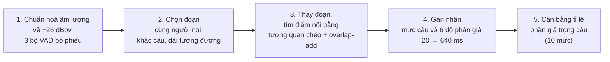
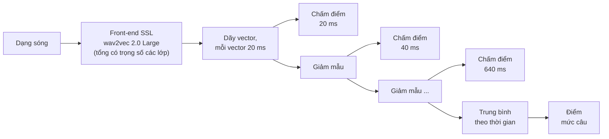

# Giả mạo một phần (Partial Spoof)

**Phạm vi:** kịch bản chỉ một vài đoạn ngắn trong bản ghi thật bị thay bằng tiếng nói sinh ra. Công trình nền tảng là bộ dữ liệu và bộ phát hiện PartialSpoof (IEEE/ACM TASLP 2023). Mọi số liệu dưới đây là EER (%).

## 1. Kịch bản

Trong kịch bản LA và DF, **cả câu** được sinh bằng một hệ thống TTS hoặc VC. Trong kịch bản giả mạo một phần (PS), kẻ tấn công chỉ thay một phần nhỏ:

| Cách tấn công | Ví dụ |
|---|---|
| Chèn một từ | Chèn "không" vào câu thật để đảo nghĩa |
| Thay một từ | Có bản ghi "Search Google" của nạn nhân, thay "Search" bằng "OK" sinh ra để vượt qua hệ thống xác thực theo câu cố định |
| Thay đơn vị nhỏ hơn từ | Thay nguyên âm để đổi "bat" thành "bit", "bot", "but" |

Một câu giả mạo một phần có thể chứa đoạn từ **nhiều** hệ thống sinh khác nhau. Đây là trường hợp riêng của ghép nối (splicing), nhưng đoạn ghép vào là tiếng nói sinh ra chứ không lấy từ bản ghi thật khác.

**Vì sao bộ phát hiện thông thường thất bại:** chúng lấy trung bình đặc trưng theo thời gian rồi mới chấm điểm. Một đoạn giả 0,3 giây trong câu 4 giây gần như không ảnh hưởng tới vector trung bình.

## 2. Hai nhiệm vụ

| Nhiệm vụ | Đầu vào → đầu ra | Ý nghĩa |
|---|---|---|
| Phát hiện mức câu | Dạng sóng → **một** điểm số | Câu có chứa đoạn giả nào không. Giống bài toán LA |
| Phát hiện mức đoạn | Dạng sóng → **dãy** điểm số, mỗi điểm cho một đoạn | Đoạn nào bị giả. Giúp giải thích kết quả |

Mức đoạn khó hơn vì mỗi điểm phải tính từ rất ít tín hiệu, và không biết trước kẻ tấn công thay đơn vị dài bao nhiêu.

## 3. Cách xây dữ liệu

Ý chính: ghép cặp **một câu thật và một câu giả hoàn toàn của cùng người nói**, rồi tráo ngẫu nhiên các đoạn giữa hai câu. Làm cả hai chiều: chèn đoạn giả vào câu thật, và chèn đoạn thật vào câu giả.

| Bước | Vì sao cần |
|---|---|
| Chuẩn hoá âm lượng | Nếu đoạn ghép to hoặc nhỏ hơn hẳn, mô hình chỉ cần nghe chênh âm lượng là đoán đúng, không học dấu vết sinh |
| Đoạn chọn theo VAD, không theo từ | Kẻ tấn công không bị giới hạn ở đơn vị từ |
| Tìm điểm nối tốt | Giảm dấu vết ở chỗ nối, giả định kẻ tấn công chỉ dùng xử lý tín hiệu cơ bản |
| Nhãn nhiều độ phân giải | Một đoạn được gán "giả" nếu chứa **bất kỳ** khung nào được sinh ra |
| Tập train và tập đánh giá dùng hệ thống sinh phần lớn khác nhau | Dựng từ các tập con tương ứng của ASVspoof 2019 LA: train/dev có A01–A06, đánh giá có A07–A19 |

**Quy mô:**

| Tập | Thật | Giả | Số hệ thống sinh tối đa trong một câu |
|---|---|---|---|
| Train | 2.580 (2,43 giờ) | 22.800 (21,82 giờ) | 6 |
| Dev | 2.548 (2,48 giờ) | 22.296 (21,86 giờ) | 6 |
| Đánh giá | 7.355 (6,94 giờ) | 63.882 (60,74 giờ) | 9 |

Độ dài trung bình mỗi câu khoảng 3,4–3,5 giây.

**Tỉ lệ nhãn giả thay đổi theo độ phân giải** (tập đánh giá): 89,68% ở mức câu, 71,19% ở 640 ms, 38,46% ở 20 ms. Đoạn càng ngắn càng ít khả năng chứa phần sinh ra, nên mức câu lệch hẳn về "giả" còn mức khung gần cân bằng.

**Hạn chế bài tự nêu:** đoạn được thay không xét nghĩa câu hay âm vị xung quanh. Dữ liệu là xấp xỉ của tấn công thật, không phải câu được dựng để lừa người nghe.

## 4. Bộ phát hiện đề xuất

| Thành phần | Chi tiết |
|---|---|
| Front-end | Mô hình SSL. Lấy đầu ra **mọi** khối Transformer, cộng có trọng số học được. Fine-tune cùng back-end. Cứ 320 mẫu (20 ms ở 16 kHz) cho ra một vector |
| Khối chấm điểm | 5 khối gMLP (MLP có cổng). Mỗi độ phân giải có một khối riêng |
| Giảm mẫu | Đi từ mịn đến thô: 20 → 40 → ... → 640 ms, rồi lấy trung bình cho mức câu |
| Huấn luyện | Dùng đồng thời nhãn của mọi độ phân giải và nhãn câu. Loss P2SGrad. Không tăng cường dữ liệu. Mỗi cấu hình chạy 3 seed, báo trung bình |

**Chọn thành phần** (EER mức câu trên tập dev, chỉ dùng nhãn câu):

| So sánh back-end (front-end wav2vec 2.0 Base) | EER | So sánh front-end (back-end 5 gMLP) | EER |
|---|---|---|---|
| 1 lớp FC | 2,89 | wav2vec 2.0 Base (95M, LibriSpeech) | 2,22 |
| 2 BLSTM + FC | 2,49 | **wav2vec 2.0 Large** (317M) | **0,35** |
| 1 gMLP | 4,28 | XLS-R (317M, đa ngôn ngữ) | 0,65 |
| **5 gMLP** | **2,22** | WavLM Large (317M) | 0,64 |

## 5. Kết quả

**So với các bộ phát hiện trước** (tập đánh giá; các bộ trước dùng LFCC hoặc CQCC với LCNN và chỉ làm được một hoặc hai độ phân giải):

| Độ phân giải | 20 ms | 40 ms | 80 ms | 160 ms | 320 ms | 640 ms | Câu |
|---|---|---|---|---|---|---|---|
| Tốt nhất trước đây | | | | 15,93 | | | 5,66 |
| Đề xuất | 12,84 | 11,94 | 10,92 | 9,24 | 6,34 | 5,19 | **0,49** |

Đoạn càng ngắn càng khó, nhưng ở 20 ms (một khung) EER vẫn khoảng 13%.

**Huấn luyện một độ phân giải hay nhiều độ phân giải:**
- Phát hiện mức đoạn: mô hình học riêng đúng độ phân giải cần dùng thì tốt hơn mô hình học chung, trừ ở 640 ms.
- Phát hiện mức câu: học chung nhiều độ phân giải thì tốt hơn. Thông tin mịn giúp quyết định thô.

**Chéo kịch bản** (EER mức câu trên tập đánh giá):

| Huấn luyện trên | Kiểm tra LA (giả cả câu) | Kiểm tra PS (giả một phần) |
|---|---|---|
| ASVspoof 2019 LA, nhãn câu | 0,83 | 14,19 |
| PartialSpoof, nhãn câu | **0,77** | 0,64 |
| PartialSpoof, mọi độ phân giải | 0,90 | **0,49** |

Mô hình học trên câu giả hoàn toàn không phát hiện tốt câu giả một phần. Chiều ngược lại thì vẫn tốt.

## 6. Vì sao tập đánh giá khó hơn tập dev

Bài kiểm tra hai giả thuyết:

| Giả thuyết | Cách kiểm tra | Kết quả |
|---|---|---|
| Tập đánh giá có hệ thống sinh khó hơn | Bỏ lần lượt các câu chứa đoạn của từng hệ thống, xem EER đổi bao nhiêu | Bỏ A15 (VC dùng giọng TTS làm nguồn, vocoder WaveNet) làm EER giảm mạnh nhất. Nhưng bỏ A15 rồi vẫn kém hơn dev |
| Đoạn không có chỗ nối khó hơn | Chia EER theo số điểm nối nằm trong đoạn | Trên tập đánh giá, đoạn **không có điểm nối nào** có EER tăng mạnh ở 20–160 ms. Tập dev ít bị ảnh hưởng |

**Ý nghĩa:** mô hình dựa một phần vào **dấu vết ở chỗ nối**, không chỉ vào dấu vết của hệ thống sinh. Với hệ thống sinh đã gặp, dấu vết sinh đủ để nhận ra. Với hệ thống chưa gặp, nếu đoạn không chứa chỗ nối, mô hình dễ sai. Một mô hình học trên dữ liệu ghép nối có thể học "phát hiện chỗ nối" thay vì "phát hiện tiếng nói sinh ra".

## 7. Đọc kỹ các con số

**Số trong phần tóm tắt không khớp bảng.** Tóm tắt ghi EER mức câu 0,77% trên PartialSpoof và 0,90% trên ASVspoof 2019 LA. Theo bảng chéo kịch bản, 0,77% là kết quả **trên LA** của mô hình học bằng nhãn câu, còn mô hình nhiều độ phân giải đạt 0,49% trên PartialSpoof và 0,90% trên LA. Phần kết luận cũng ghi 0,77% là kết quả trên LA. Khi trích, dùng số trong bảng.

**Dữ liệu đã cũ.** Mọi đoạn giả lấy từ ASVspoof 2019 LA (tiếng Anh, các hệ thống TTS/VC trước 2019). Các công cụ chỉnh sửa tiếng nói bằng mô hình neural đời mới không có trong dữ liệu.

## 8. Ưu và nhược điểm

| Ưu điểm | Nhược điểm |
|---|---|
| Sát với lừa đảo thực tế: chỉ đổi vài từ là đổi nghĩa | Cần nhãn theo đoạn, tốn công tạo dữ liệu |
| Một mô hình cho cả mức câu và mức đoạn ở 6 độ phân giải | Đoạn ngắn vẫn khó: 13% ở 20 ms |
| Kết quả mức đoạn giải thích được câu bị sửa ở đâu | Mô hình phụ thuộc dấu vết chỗ nối |
| Học trên dữ liệu giả một phần vẫn tốt với giả cả câu | Dữ liệu ghép không xét nghĩa, chỉ có tiếng Anh và hệ thống sinh cũ |

## 9. Câu hỏi tự kiểm tra

1. Vì sao bộ phát hiện lấy trung bình theo thời gian khó nhận ra một đoạn giả ngắn?
2. Vì sao phải chuẩn hoá âm lượng trước khi ghép đoạn?
3. Vì sao tỉ lệ nhãn giả giảm từ khoảng 90% ở mức câu xuống khoảng 38% ở 20 ms?
4. Muốn phát hiện mức đoạn ở 160 ms thì nên huấn luyện thế nào? Muốn phát hiện mức câu thì sao?
5. Kết quả phân tích theo số điểm nối nói gì về điều mô hình thực sự học?
