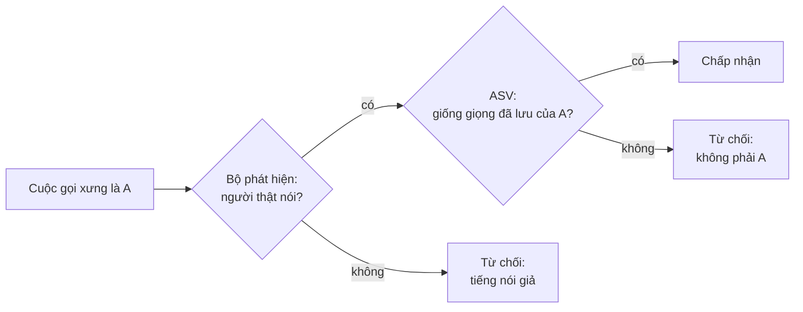
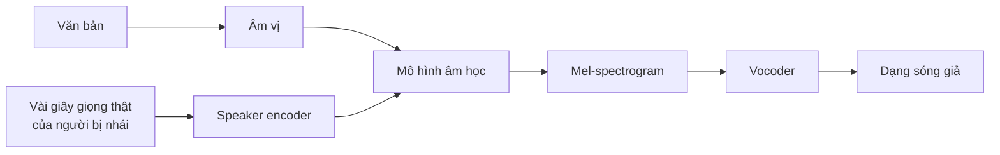

# Kiến thức nền: từ tín hiệu đến đánh giá bộ phát hiện

**Phạm vi:** các kiến thức cần có trước khi đọc các mô hình phát hiện tiếng nói giả như wav2vec 2.0 hay XLS-R. Gồm tín hiệu, Fourier, STFT, spectrogram, cách sinh tiếng nói giả, EER, minDCF, actDCF, LLR, front-end/back-end và bài toán tổng quát hoá. Các ví dụ ghi "minh hoạ" dùng số tự đặt để giải thích.

## 1. Bài toán

Một hệ thống **ASV** (automatic speaker verification, xác thực người nói) chỉ trả lời câu hỏi "giọng này có giống giọng đã lưu của A không". Giọng nhái được làm ra chính để giống A, nên ASV có thể chấp nhận nó. **Bộ phát hiện** (countermeasure) được đặt trước ASV để trả lời một câu hỏi khác: đoạn này có phải người thật nói không.

| Thuật ngữ ASVspoof | Nghĩa |
|---|---|
| Bona fide | Tiếng nói thật, do chính người nói phát ra và được thu trực tiếp |
| Spoof | Tiếng nói giả, do máy sinh ra, chuyển đổi hoặc phát lại |

Bài toán cơ bản là **phân loại nhị phân trên cả đoạn tiếng nói**: đầu vào là một đoạn âm thanh, đầu ra là một điểm số. Ngoài ra còn hai biến thể: định vị đoạn giả trong một bản ghi, và truy vết hệ thống đã sinh ra tiếng nói.

## 2. Tín hiệu tiếng nói

**Từ âm thanh thành số:** micro biến dao động không khí thành tín hiệu điện. Máy tính đo tín hiệu này đều đặn theo thời gian, mỗi lần đo được một **mẫu**. Các mẫu xếp theo thứ tự tạo thành một vector số thực.

| Khái niệm | Giá trị cần nhớ |
|---|---|
| Tần số lấy mẫu $f_s$ | Các bộ dữ liệu chuẩn dùng 16 kHz, tức 16.000 mẫu mỗi giây |
| Một đoạn 4 giây | Vector 64.000 chiều |
| Dạng sóng (waveform) | Đồ thị các mẫu theo thời gian, cho biết lúc nào có tiếng và tiếng to hay nhỏ |

**Hai loại âm có dạng sóng khác nhau:**

| Loại âm | Cách tạo | Dạng sóng |
|---|---|---|
| Nguyên âm (a, i, u) | Hơi đi qua gần như không bị cản, dây thanh rung | Gần như lặp lại theo chu kỳ. Số chu kỳ mỗi giây là **tần số cơ bản $f_0$**, quyết định cao độ: nam khoảng 90–155 Hz, nữ khoảng 165–255 Hz |
| Phụ âm xát (s, x) | Hơi bị ép qua khe hẹp, tạo dòng khí xoáy | Giống nhiễu ngẫu nhiên, không lặp lại |

Nhìn dạng sóng thì khó biết tín hiệu chứa những tần số nào, trong khi cao độ và âm đang phát nằm ở thành phần tần số. Vì vậy cần biến đổi Fourier.

**Lưu ý thực hành:** các mô hình SSL phổ biến (wav2vec 2.0, XLS-R, HuBERT) được huấn luyện trên dạng sóng 16 kHz. Dữ liệu ở tần số lấy mẫu khác phải được resample về 16 kHz trước khi đưa vào.

## 3. Biến đổi Fourier

**Ý chính:** một tín hiệu phức tạp có thể viết thành tổng nhiều sóng sin có tần số và biên độ khác nhau. Biến đổi Fourier tìm biên độ của từng sóng sin đó. Biên độ theo từng tần số gọi là **phổ**.

Ví dụ: sóng sin 200 Hz biên độ 1 cộng sóng sin 600 Hz biên độ 0,5 cho ra một dạng sóng trông phức tạp, nhưng phổ chỉ có hai đỉnh, ở 200 Hz và 600 Hz.

| Khái niệm | Nội dung |
|---|---|
| Chuỗi Fourier, hài | Tín hiệu tuần hoàn với tần số cơ bản $f_0$ là tổng các sóng có tần số $f_0, 2f_0, 3f_0, \dots$, gọi là các **hài**. Vì vậy phổ nguyên âm có các đỉnh cách đều nhau |
| Biên độ và pha | Mỗi giá trị $X(f)$ là số phức $Ae^{i\theta}$. Biên độ $A$ cho biết tần số $f$ mạnh hay yếu, pha $\theta$ cho biết sóng bị dịch bao nhiêu theo thời gian. Dựng lại tín hiệu cần cả hai |
| DFT | Bản rời rạc cho $N$ mẫu: $X_k = \sum_{n=0}^{N-1} x_n e^{-i2\pi kn/N}$. $\lvert X_k\rvert$ lớn khi tín hiệu chứa nhiều thành phần ở tần số thứ $k$ |
| Chỉ số $k$ ứng với tần số nào | $k \cdot f_s / N$. Khung 25 ms ở 16 kHz có $N = 400$, nên mỗi bước $k$ là 40 Hz |
| Chỉ cần nửa phổ | Với tín hiệu thực, $X_{N-k}$ là liên hợp phức của $X_k$, nên chỉ cần $k$ từ 0 đến $N/2$ |
| FFT | Thuật toán tính đúng DFT với khoảng $N \log N$ phép tính thay vì $N^2$. Với $N = 400$: từ 160.000 xuống khoảng 3.500 |
| Cửa sổ và rò phổ | Cắt khung đột ngột làm năng lượng một tần số lan sang các tần số lân cận (**rò phổ**). Nhân khung với cửa sổ Hamming $w_n = 0{,}54 - 0{,}46\cos\frac{2\pi n}{N-1}$ để giảm rò phổ, đổi lại đỉnh chính rộng hơn |
| Độ dài khung | Khung dài: phân giải tần số tốt, phân giải thời gian kém. Khung ngắn thì ngược lại. 25 ms là mức cân bằng thường dùng cho tiếng nói |

**Tần số Nyquist**

| Ý | Nội dung |
|---|---|
| Định nghĩa | Với tần số lấy mẫu $f_s$, chỉ tần số dưới $f_s/2$ được biểu diễn đúng. $f_s/2$ gọi là tần số Nyquist: 8 kHz khi lấy mẫu 16 kHz |
| Vì sao | Muốn nhận ra một sóng sin cần ít nhất 2 mẫu mỗi chu kỳ. Ở 16 kHz, sóng 6 kHz có khoảng 2,7 mẫu mỗi chu kỳ, nên nhận ra được |
| Aliasing | Sóng trên $f_s/2$ bị nhận nhầm thành sóng thấp hơn. Sóng 10 kHz lấy mẫu ở 16 kHz cho ra đúng các mẫu của sóng 6 kHz (16 − 10). Sau khi lấy mẫu, không còn cách nào phân biệt hai sóng này |
| Cách tránh | Lọc bỏ phần trên $f_s/2$ trước khi lấy mẫu. Các hàm resample tự làm bước lọc này |
| Liên hệ với DFT | Chỉ số $k = N/2$ ứng với $f_s/2$, nên chỉ cần nửa đầu của phổ |
| Hệ quả cho phát hiện | Đưa âm thanh 44,1 kHz hay 24 kHz về 16 kHz sẽ cắt mọi nội dung trên 8 kHz. Nếu một hệ thống sinh để lại dấu vết ở dải này, bộ phát hiện dùng 16 kHz sẽ không thấy được |

## 4. STFT và spectrogram

Để thấy thành phần tần số thay đổi theo thời gian, tín hiệu được xử lý qua ba bước:

| Bước | Làm gì | Giá trị thường dùng |
|---|---|---|
| 1. Chia khung | Cắt tín hiệu thành các khung ngắn chồng lên nhau. Trong một khung, âm đang phát gần như không đổi | Khung 25 ms, bước nhảy 10 ms |
| 2. Tính phổ từng khung | Nhân cửa sổ Hamming rồi FFT. Bước 1 và 2 gộp lại gọi là **STFT** (biến đổi Fourier thời gian ngắn) | $N = 400$ mẫu |
| 3. Xếp phổ theo thời gian | Mỗi cột là phổ của một khung, tạo thành ảnh **spectrogram**. Độ đậm là năng lượng, tính từ bình phương biên độ STFT | Trục ngang: thời gian. Trục dọc: tần số, 0–8 kHz |

**Kích thước ví dụ:** đoạn 4 giây ở 16 kHz, khung 400 mẫu, bước nhảy 160 mẫu cho ra khoảng 398 khung × 201 tần số ($N/2 + 1$).

**Đọc spectrogram:**
- Nguyên âm hiện thành nhiều **vạch ngang cách đều nhau**, chính là các hài.
- Phụ âm xát hiện thành **vùng năng lượng trải rộng ở tần số cao**.

**Mel-spectrogram:** gộp các tần số thành khoảng 80 dải, dải hẹp ở tần số thấp và rộng dần ở tần số cao. Đây vừa là đầu vào của nhiều bộ phát hiện, vừa là bước trung gian của nhiều mô hình sinh tiếng nói giả.

**Điểm quan trọng:** spectrogram **chỉ giữ biên độ, bỏ pha**. Vì vậy hệ thống sinh tiếng nói cần một bước riêng (vocoder) để dựng lại dạng sóng.

## 5. Tiếng nói giả được tạo ra thế nào

**Quy trình TTS hiện đại:**

| Thành phần | Vai trò |
|---|---|
| Mô hình âm học | Dự đoán mel-spectrogram từ dãy âm vị |
| Vocoder (ví dụ HiFi-GAN) | Dựng dạng sóng từ mel-spectrogram, tức là phải tự tạo lại phần pha đã bị bỏ |
| Speaker encoder | Biến vài giây giọng thật thành một vector đặc trưng giọng. YourTTS cần chưa tới 1 phút, VALL-E chỉ cần 3 giây |
| Voice conversion (VC) | Cùng các thành phần, nhưng đầu vào là lời nói của người A thay cho văn bản |

**Dấu vết:** mỗi bước sinh có thể để lại dấu vết, trên miền tần số (một vài dải của spectrogram) hoặc trên miền thời gian (chỗ chuyển giữa hai âm). Nhận ra tín hiệu đã đi qua vocoder là đủ để kết luận tín hiệu được tổng hợp. Khó khăn là **mỗi hệ thống sinh để lại dấu vết khác nhau**, nên bộ phát hiện học trên một số hệ thống chưa chắc nhận ra hệ thống mới.

**Các kịch bản tấn công:**

| Kịch bản | Mô tả |
|---|---|
| LA (logical access) | Tín hiệu TTS hoặc VC đưa thẳng vào hệ thống, ví dụ qua đường truyền cuộc gọi |
| DF (deepfake) | Tiếng nói giả lan truyền trên mạng, bị nén mp3, m4a, ogg, không nhắm vào một hệ thống ASV cụ thể |
| PA (physical access) | Ghi âm giọng thật rồi phát lại qua loa vào micro (replay) |
| Giả mạo một phần | Chỉ thay vài từ trong bản ghi thật, phần lớn tín hiệu vẫn là thật |

## 6. Đánh giá bộ phát hiện

### 6.1. Điểm số, ngưỡng và hai loại lỗi

Bộ phát hiện gán cho mỗi đoạn một **điểm số $s$**, điểm cao nghiêng về thật. Để ra quyết định, chọn **ngưỡng $\theta$**: $s \ge \theta$ thì kết luận thật, ngược lại là giả.

**Không dùng accuracy**, vì accuracy phụ thuộc tỉ lệ thật/giả trong tập kiểm tra. Tập đánh giá ASVspoof 2019 LA có khoảng 7 nghìn đoạn thật và 64 nghìn đoạn giả, nên mô hình luôn trả lời "giả" đã đạt accuracy khoảng 90%.

| Lỗi | Nghĩa | Tỉ lệ | Ở tổng đài ngân hàng |
|---|---|---|---|
| Miss | Đoạn thật bị kết luận là giả | $P_\text{miss}$ = số đoạn thật bị chặn / tổng số đoạn thật | Khách thật bị từ chối |
| False alarm | Đoạn giả bị kết luận là thật | $P_\text{fa}$ = số đoạn giả lọt qua / tổng số đoạn giả | Kẻ gian lọt qua |

Tăng ngưỡng thì $P_\text{miss}$ tăng, $P_\text{fa}$ giảm. Không có ngưỡng nào làm cả hai cùng nhỏ nhất.

**Ví dụ (minh hoạ):** thật = {0,9; 0,7; 0,6; 0,2}, giả = {0,8; 0,4; 0,3; 0,1}

| $\theta$ | $P_\text{miss}$ | $P_\text{fa}$ |
|---|---|---|
| 0,35 | 25% | 50% |
| 0,5 | 25% | 25% |
| 0,75 | 75% | 25% |

### 6.2. EER

**Định nghĩa:** quét ngưỡng, tìm chỗ $P_\text{miss} = P_\text{fa}$. Tỉ lệ lỗi tại đó là EER (equal error rate). Trong ví dụ, EER = 25%.

| Giá trị | Nghĩa |
|---|---|
| 0% | Mọi đoạn thật có điểm cao hơn mọi đoạn giả |
| 50% | Như đoán ngẫu nhiên |
| Trên 50% | Thứ tự bị đảo: mô hình có hệ thống cho đoạn giả điểm cao hơn đoạn thật. Thường gặp khi tính EER riêng cho một hệ thống sinh mà mô hình bị đánh lừa hoàn toàn, hoặc khi đọc nhầm chiều điểm |

**Cần nhớ:**
- EER chỉ phụ thuộc **thứ tự** các điểm. Nhân mọi điểm với một số dương hay cộng thêm một hằng số thì EER giữ nguyên.
- EER dùng ngưỡng chọn **sau khi biết nhãn**, nên là con số lạc quan.
- Với dữ liệu rời rạc, hiếm khi có ngưỡng làm hai tỉ lệ bằng nhau chính xác. Mỗi cách xử lý chỗ giao nhau cho số hơi khác nhau, nên khi so với số công bố phải dùng cùng cách tính.

### 6.3. DCF

EER coi hai loại lỗi ngang nhau. DCF (detection cost function) tính thêm **chi phí** của mỗi loại lỗi và **tỉ lệ tấn công**:

$$
\text{DCF}(\theta) = \beta \cdot P_\text{miss}(\theta) + P_\text{fa}(\theta), \qquad \beta = \frac{C_\text{miss}}{C_\text{fa}} \cdot \frac{1 - \pi_\text{spf}}{\pi_\text{spf}}
$$

ASVspoof 5 đặt $C_\text{miss} = 1$, $C_\text{fa} = 10$, $\pi_\text{spf} = 0{,}05$, nên $\beta = 0{,}1 \times 19 = 1{,}9$.

**Đọc $\beta$:** để lọt kẻ gian đắt gấp 10 lần, nhưng khách thật đông gấp 19 lần. Tính chung, một điểm % miss nặng gấp 1,9 lần một điểm % false alarm.

**Mốc so sánh:** hệ thống luôn trả lời "thật" có $P_\text{miss} = 0$, $P_\text{fa} = 1$, nên DCF = 1. **DCF chỉ có ích khi nhỏ hơn 1.**

Ví dụ trên, quét mọi ngưỡng:

| $\theta$ | 0,1 | 0,2 | 0,3 | 0,4 | **0,6** | 0,7 | 0,8 | 0,9 |
|---|---|---|---|---|---|---|---|---|
| DCF | 1,000 | 0,750 | 1,225 | 0,975 | **0,725** | 1,200 | 1,675 | 1,425 |

### 6.4. minDCF và actDCF

| Độ đo | Ngưỡng được chọn thế nào | Đo cái gì |
|---|---|---|
| **minDCF** | Ngưỡng tốt nhất, chọn **sau khi biết nhãn** | Mức tốt nhất mô hình có thể đạt. Lạc quan như EER. Ví dụ trên: 0,725 |
| **actDCF** | Ngưỡng **đặt trước**, tính từ chi phí và tỉ lệ tấn công, không nhìn tập kiểm tra: $\theta_\text{Bayes} = -\log\beta \approx -0{,}64$ | Thiệt hại thật khi triển khai |

Ngưỡng −0,64 chỉ có nghĩa khi điểm số là **LLR**.

### 6.5. LLR

**Định nghĩa:**

$$
\text{LLR}(x) = \log \frac{p(x \mid \text{thật})}{p(x \mid \text{giả})}
$$

Nói đơn giản: **điểm số này hay gặp ở giọng thật hay ở giọng giả hơn, và hơn bao nhiêu lần**, viết dưới dạng log. Dương là nghiêng về thật, âm là nghiêng về giả, 0 là không nghiêng bên nào.

**Ví dụ (minh hoạ):** cho mô hình chấm 1.000 đoạn thật và 1.000 đoạn giả có nhãn, rồi đếm theo khoảng điểm:

| Điểm mô hình cho | Số đoạn thật | Số đoạn giả | Nhận xét | LLR |
|---|---|---|---|---|
| 0,8 – 1,0 | 300 | 30 | Gặp ở giọng thật nhiều gấp 10 lần | +2,30 |
| 0,6 – 0,8 | 300 | 100 | Gặp ở giọng thật nhiều gấp 3 lần | +1,10 |
| 0,4 – 0,6 | 200 | 200 | Như nhau | 0 |
| 0,2 – 0,4 | 150 | 300 | Gặp ở giọng giả nhiều gấp 2 lần | −0,69 |
| 0,0 – 0,2 | 50 | 370 | Gặp ở giọng giả nhiều gấp 7,4 lần | −2,00 |

Hai nhóm được đếm trên cùng 1.000 đoạn mỗi loại, nên LLR chỉ nói về **bằng chứng trong đoạn âm thanh**, không phụ thuộc ngoài đời đồ giả nhiều hay ít.

**Vì sao ngưỡng là −0,64:**
- Ở tổng đài, 95% cuộc gọi là thật, nên trước khi nghe đã nghiêng về thật với tỉ lệ **19 : 1**.
- Lọt kẻ gian đắt gấp 10 lần, nên chỉ cho qua khi chắc chắn **ít nhất 10 : 1** là thật.
- Tỉ lệ sau khi nghe = 19 × (số lần bằng chứng nghiêng về thật). Điểm hoà vốn là 19 × bằng chứng = 10, tức bằng chứng = 1/1,9, tức LLR = log(1/1,9) ≈ **−0,64**.
- Kết luận: **cho qua, trừ khi điểm nghiêng về giả quá 1,9 lần.**

Áp dụng: đoạn được 0,3 có LLR −0,69 < −0,64, nên chặn. Đoạn được 0,5 có LLR 0, nên cho qua.

### 6.6. Hiệu chuẩn và actDCF

Mô hình xuất ra **0,3**, không xuất ra "−0,69". Nếu đem thẳng điểm thô trong khoảng [0, 1] so với −0,64 thì mọi điểm đều lớn hơn, nên **mọi cuộc gọi đều được cho qua và actDCF = 1**. Đây là lý do các đội đứng đầu ASVspoof 5 có actDCF gần 1 dù minDCF rất thấp.

**Hiệu chuẩn** (calibration) là đổi điểm thô sang LLR. Thực tế người ta không chia khoảng như bảng trên mà học một phép biến đổi tuyến tính trên tập dev: $\text{LLR} \approx a \cdot s + b$ (hồi quy logistic).

Tính DCF trên 1.000 đoạn thật và 1.000 đoạn giả của ví dụ minh hoạ:

| Cách chạy | Thật bị chặn | Giả lọt | DCF |
|---|---|---|---|
| A. So thẳng điểm thô với −0,64 | 0% | 100% | **actDCF = 1,00** |
| B. Đổi sang LLR rồi so với −0,64 (tương đương chặn khi điểm < 0,4) | 20% | 33% | **actDCF = 0,71** |
| C. Biết nhãn, thử mọi ngưỡng, lấy ngưỡng tốt nhất | 20% | 33% | **minDCF = 0,71** |

**Cần nhớ:**
- Cùng một mô hình, cùng khả năng phân biệt. Hiệu chuẩn đúng thì actDCF bằng minDCF, không hiệu chuẩn thì actDCF bằng 1.
- **actDCF − minDCF là phần thiệt do hiệu chuẩn kém.**
- Hiệu chuẩn giữ nguyên thứ tự điểm, nên **EER và minDCF không đổi**, chỉ actDCF thay đổi.
- Log-odds của softmax $\log\frac{p}{1-p}$ chỉ bằng LLR khi tập huấn luyện cân bằng thật/giả và mô hình không quá tự tin. Trong ví dụ 8 đoạn ở 6.1, đổi sang log-odds chỉ đưa actDCF từ 1,0 xuống 0,975, vẫn xa minDCF 0,725. Vì vậy vẫn cần học $a, b$ trên dev.

### 6.7. Tóm tắt bốn độ đo

| Độ đo | Ngưỡng chọn sau khi biết nhãn? | Đổi thang điểm có làm thay đổi? | Phụ thuộc chi phí và tỉ lệ tấn công? | Trả lời câu hỏi |
|---|---|---|---|---|
| EER | Có | Không | Không | Mô hình xếp thật trên giả tốt đến đâu? |
| minDCF | Có | Không | Có | Như EER, nhưng tính đến chi phí lỗi |
| actDCF | Không | **Có** | Có | Dùng ngay với ngưỡng đặt trước thì thiệt hại bao nhiêu? |
| LLR | (không phải độ đo) | | | Thang điểm làm cho ngưỡng đặt trước có nghĩa |

ASVspoof 2019 và 2021 dùng **t-DCF**, một biến thể của DCF tính cả lỗi của hệ thống ASV phía sau. ASVspoof 5 chuyển sang DCF ở trên.

### 6.8. Khi tự tính các độ đo

- Thống nhất chiều điểm. Mỗi bộ dữ liệu hay công cụ có thể quy ước khác nhau (điểm cao là thật, hoặc điểm cao là giả). Đảo dấu khi cần trước khi tính.
- EER và minDCF: quét mọi ngưỡng. actDCF: **dùng cố định** $\theta = -\log\beta$, không tối ưu trên tập kiểm tra.
- Kiểm tra code bằng ví dụ 8 đoạn ở 6.1: EER 25%, minDCF 0,725, actDCF 1,0 nếu đưa điểm dạng xác suất.
- Lưu điểm dạng log-odds (hiệu hai logit thật và giả) thay vì xác suất.
- Báo EER riêng cho từng hệ thống sinh, ngoài EER gộp chung. Con số gộp có thể che mất một hệ thống bị đảo hẳn thứ tự.
- EER trên 50% bất thường: kiểm tra chiều điểm trước khi kết luận.

## 7. Front-end và back-end

| Phần | Làm gì | Tương ứng trong phân loại ảnh |
|---|---|---|
| Front-end | Biến dạng sóng thành đặc trưng, thường là một dãy vector theo thời gian | Trích xuất đặc trưng |
| Back-end | Tính điểm số từ dãy đặc trưng | Bộ phân loại |

**Ba thế hệ** khác nhau chủ yếu ở front-end. Từ trên xuống, phần do con người thiết kế giảm dần, còn lượng dữ liệu front-end được học tăng dần:

| Thế hệ | Front-end | Back-end | Ví dụ |
|---|---|---|---|
| Đặc trưng thủ công | FFT hoặc CQT → bộ lọc, log, DCT → LFCC, CQCC. Cố định, không học | Mô hình thống kê (GMM) | Baseline ASVspoof 2019 |
| Học trực tiếp từ dạng sóng | Lớp đầu tự học bộ lọc tần số (bộ lọc sinc) → khối residual | GRU hoặc graph attention | RawNet2, AASIST |
| Front-end tự giám sát (SSL) | Mô hình lớn học từ hàng trăm nghìn giờ không nhãn: CNN cho 1 vector mỗi 20 ms → 24 khối Transformer → vector 1024 chiều | Back-end của AASIST, fine-tune cùng front-end | XLS-R + AASIST |

Trên ASVspoof 2019 LA, EER giảm từ khoảng 8–10% (đặc trưng thủ công) xuống dưới 1% (AASIST, XLS-R + AASIST).

**SSL** (self-supervised learning): học biểu diễn từ dữ liệu không nhãn, với nhãn tạo ra từ chính dữ liệu. **Fine-tune**: huấn luyện tiếp một mô hình đã học sẵn trên dữ liệu của bài toán mới, giống transfer learning trong phân loại ảnh.

**Lưu ý:**
- Front-end SSL nhận **dạng sóng**, không nhận spectrogram. Khối CNN đầu tiên thay cho bước chia khung và STFT: các bộ lọc được học từ dữ liệu, và cứ mỗi 20 ms cho ra một vector.
- Back-end có thể rất đơn giản: lấy trung bình dãy vector theo thời gian thành một vector, rồi qua một lớp fully connected cho ra 2 lớp thật/giả. Back-end phức tạp như AASIST khai thác thêm quan hệ giữa các khung và các dải tần.

## 8. Cùng miền, ngoài miền và lối tắt

| Khái niệm | Nghĩa |
|---|---|
| Cùng miền | Đánh giá trên dữ liệu cùng nguồn với dữ liệu huấn luyện |
| Ngoài miền | Đánh giá trên bộ dữ liệu khác: hệ thống sinh, người nói, điều kiện thu âm chưa gặp |
| Tổng quát hoá | Khả năng giữ kết quả tốt khi chuyển sang dữ liệu ngoài miền |
| Lối tắt | Đặc điểm chỉ tình cờ đi kèm nhãn trong bộ dữ liệu |

**Các bộ dữ liệu chuẩn:**

| Bộ dữ liệu | Đặc điểm | Vai trò thường gặp |
|---|---|---|
| ASVspoof 2019 LA | 19 hệ thống TTS và VC, thu trong phòng thu | Huấn luyện, đánh giá cùng miền |
| ASVspoof 2021 LA | Như 2019 LA nhưng truyền qua kênh điện thoại | Ngoài miền |
| ASVspoof 2021 DF | Hơn 100 phương pháp sinh, bị nén mp3, m4a, ogg | Ngoài miền |
| In-the-Wild | Deepfake người nổi tiếng thu từ mạng | Ngoài miền, gần thực tế |
| ASVspoof 5 | Khoảng 2.000 người nói, có cả tấn công đối kháng | Huấn luyện và đánh giá thế hệ mới |

**Kết quả cùng miền tốt không đảm bảo kết quả ngoài miền tốt:**

| Trường hợp | Cùng miền | Ngoài miền |
|---|---|---|
| RawNet2, huấn luyện trên ASVspoof 2019 LA | 4,35% | 33,94% trên In-the-Wild |
| Đội tốt nhất ASVspoof 2021 | 1,32% (LA) | 15,64% (DF) |
| Baseline ASVspoof 5, huấn luyện trên tập train của chính ASVspoof 5 | | RawNet2 36,04%, AASIST 29,12% trên tập đánh giá |

Khi huấn luyện trên ASVspoof 2019 LA rồi đánh giá trên In-the-Wild, EER tăng gấp khoảng 3–11 lần, và nhiều mô hình không hơn đoán ngẫu nhiên. Một nguyên nhân là tập huấn luyện nhỏ (20 người nói, 6 hệ thống sinh, thu trong phòng thu) nên mô hình dễ học lối tắt. Ví dụ: tiếng thật trong ASVspoof 2019 thường có khoảng lặng đầu và cuối dài hơn. Chỉ dùng độ dài khoảng lặng ở đầu câu đã đạt EER 15,1%, dù không nhìn vào giọng nói.

**Hệ quả khi thiết kế thí nghiệm:**
- Không chỉ báo kết quả cùng miền. Cần ít nhất một tập ngoài miền và một tập có hệ thống sinh chưa gặp lúc huấn luyện.
- Tập train và tập test không được trùng người nói.
- Nếu tiếng thật và tiếng giả đến từ hai kho dữ liệu khác nhau, mô hình có thể học cách phân biệt **kho dữ liệu** (micro, phòng thu, độ dài khoảng lặng) thay vì phân biệt **thật và giả**. Cách kiểm tra: một tập nhỏ cùng người nói, cùng câu, cùng điều kiện thu, chỉ khác thật và giả.
- Mô hình học trên kho này có thể coi tiếng thật từ kho khác là giả. Hiện tượng này phải được báo cáo, không được che đi.

