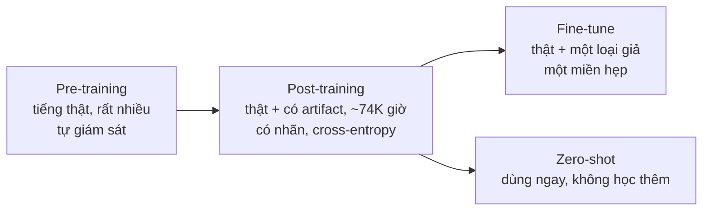

# Post-training mô hình SSL cho phát hiện tiếng nói giả

**Phạm vi:** vì sao cần thêm một pha huấn luyện có nhãn giữa pre-training và fine-tune, pha đó dùng dữ liệu gì, kiến trúc ra sao, và mô hình sau pha đó làm tốt đến đâu khi chưa fine-tune (zero-shot) và khi fine-tune. Bài nền: *Post-training for Deepfake Speech Detection* (Ge, Wang, Liu, Yamagishi; arXiv 2506.21090, bản v4 ngày 21/10/2025). Bộ mô hình công bố kèm bài có tên AntiDeepfake. Mọi bảng số liệu là **EER (%), thấp hơn là tốt hơn**.

## 1. Vấn đề

Mô hình SSL (wav2vec 2.0, HuBERT) được pre-train để **đoán phần bị che** của tiếng nói thật. Mục tiêu đó không dạy mô hình phân biệt thật với giả. Cách làm thường gặp là fine-tune lại backbone trên **từng** bộ dữ liệu giả mạo, và làm lại cho mỗi bài toán mới (giả mạo một phần, truy vết nguồn...). Tốn công, và mỗi lần chỉ học được một miền hẹp.

**Ý tưởng:** chỉnh backbone **một lần** trên dữ liệu thật/giả rất lớn và rất đa dạng, để ra một "nền" chuyên cho phát hiện giả. Sau đó dùng thẳng (zero-shot) hoặc fine-tune nhẹ cho từng miền.

## 2. Ba giai đoạn

| | Pre-training | Post-training | Fine-tune |
|---|---|---|---|
| Cách học | Tự giám sát | Có giám sát (phân biệt) | Có giám sát (phân biệt) |
| Dữ liệu | Tiếng thật, quy mô lớn | Thật **và** tiếng có artifact, quy mô lớn | Thật và một loại giả, quy mô nhỏ |
| Miền | Nhiều miền | Nhiều miền | Một miền |
| Mục đích | Biểu diễn chung | Biểu diễn hợp với phát hiện artifact, **không gắn với miền nào** | Tối ưu cho một miền |

Post-training và fine-tune dùng **cùng một hàm loss**. Khác nhau ở quy mô và độ đa dạng của dữ liệu.

## 3. Dữ liệu post-training

Tổng cộng **56,37K giờ thật** và **18,28K giờ có artifact**, hơn 100 ngôn ngữ, từ 27 bộ công khai và 2 bộ tự tạo. "Có artifact" rộng hơn "giả": gồm cả tiếng nói chỉ đi qua vocoder, qua bộ phục hồi chất lượng, hay qua neural codec.

| Nhóm | Tạo ra thế nào | Ví dụ (giờ giả) | Tổng giờ giả |
|---|---|---|---|
| 1. TTS và VC | Hệ thống tổng hợp hoặc chuyển giọng | ASVspoof5 (1.808), SpoofCeleb (1.916), MLAAD 38 ngôn ngữ (378), ASVspoof 2019/2021, CFAD, DSD, HABLA... | ~6.164 |
| 2. Vocoded | Lấy tiếng thật, phân tích rồi tổng hợp lại bằng vocoder: **giữ nguyên nội dung**, chỉ đổi dạng sóng | VoxCeleb2-Vocoded (4.721), LibriTTS-Vocoded (2.345), CVoiceFake (1.561), WaveFake (199) | ~8.826 |
| 3. Restored | Tiếng chất lượng thấp được "làm đẹp" bằng vocoder khuếch tán | FLEURS-R 102 ngôn ngữ (1.239), LibriTTS-R (583) | ~1.822 |
| 4. Neural codec | Tiếng thật nén rồi giải nén bằng codec neural | Codecfake (808), CodecFake (661) | ~1.469 |
| 5. Chỉ có tiếng thật | Thêm người nói, ngôn ngữ, điều kiện thu | MLS (50.558 giờ thật), CNCeleb2, AISHELL3 | 0 |

Tổng giờ từng nhóm do note cộng từ Bảng I của bài; bốn nhóm cộng lại 18.282 giờ, khớp với 18,28K.

**Hai điều đáng chú ý khi đọc bảng:**
- **Chỉ khoảng 1/3 số giờ "giả" là TTS/VC thật sự** (~6.164 trên 18.282 giờ). Khoảng 2/3 là vocoded, restored, codec. Bài nói rõ tiếng qua codec **không được coi là deepfake**; mục đích là dạy mô hình nhận ra các sai khác rất nhỏ ở dạng sóng.
- **Tiếng thật dồn vào một nguồn:** MLS chiếm khoảng 90% số giờ thật (50.558 / 56.370). MLS là sách nói của 8 ngôn ngữ châu Âu.

**Ví dụ về vocoded:** câu thật "xin chào" của người A được trích đặc trưng rồi tổng hợp lại bằng vocoder. Câu mới vẫn là người A nói "xin chào", nhưng dạng sóng mang dấu vết của vocoder. Mô hình phải phân biệt hai câu chỉ khác nhau ở dấu vết đó. Dữ liệu loại này rẻ: có tiếng thật là tạo được, không cần huấn luyện TTS.

## 4. Kiến trúc và cách huấn luyện

Kiến trúc chỉ có ba khối: backbone, trung bình theo thời gian, một lớp fully connected. Không có back-end phức tạp. Cả backbone và lớp FC đều được cập nhật.

| Chi tiết | Giá trị trong bài |
|---|---|
| Loss | Cross-entropy, cộng loss các nhóm dữ liệu **không gán trọng số** |
| Câu dài hơn 13 giây khi huấn luyện | Cắt ngẫu nhiên một đoạn 10–13 giây |
| Batch | Gom câu dài gần nhau, đệm 0; tổng tối đa 100 giây âm thanh (bản 2B: 50 giây) |
| Tăng cường dữ liệu | RawBoost, cấu hình tốt nhất của bài gốc RawBoost (xem note RawBoost) |
| Optimizer | AdamW, weight decay 0,01 |
| Learning rate | Tăng tuyến tính tới $10^{-7}$ trong 80K bước đầu, rồi giảm tới 0 ở bước 800K (HuBERT-XL dùng $5 \times 10^{-6}$) |
| Chọn mô hình | Đánh giá trên phần validation của từng bộ dữ liệu, mỗi 100K bước |
| Phần cứng | 8 GPU H100 |
| Lượng dữ liệu đã thấy | Bản 2B: hơn 90% dữ liệu ít nhất một lần; các bản khác: phần lớn dữ liệu hai lần |
| Khi chấm | Giữ nguyên độ dài câu, không tăng cường |

**Learning rate $10^{-7}$ là rất nhỏ** so với fine-tune thông thường ($10^{-6}$ đến $10^{-4}$). Với 800K bước trên 74K giờ, mô hình được chỉnh từ từ, không bị kéo mạnh khỏi điểm pre-train.

**Bảy backbone:**

| Mô hình | Tham số | Ngôn ngữ pre-train |
|---|---|---|
| W2V-Small | 95M | Anh |
| W2V-Large | 317M | Anh |
| MMS-300M | 317M | Đa ngôn ngữ |
| HuBERT-XL | 964M | Anh |
| MMS-1B | 965M | Đa ngôn ngữ |
| XLS-R-1B | 965M | Đa ngôn ngữ |
| XLS-R-2B | 2,2B | Đa ngôn ngữ |

Mỗi backbone có hai bản: **có RawBoost** (bản mặc định) và **không RawBoost** (NDA, *no data augmentation*).

## 5. Kết quả zero-shot

Sáu tập kiểm tra, **không tập nào có mặt trong pre-training hay post-training**:

| Tập | Đặc điểm |
|---|---|
| ADD 2023 (track 1.2) | Tiếng Trung, từ cuộc thi ADD |
| DEEP-VOICE | 8 người nổi tiếng và bản chuyển giọng; câu dài vài phút, đã cắt đoạn |
| FakeOrReal (gốc và bản "norm") | Tiếng Anh |
| In-the-Wild | Tiếng Anh, người nổi tiếng, thu từ mạng |
| Deepfake-Eval-2024 | Mạng xã hội 2024, hơn 50 ngôn ngữ, cắt đoạn 4 giây |

Mỗi ô ghi **có RawBoost / không RawBoost**:

| Mô hình | ADD 2023 | DEEP-VOICE | FoR | FoR-norm | In-the-Wild | DFE-2024 |
|---|---|---|---|---|---|---|
| HuBERT-XL | 18,91 / 35,34 | 5,68 / 14,84 | 2,48 / 3,67 | 3,18 / 15,56 | 5,23 / 17,99 | 34,10 / 47,73 |
| W2V-Small | 13,02 / 19,41 | 9,79 / 16,20 | 22,03 / 1,06 | 17,89 / 6,48 | 4,23 / 4,65 | 33,33 / 31,97 |
| W2V-Large | 13,25 / 12,67 | 4,44 / 5,04 | 0,67 / 0,80 | 0,97 / 1,45 | 1,91 / 2,25 | 33,36 / 30,06 |
| MMS-300M | 7,93 / 11,22 | 2,35 / 3,06 | 1,40 / 0,48 | 5,92 / 2,70 | 2,90 / 2,00 | 32,84 / 31,39 |
| MMS-1B | 9,06 / 9,46 | 2,47 / 2,35 | 1,23 / 0,88 | 1,73 / 1,10 | 1,82 / 1,87 | 27,70 / 27,54 |
| XLS-R-1B | 5,39 / 6,58 | 2,47 / 2,59 | 5,74 / 3,17 | 12,14 / 10,91 | 1,35 / 1,36 | 26,76 / 26,17 |
| XLS-R-2B | 4,67 / 6,84 | 2,23 / 2,72 | 2,61 / 1,19 | 1,64 / 1,73 | **1,23** / 1,31 | 27,76 / 25,76 |

**Mốc so sánh** (cũng zero-shot, số do bài tổng hợp): trên In-the-Wild, XLS-R + SLS 7,45; XLSR-Mamba 6,70; AASIST 43,01; RawNet2 49,19. Mô hình 2,1B của Resemble AI: 3,94.

**Đọc bảng:**

1. **Mô hình lớn thường tốt hơn**, trừ HuBERT-XL. XLS-R-2B tốt nhất trên ADD 2023 (4,67), DEEP-VOICE (2,23) và In-the-Wild (1,23).
2. **Ngoại lệ ở FakeOrReal:** mô hình 317M lại tốt nhất (MMS-300M 0,48; W2V-Large 0,97 trên bản norm).
3. **Deepfake-Eval-2024 khó với mọi mô hình:** EER 25–48%. Dữ liệu mạng xã hội năm 2024 có nhiều nhạc nền, nhiễu, nhiều hệ thống sinh mới.
4. **Post-trained 317M đã hơn hẳn các hệ thống chuyên biệt** trên In-the-Wild: W2V-Large 1,91 so với XLS-R + SLS 7,45.

**RawBoost không phải lúc nào cũng giúp.** Note đếm từ bảng trên, số mô hình (trên 7) mà bản có RawBoost tốt hơn:

| Tập | ADD 2023 | DEEP-VOICE | FoR | FoR-norm | In-the-Wild | DFE-2024 |
|---|---|---|---|---|---|---|
| RawBoost tốt hơn | 6/7 | 6/7 | 2/7 | 3/7 | 6/7 | 1/7 |

- Ba tập đầu và In-the-Wild: RawBoost giúp gần như mọi lần. Bài cũng kết luận như vậy.
- FakeOrReal và Deepfake-Eval-2024: thường làm kém đi.
- Có những đảo chiều lớn: W2V-Small trên FoR từ 1,06 lên 22,03 khi thêm RawBoost; HuBERT-XL **không** RawBoost thì kém hẳn trên mọi tập.
- Ngay cả trên In-the-Wild vẫn có ngoại lệ: MMS-300M có RawBoost 2,90, không RawBoost 2,00.

**Hệ quả:** tác dụng của một kỹ thuật tăng cường phụ thuộc vào cả tập kiểm tra lẫn backbone. Muốn biết nó có giúp trên một miền mới hay không thì phải đo, không suy ra từ một tập khác.

## 6. Kết quả fine-tune

Fine-tune trên phần huấn luyện của Deepfake-Eval-2024 (90% để học, 10% để chọn mô hình), 6K bước, learning rate $10^{-6}$, có RawBoost. Chấm trên phần test, cắt đoạn 4, 10, 13, 30, 50 giây. Hai cột so sánh **có** và **không** post-training trước khi fine-tune:

| Mô hình | Có post-training, 4 s | Không post-training, 4 s | Có, 50 s | Không, 50 s |
|---|---|---|---|---|
| W2V-Large | 19,56 | 24,42 | 11,36 | 21,53 |
| MMS-300M | 17,15 | 19,77 | 10,79 | 12,30 |
| MMS-1B | 12,11 | 19,85 | 9,35 | 11,40 |
| XLS-R-1B | 11,86 | 19,96 | **8,28** | 11,20 |
| XLS-R-2B | 12,14 | 12,88 | 9,56 | 9,84 |
| *Tham khảo (4 s, không post-training):* P3 15,38; AASIST 16,99; RawNet2 20,91 | | | | |

1. **Post-training giúp fine-tune** ở gần như mọi ô. Rõ nhất ở đoạn ngắn: với 4 giây, EER của XLS-R-1B giảm 8,1 điểm (19,96 → 11,86), MMS-1B giảm 7,7 điểm.
2. **Đoạn dài hơn cho EER thấp hơn**, vì ít khả năng chỉ chứa im lặng. Kéo dài quá 13 giây (độ dài tối đa khi huấn luyện) vẫn giúp, nhưng ít dần.
3. **Lợi ích không đều.** XLS-R-2B chỉ hơn 0,3–0,7 điểm. MMS-300M ở 10 giây còn hơi kém bản không post-train (13,38 so với 13,26).
4. **Mô hình P3** (cùng cỡ 317M, học trên dữ liệu vocoded bằng loss tương phản rồi chưng cất) tốt hơn MMS-300M ở 4 giây (15,38 so với 17,15). Tác giả cho rằng loss tương phản có thể hợp hơn cross-entropy, và có thể chỉ cần dữ liệu vocoded.

**Hình t-SNE:** embedding sau lớp trung bình của XLS-R-2B tách thật/giả rõ hơn khi có post-training. Embedding của mô hình post-trained cũng tách được thật/giả trên một phần dữ liệu giả mạo một phần, dù chưa học bài toán đó.

## 7. Hạn chế do chính tác giả nêu

| Hạn chế | Hướng tác giả gợi ý |
|---|---|
| RawBoost không đủ cho âm thanh thực tế (Deepfake-Eval-2024) | Thêm nhiễu nền, nhạc nền ở nhiều mức SNR (ví dụ MUSAN) |
| Cross-entropy có thể chưa tối ưu | Học tương phản có giám sát |
| Không gán trọng số giữa các nhóm artifact | Ưu tiên một số nhóm, đổi trọng số trong lúc huấn luyện |
| Chưa rõ có cần dữ liệu TTS/VC (tốn công tạo) hay không | Thử chỉ dùng vocoded, restored, codec |
| Chỉ làm phát hiện giả toàn câu | Mở rộng sang giả mạo một phần, truy vết nguồn |

## 8. Ưu và nhược điểm

| Ưu điểm | Nhược điểm |
|---|---|
| Zero-shot rất mạnh: 1,23% trên In-the-Wild mà không học tập đó | Chi phí post-training rất lớn (8 GPU H100, 800K bước); người dùng thường không tự làm lại được |
| Một mô hình dùng cho nhiều miền; fine-tune từ đây tốt hơn fine-tune từ bản pre-train | Kém trên dữ liệu mạng xã hội mới (EER trên 25%) |
| Kiến trúc tối giản, có sẵn checkpoint 7 backbone × 2 bản | Dữ liệu lệch: ~90% giờ thật từ một nguồn sách nói, ~2/3 giờ giả không phải TTS/VC |
| Embedding dùng được cho bài toán khác (giả mạo một phần) | Lợi ích không đều giữa các backbone; tác dụng của RawBoost đổi chiều theo tập |

## 9. Câu hỏi tự kiểm tra

1. Post-training khác pre-training ở điểm nào, khác fine-tune ở điểm nào?
2. Kể 5 nhóm dữ liệu post-training. Vì sao tiếng nói qua vocoder hay codec được xếp vào lớp "có artifact" dù nội dung là thật?
3. Kiến trúc dùng khi post-training gồm những khối nào? Khối nào được cập nhật?
4. Trên In-the-Wild, mô hình nào tốt nhất và EER bao nhiêu? So với XLS-R + SLS thì sao?
5. RawBoost giúp ở những tập nào, làm kém đi ở những tập nào? Rút ra điều gì?
6. Vì sao chấm Deepfake-Eval-2024 phải cắt đoạn? Độ dài đoạn ảnh hưởng thế nào đến EER?
7. Với MMS-300M, post-training giúp fine-tune nhiều hay ít so với XLS-R-1B?
