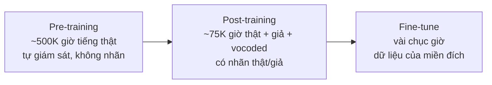

# Post-training và fine-tune bằng học tăng cường (GRPO)

**Phạm vi:** quy trình huấn luyện nhiều giai đoạn cho bộ phát hiện dùng mô hình SSL, vấn đề "quên" khi fine-tune, và cách dùng học tăng cường GRPO thay cho fine-tune có giám sát. Bài nền: *Does Fine-tuning by Reinforcement Learning Improve Generalization in Binary Speech Deepfake Detection?* (Interspeech 2026). Mọi bảng số liệu là **EER (%), thấp hơn là tốt hơn**.

## 1. Ba giai đoạn huấn luyện

| Giai đoạn | Học gì | Ai làm |
|---|---|---|
| Pre-training | Biểu diễn chung của tiếng nói (wav2vec 2.0, XLS-R, MMS) | Nhóm lớn có nhiều GPU |
| Post-training | Chỉnh mô hình SSL thành bộ phát hiện "đa năng" trên dữ liệu thật/giả rất lớn, nhiều miền | Nhóm phát hành mô hình (ví dụ AntiDeepfake) |
| Fine-tune | Thích nghi với một miền cụ thể (một ngôn ngữ, một nguồn dữ liệu) | Người dùng, với GPU nhỏ |

Quy trình này giống LLM: pre-training → mid-training → fine-tune.

## 2. Vấn đề: fine-tune làm mô hình "quên"

Fine-tune trên miền mới thì kết quả **trên miền đó tốt lên**, nhưng kết quả **trên các miền khác có thể xấu đi**. Hiện tượng này gọi là **catastrophic forgetting** (quên thảm khốc).

Ví dụ thật, với bản post-trained của XLS-R-2B fine-tune trên Deepfake-Eval-2024 (khoảng 50 giờ dữ liệu mạng xã hội năm 2024):

| | Trong miền (DFE24) | In-the-Wild (ngoài miền) |
|---|---|---|
| Chưa fine-tune | 22,64 | **1,24** |
| Fine-tune có giám sát (SFT) | 10,26 | **6,35** |

Lỗi trong miền giảm một nửa, nhưng lỗi trên In-the-Wild tăng gấp 5 lần.

### 2.1. Ba bẫy thường gặp khi fine-tune trên một miền nhỏ

| Bẫy | Biểu hiện | Cách phát hiện |
|---|---|---|
| **Tách nguyên nhân bằng hai tập kiểm tra** | Cùng mô hình sau fine-tune: trên tập TTS mới nhưng tiếng thật cùng nguồn với train, EER 5,2% → 0,1%; trên tập có tiếng thật nguồn khác, EER **tăng** và tỉ lệ tiếng thật bị coi là giả tăng 4,8% → ~33% | Ghép cùng một phần tiếng thật với nhiều nhóm tiếng giả (và ngược lại) để biết lỗi do phía giả hay phía thật |
| **Tiếng thật chỉ từ một nguồn** | Mô hình học "thật = giống nguồn này". Tiếng thật từ nguồn khác (thiết bị, phòng thu, cách cắt khác) bị coi là giả nhiều hơn. Ví dụ đo được: sau fine-tune, tỉ lệ tiếng thật nguồn khác bị coi là giả ở ngưỡng 0 tăng từ ~5% lên ~28%, trong khi tỉ lệ tiếng giả lọt qua giảm từ ~37% xuống ~13–20% | Không chỉ nhìn EER: báo riêng hai loại lỗi ở ngưỡng cố định, và actDCF − minDCF (ví dụ trên tăng từ 0,007 lên 0,2) |
| **Tập kiểm tra trong miền bão hoà** | Mô hình chưa fine-tune đã gần 0% EER trên chính bộ dữ liệu fine-tune, kể cả trên các hệ thống sinh được để riêng. Mọi cấu hình đều ra ~0%, không so được | Chấm mô hình chưa fine-tune trên tập kiểm tra **trước** khi chọn nó làm thước đo chính |
| **Cấu hình không áp dụng như mình tưởng** | Một số toolkit coi vài tham số là tham số chạy, không ghi đè vào file cấu hình. Ví dụ: truyền giới hạn số bước qua dòng lệnh, toolkit dùng nó để dừng nhưng lịch learning rate vẫn tính theo giá trị cũ trong file, nên learning rate không giảm như dự kiến | Đọc file cấu hình đã giải (bản toolkit ghi ra lúc chạy) và learning rate thật trong log, không chỉ đọc lệnh đã truyền |

**Mức quên phụ thuộc backbone.** Quan sát một seed: cùng dữ liệu, cùng siêu tham số, một backbone 300M đa ngôn ngữ quên rõ trên In-the-Wild (2,6% → 7,6%), còn backbone 300M chỉ pre-train tiếng Anh thì không quên (2,0% → 1,4%). Kết luận "SFT làm quên" cần kiểm trên hơn một backbone. Backbone nhỏ (95M) bị nặng nhất: sau fine-tune trên một nguồn tiếng thật, nó coi 60–80% tiếng thật nguồn khác là giả ở ngưỡng 0, và EER trên bộ dữ liệu khác kém bản 317M cùng họ ~13,6 điểm (chưa fine-tune chỉ kém ~9,4).

## 3. SFT và học tăng cường khác nhau ở đâu

**SFT (fine-tune có giám sát):** đưa đáp án đúng, ép mô hình tăng xác suất của đáp án đó. Loss là $-\log p(\text{nhãn đúng})$. Câu nào mô hình đang sai càng nặng thì bị kéo càng mạnh.

**Học tăng cường (RL):** mô hình **tự thử trả lời**, được chấm điểm, rồi tăng xác suất của những câu trả lời được điểm cao và giảm những câu bị điểm thấp. Mô hình không bị "cầm tay" theo đáp án, mà học từ chính các lần thử của nó.

## 4. GRPO từng bước

Cho một câu âm thanh có nhãn đúng là **thật**. Mô hình hiện đang cho $p(\text{thật}) = 0{,}7$.

| Bước | Làm gì | Ví dụ |
|---|---|---|
| 1. Lấy mẫu | Rút ngẫu nhiên $G = 64$ câu trả lời theo xác suất của mô hình | Khoảng 45 lần "thật", 19 lần "giả" |
| 2. Chấm điểm | Phần thưởng $r = 1$ nếu trả lời đúng nhãn, $r = 0$ nếu sai | 45 mẫu được 1, 19 mẫu được 0 |
| 3. Chuẩn hoá trong nhóm | Lợi thế $A = (r - \bar r)/\sigma$, với $\bar r$, $\sigma$ là trung bình và độ lệch chuẩn của 64 phần thưởng | $\bar r = 0{,}7$, $\sigma \approx 0{,}46$. Mẫu đúng: $A \approx +0{,}65$. Mẫu sai: $A \approx -1{,}53$ |
| 4. Cập nhật | Tăng xác suất các câu trả lời có $A > 0$, giảm các câu có $A < 0$ | Đẩy $p(\text{thật})$ lên |
| 5. Giới hạn bước đi | Tỉ số $p_\text{mới}/p_\text{cũ}$ bị kẹp trong $[1-\epsilon, 1+\epsilon]$, với $\epsilon = 0{,}2$ | Mỗi bước không được đổi quá 20% so với mô hình cũ |
| 6. Phạt đi xa | Trừ $\beta \cdot \text{KL}$, đo độ lệch so với **mô hình tham chiếu** (bản post-trained, giữ băng), $\beta = 0{,}04$ | Kéo mô hình về gần điểm xuất phát |

Công thức tổng quát:

$$
\mathcal{L}_\text{RL}(\Theta) = -\mathbb{E}\left[ A \cdot \frac{p_\Theta(\tilde y \mid x)}{p_{\hat\Theta}(\tilde y \mid x)} - \beta \, \mathcal{L}_p(\dot\Theta, \Theta) \right]
$$

| Ký hiệu | Nghĩa |
|---|---|
| $\Theta$ | Mô hình đang học |
| $\hat\Theta$ | Mô hình "cũ", bản chụp từ trước, cập nhật thưa hơn |
| $\dot\Theta$ | Mô hình tham chiếu, giữ băng |
| $\tilde y$ | Câu trả lời được lấy mẫu |

GRPO cần giữ **ba bản mô hình** cùng lúc, nên tốn bộ nhớ hơn SFT. Hai bản phụ chỉ chạy suy luận, không cần gradient.

**Biến thể đơn giản (GRPOs):** bỏ mô hình cũ và bỏ bước kẹp. Kết quả gần như GRPO đầy đủ.

**Lưu ý khi đọc code:** công thức trong bài chuẩn hoá phần thưởng **trong nhóm 64 mẫu của từng câu**. Có những cài đặt chuẩn hoá **trên toàn bộ batch** (mọi câu, mọi mẫu). Hai cách cho lợi thế khác nhau, nên phải kiểm tra code đang dùng cách nào.

## 5. Kết quả

Fine-tune trên Deepfake-Eval-2024. Ngoài miền là trung bình của 4 tập ADD23, FoR, DEEP-VOICE, In-the-Wild. Mỗi số là trung bình 3 lần chạy.

| Mô hình | Cách fine-tune | Trong miền | Ngoài miền (TB) | In-the-Wild |
|---|---|---|---|---|
| XLS-R-2B post-trained | Không fine-tune | 22,64 | 2,69 | 1,24 |
| | SFT | 10,26 | 6,28 | 6,35 |
| | **GRPO** | **9,93** | **2,69** | 2,19 |
| | SFT rồi GRPO | 9,81 | 5,37 | 5,89 |
| XLS-R-2B **chỉ pre-train** | SFT | 10,45 | 19,34 | 13,49 |
| | GRPO | 11,15 | 21,86 | 19,00 |
| MMS-1B post-trained | Không / SFT / GRPO | 23,87 / 9,88 / 10,17 | 3,64 / 4,36 / 2,96 | 1,82 / 6,59 / 2,98 |
| MMS-300M post-trained | Không / SFT / GRPO | 29,23 / 12,23 / 11,94 | 3,68 / 7,74 / 3,78 | 2,91 / 14,17 / 5,91 |

**Bốn kết luận của bài:**
1. **GRPO giữ được ngoài miền, SFT thì không.** Trong miền hai cách ngang nhau (khoảng 10%).
2. **Chỉ dùng GRPO tốt hơn SFT rồi GRPO.** Đã SFT trước thì GRPO không cứu lại được.
3. **GRPO chỉ có tác dụng trên mô hình đã post-train.** Từ mô hình chỉ pre-train, GRPO còn kém SFT.
4. **Bỏ kẹp và mô hình cũ không ảnh hưởng nhiều** (GRPOs gần bằng GRPO).

## 6. Ablation (chỉ làm với XLS-R-2B)

| Biến thể | Trong miền | Ngoài miền (TB) | Ý nghĩa |
|---|---|---|---|
| GRPO mặc định ($\beta = 0{,}04$) | 9,93 | 2,69 | |
| Bỏ phạt đi xa ($\beta = 0$) | 10,21 | 3,53 | DEEP-VOICE tăng lên 6,50%. Phạt đi xa **có** vai trò, khác với kết luận ở LLM |
| Phạt rất mạnh ($\beta = 1$) | 15,83 | **2,04** | Ngoài miền tốt nhất nhưng trong miền kém hẳn: mô hình gần như không học miền mới |
| Bỏ phần thưởng âm | 11,41 | 3,44 | Kém hơn ở mọi tập. Bài cho rằng **phần thưởng âm** là khác biệt then chốt giữa GRPO và SFT |

"Bỏ phần thưởng âm" nghĩa là $A = r$: mẫu đúng được 1, mẫu sai được 0 thay vì bị phạt. Biến thể này về bản chất gần với SFT cộng thêm phạt đi xa.

**Phân tích độ trôi:** bài đo khoảng cách Wasserstein giữa phân bố embedding của tập kiểm tra và tập tham chiếu. SFT kéo các tập ngoài miền (DEEP-VOICE, In-the-Wild) **ra xa**, còn GRPO thì không.

## 7. Đọc kỹ các con số

**"GRPO cải thiện ngoài miền" là so với SFT, không phải so với không fine-tune.** So với mô hình chưa fine-tune:
- XLS-R-2B: trung bình ngoài miền bằng nhau (2,69 và 2,69). Xét từng tập, GRPO kém hơn ở ADD23 (5,34 so với 4,67), DEEP-VOICE (2,76 so với 2,23), In-the-Wild (2,19 so với 1,24), và chỉ tốt hơn ở FoR.
- MMS-300M: hơi kém hơn (3,78 so với 3,68). In-the-Wild vẫn tăng từ 2,91% lên 5,91%.

Nói chính xác: GRPO **giảm mức quên**, chưa **loại bỏ** được việc quên.

**$\beta = 1$ là một sự đánh đổi, không chỉ là "underfit".** Ngoài miền tốt nhất trong bảng (2,04), đổi lại trong miền kém (15,83). Chọn $\beta$ là chọn điểm cân bằng giữa học cái mới và giữ cái cũ.

**Phạm vi hẹp:** chỉ một bộ dữ liệu fine-tune, ablation chỉ trên XLS-R-2B, cơ chế để ngỏ. Thí nghiệm chạy trên GPU H100.

## 8. Phân tích thêm: vì sao GRPO có thể ít làm quên hơn

**Phần này là phân tích của note, không có trong bài.** Giả sử chuẩn hoá theo nhóm như công thức (4), lấy kỳ vọng theo phép lấy mẫu, và bỏ qua kẹp và phạt KL. Gọi $p$ là xác suất mô hình gán cho nhãn đúng, $z$ là logit.

| | Lực kéo lên logit của nhãn đúng |
|---|---|
| SFT | $(1 - p)$ |
| GRPO | $\sqrt{p(1-p)}$ |

| $p$ (mô hình đang...) | SFT | GRPO |
|---|---|---|
| 0,01 (sai rất tự tin) | **0,99** | 0,10 |
| 0,5 (phân vân) | 0,50 | 0,50 |
| 0,99 (đúng rất tự tin) | 0,01 | 0,10 |

SFT kéo mạnh nhất vào những câu mô hình **đang sai nặng**. Đó thường là những câu đặc thù của miền mới, nên mô hình bị đổi nhiều để chiều theo chúng. GRPO kéo đều hơn và nhẹ tay với những câu sai nặng. Đây là một giả thuyết hợp lý cho việc GRPO giữ kiến thức cũ tốt hơn, nhưng **chưa được kiểm chứng**.

Phân tích này cũng gợi ý vì sao GRPO kém trên mô hình chỉ pre-train: khi mô hình ban đầu đoán gần như ngẫu nhiên, các lần thử ít mang thông tin, nên tín hiệu học yếu.

### 8.1. Nếu cài đặt chuẩn hoá phần thưởng theo cả batch

Một số cài đặt tính $\bar r$, $\sigma$ trên **mọi mẫu của mọi câu trong batch**, không theo từng câu. Khi đó mọi câu trong batch dùng chung một $\sigma_\text{batch}$, và kỳ vọng lực kéo (cùng giả định như trên) đổi thành:

| Cách | Lực kéo lên logit của nhãn đúng | Câu bị kéo mạnh nhất |
|---|---|---|
| SFT | $1 - p$ | Câu đang sai nặng |
| GRPO chuẩn hoá theo nhóm | $\sqrt{p(1-p)}$ | Câu phân vân |
| GRPO chuẩn hoá theo batch | $p(1-p)/\sigma_\text{batch}$ | Câu phân vân; câu sai nặng gần như không được kéo |
| GRPO không có phần thưởng âm ($A = r$) | $p(1-p)$ | Như trên |

Đã kiểm bằng mô phỏng Monte Carlo (64 mẫu mỗi câu, 10 câu mỗi batch, 4.000 lượt): khớp công thức đến 3 chữ số.

Hai hệ quả:
1. So với SFT, mỗi câu được nhân thêm trọng số $p/\sigma_\text{batch}$: GRPO gần như **bỏ qua câu mô hình đang sai chắc chắn**.
2. Khi chuẩn hoá theo batch, "phần thưởng âm" **không đổi hướng** cập nhật so với biến thể không có phần thưởng âm, chỉ nhân độ lớn bước lên $1/\sigma_\text{batch}$ (batch đúng 95% thì ~4,6 lần, đúng 99% thì ~10 lần). Vậy khi một ablation thấy "bỏ phần thưởng âm làm kém đi", cần tách phần do **bước cập nhật nhỏ hơn** ra khỏi phần do bản thân phần thưởng âm.

Cách kiểm trực tiếp, rẻ: fine-tune bằng cross-entropy có trọng số $p(y \mid x)$ cho mỗi câu (không cần lấy mẫu). Nếu kết quả gần GRPO thì cơ chế nằm ở trọng số này.

### 8.2. Khi miền fine-tune đã gần như giải xong (quan sát thực nghiệm)

Bảng ở mục 8 cho thấy một chiều thường bị bỏ qua: với câu **đã đúng chắc** ($p = 0{,}999$), SFT gần như dừng kéo ($1 - p = 0{,}001$), còn GRPO vẫn kéo với lực $\approx \sqrt{p(1-p)} \approx 0{,}032$, tức khoảng **30 lần** SFT. Nếu mô hình dùng thẳng đã gần đúng hết trên dữ liệu fine-tune (EER ~1%), phần lớn câu rơi vào vùng này, nên GRPO chủ yếu **tiếp tục làm sắc những câu đã đúng**: mô hình ngày càng tự tin, cả phân bố điểm dịch xa hơn SFT. Quan sát được (một seed): sau fine-tune, 99,4% câu dev được đoán đúng với $p > 0{,}999$ ở GRPO so với 91–97% ở SFT; ngoài miền, tiếng thật nguồn khác bị coi là giả nhiều hơn. Đồng thời phần lớn batch có mọi nhãn lấy mẫu đều đúng, lợi thế bằng 0, chỉ còn phạt KL; các batch còn lại có vài nhãn sai mang trọng số rất lớn, nên cập nhật thưa và giật.

Hệ quả: lợi thế "ít quên" của GRPO trong bài báo xuất hiện khi dữ liệu fine-tune **khó** (mô hình dùng thẳng EER ~23–29%, đa số câu ở ranh giới). Khi miền đích đã dễ, không nên kỳ vọng GRPO nhẹ tay hơn SFT; cần phạt KL mạnh hơn hoặc giảm learning rate.

### 8.3. Bỏ chia cho độ lệch chuẩn

Dr. GRPO (2025, huấn luyện LLM giải toán) chỉ ra hai thiên lệch trong công thức GRPO và bỏ cả hai:

| Số hạng | Thiên lệch | Có ở bộ phân loại không |
|---|---|---|
| Chia cho độ dài câu trả lời $\lvert o_i \rvert$ | Câu trả lời đúng ngắn được thưởng nhiều hơn; câu trả lời sai dài bị phạt ít hơn, nên câu sai dài dần | Không (mỗi câu một nhãn) |
| Chia cho độ lệch chuẩn phần thưởng **của từng câu hỏi** | Câu hỏi quá dễ hoặc quá khó (phần thưởng gần như toàn 1 hoặc toàn 0) có độ lệch chuẩn nhỏ nên được trọng số lớn hơn | Có, nếu chuẩn hoá theo nhóm như công thức (4) |

Bỏ độ lệch chuẩn thì lợi thế chỉ còn $r - \bar r$ (tương đương REINFORCE leave-one-out nhân một hệ số), và lực kéo thành $p(1 - p)$.

Nếu cài đặt chuẩn hoá theo **cả batch** (mục 8.1), không có thiên lệch giữa các câu cùng batch, nhưng phép chia gây một hiệu ứng khác: $1/\sigma_\text{batch}$ nhân cả bước cập nhật và tăng khi mô hình đúng gần hết, như một learning rate tự tăng. Cách sửa nhẹ nhất: cộng một hằng $c$ vào mẫu số, $(r - \bar r)/(\sigma + c)$. $c \to 0$ là GRPO gốc; $c$ lớn hơn nhiều $\sigma$ là bỏ chuẩn hoá. Với phần thưởng 0/1, $\sigma \le 0{,}5$, nên $c = 1$ đã đủ để mẫu số gần như hằng (từ 1 đến 1,5).

Lực kéo theo số lần SFT (mô phỏng Monte Carlo, 10 câu × 64 mẫu mỗi batch, bỏ KL và kẹp):

| Batch | Câu | Chia cho $\sigma_\text{batch}$ | Chia cho $\sigma_\text{batch} + 1$ |
|---|---|---|---|
| Hỗn hợp ($\sigma_\text{batch} = 0{,}48$) | phân vân, $p = 0{,}5$ | 1,0 | 0,34 |
| Bão hoà ($\sigma_\text{batch} = 0{,}11$) | đúng chắc, $p = 0{,}999$ | 9,2 | 0,9 |

Hai tác dụng phụ cần đối chứng khi thử cách sửa này:
1. **Bước cập nhật nhỏ hơn SFT ở mọi câu.** Nếu kết quả tốt lên, có thể chỉ vì học chậm hơn. Cần thêm một lần GRPO gốc với learning rate thấp để tách "đổi cơ chế" khỏi "giảm cường độ".
2. **Phạt KL nặng lên tương đối.** Khi chia cho $\sigma_\text{batch}$, biên độ lợi thế luôn ≈ 1; khi chia cho $\sigma_\text{batch} + 1$, biên độ co về 0 lúc mô hình bão hoà (0,10 ở batch trên), còn số hạng KL giữ nguyên. Vậy gần bão hoà, cập nhật bị phạt KL chi phối, mô hình tự dừng và bị kéo về mô hình tham chiếu. Cách sửa này vì vậy gần với "tăng $\beta$" hơn vẻ ngoài của nó.

## 9. Ưu và nhược điểm

| Ưu điểm | Nhược điểm |
|---|---|
| Giữ khả năng ngoài miền tốt hơn SFT, trong miền ngang SFT | Chưa giữ được hoàn toàn: vẫn có tập kém hơn so với không fine-tune |
| Không cần dữ liệu mới, chỉ đổi hàm loss | Tốn bộ nhớ hơn: 3 bản mô hình, 64 mẫu mỗi câu |
| Phần thưởng đơn giản (đúng = 1, sai = 0) | Chỉ có tác dụng khi điểm xuất phát đã tốt (đã post-train) |
| Có ablation tách vai trò của phạt KL và phần thưởng âm | Ablation chỉ trên một backbone, một bộ dữ liệu; cơ chế chưa giải thích |

### 9.1. Chi phí đo được trên một GPU 16 GB (backbone 317M, batch ~50 giây âm thanh)

| | SFT | GRPO đơn giản (thêm mô hình tham chiếu) | GRPO đủ (thêm tham chiếu và mô hình cũ) |
|---|---|---|---|
| Thời gian mỗi bước so với SFT | 1 | ~1,5 | ~1,55 |
| Bộ nhớ thêm | | ~1,3 GB (một bản 317M tham số fp32) | ~2,5 GB |

- Hai bản phụ chỉ chạy forward không gradient, nên tốn thêm ~1/4 thời gian mỗi bản chứ không gấp đôi; lấy mẫu 64 nhãn mỗi câu gần như không tốn gì với bài toán hai lớp.
- **Đo bộ nhớ bằng `torch.cuda.max_memory_allocated`, không bằng nvidia-smi:** nvidia-smi thấy cả phần allocator của PyTorch giữ sẵn nên gần như luôn báo gần đầy, kể cả khi mô hình chỉ cần ít hơn nhiều.
- **Hết bộ nhớ có thể do phân mảnh, không do thiếu dung lượng.** Thông báo lỗi cho biết bao nhiêu là "reserved but unallocated"; nếu phần này lớn (ví dụ ~0,8 GB trong khi yêu cầu chỉ 0,28 GB), đặt `PYTORCH_CUDA_ALLOC_CONF=expandable_segments:True` thường đủ, không đổi phép tính. Giảm batch cũng chữa được nhưng đổi số bước và lịch learning rate, nên mất khả năng so với cấu hình cũ.
- **Thử áp lực bằng batch toàn câu dài nhất** trước khi chạy dài: với batch giới hạn theo tổng thời lượng, bộ nhớ gần như không đổi giữa các batch, phần chênh đến từ attention (bậc hai theo độ dài câu).

## 10. Câu hỏi tự kiểm tra

1. Post-training nằm ở đâu trong quy trình, và khác fine-tune ở điểm nào?
2. "Quên" khi fine-tune là gì? Lấy một ví dụ bằng số.
3. Kể 6 bước của GRPO. Bước nào giới hạn mức thay đổi mỗi lần, bước nào kéo mô hình về điểm xuất phát?
4. Với $p(\text{nhãn đúng}) = 0{,}7$, lợi thế của mẫu đúng và mẫu sai là bao nhiêu?
5. Vì sao nói "GRPO cải thiện ngoài miền" cần nói rõ là so với cái gì?
6. $\beta = 0$ và $\beta = 1$ cho kết quả thế nào? Rút ra điều gì?
7. Chuẩn hoá phần thưởng theo nhóm và theo batch khác nhau thế nào về câu nào được kéo mạnh nhất?
8. Sau fine-tune, EER giảm nhưng tiếng thật nguồn khác bị chặn nhiều hơn. Vì sao, và đo bằng gì?
