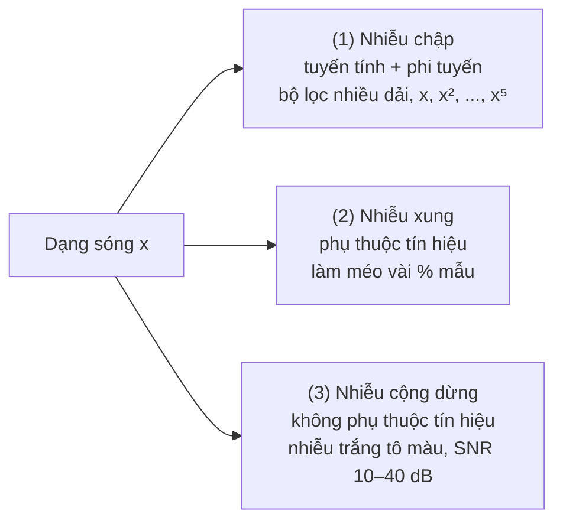

# RawBoost: tăng cường dữ liệu trên dạng sóng

**Phạm vi:** RawBoost là gì, ba loại nhiễu nó tạo ra, cách kết hợp, và nó giúp đến đâu. Bài nền: *RawBoost: A Raw Data Boosting and Augmentation Method Applied to Automatic Speaker Verification Anti-Spoofing* (Tak, Kamble, Patino, Todisco, Evans; ICASSP 2022, arXiv 2111.04433). Bảng kết quả dùng **EER (%)** và **min t-DCF**, cả hai **thấp hơn là tốt hơn**.

## 1. Tăng cường dữ liệu là gì

**Tăng cường dữ liệu** (data augmentation) là biến đổi ngẫu nhiên mẫu huấn luyện để mô hình thấy nhiều điều kiện hơn mà không cần thu thêm dữ liệu. Ví dụ: thêm nhiễu vào một câu thật, nhãn vẫn là thật. Mô hình buộc phải dựa vào đặc điểm không đổi khi có nhiễu, nên ít bị **overfit** (học thuộc chi tiết riêng của tập huấn luyện).

Tăng cường chỉ dùng **khi huấn luyện**. Khi chấm điểm, âm thanh giữ nguyên.

## 2. Vì sao cần RawBoost

| Vấn đề | Chi tiết |
|---|---|
| Lệch kênh truyền | Cuộc thi ASVspoof 2021 LA chỉ cho huấn luyện trên ASVspoof 2019 LA (âm thanh sạch), nhưng tập kiểm tra đã đi qua điện thoại, VoIP với nhiều codec (A-law, G.722 và cả codec không công bố) |
| Mô hình nhận dạng sóng | Các mô hình như RawNet2, AASIST đọc thẳng dạng sóng. Kỹ thuật phổ biến như SpecAugment che dải trên spectrogram, không áp được vào dạng sóng |
| Không muốn phụ thuộc dữ liệu ngoài | Cách khác (WavAugment, cộng nhiễu MUSAN, mô phỏng codec) cần bản ghi nhiễu, đáp ứng xung phòng hoặc bộ codec |

**Ý tưởng:** dùng các kỹ thuật xử lý tín hiệu cổ điển để **tự sinh** biến dạng giống kênh truyền, không cần dữ liệu ngoài, không sửa mô hình. Bài nhấn mạnh RawBoost được thiết kế cho **kịch bản điện thoại**.

## 3. Ba loại nhiễu

### 3.1. Nhiễu chập tuyến tính và phi tuyến

**Mô phỏng gì:** mã hoá, nén, truyền tín hiệu làm méo phổ (tuyến tính), và thiết bị phi tuyến (bộ khuếch đại) sinh thêm hài bậc cao.

**Cách làm:**
1. Tạo một **bộ lọc nhiều dải** (FIR): ghép $N_\text{notch} = 5$ bộ lọc, mỗi cái có tần số trung tâm ngẫu nhiên trong 20 Hz – 8 kHz, độ rộng ngẫu nhiên 100 – 1.000 Hz, số hệ số ngẫu nhiên 10 – 100. Nhiều hệ số thì đáp ứng sắc; ít hệ số thì mềm và gợn sóng.
2. Áp bộ lọc riêng (ngẫu nhiên lại) cho **từng luỹ thừa** của tín hiệu, rồi cộng:

$$
y_\text{cn}[n] = \sum_{j=1}^{N_f} g_j^\text{cn} \sum_{i=0}^{N_\text{fir}_j} b_{ij} \, x^j[n-i]
$$

| Ký hiệu | Nghĩa | Giá trị |
|---|---|---|
| $j = 1$ | Thành phần tuyến tính $x$ | Hệ số khuếch đại 0 dB |
| $j = 2..N_f$ | Thành phần phi tuyến $x^2, x^3, ...$ | Khuếch đại ngẫu nhiên từ −20 đến −5 dB |
| $N_f$ | Bậc phi tuyến cao nhất | 5 |

**Vì sao luỹ thừa tạo hài:** nếu $x$ chứa một thành phần tần số $f_0$, thì $x^2$ chứa $2f_0$, $x^3$ chứa $3f_0$, ... Đây là méo hài, giống loa hay micro bị quá tải.

### 3.2. Nhiễu xung phụ thuộc tín hiệu

**Mô phỏng gì:** lỗi lúc thu: cắt biên độ (clipping), micro hay bộ khuếch đại hoạt động không tối ưu, lỗi đồng bộ, tràn số.

**Cách làm:** chọn ngẫu nhiên tối đa $P$ mẫu (rải đều trong câu) và làm méo từng mẫu theo **chính biên độ của nó**:

$$
y_\text{sd}[n] = x[n] + g_\text{sd} \cdot r[n] \cdot x[n], \quad r[n] \in [-1, 1]
$$

$r$ lấy từ phân phối có mật độ $-\log|r|$: dồn nhiều về gần 0, hiếm khi gần ±1.

**Ví dụ:** câu 4 giây ở 16 kHz có 64.000 mẫu. Với $P_\text{rel}$ tối đa 10%, tỉ lệ thực tế được rút đều trong 0–10%, trung bình 5%, tức khoảng **3.200 mẫu** bị đổi. Với $g_\text{sd} = 2$, mỗi mẫu bị đổi tối đa ±200% biên độ của chính nó. Mẫu nào gần im lặng thì gần như không đổi, vì nhiễu tỉ lệ với $x[n]$.

### 3.3. Nhiễu cộng dừng, không phụ thuộc tín hiệu

**Mô phỏng gì:** dây nối lỏng, nhiễu điện từ, nhiễu nhiệt, hiệu ứng kênh truyền.

**Cách làm:** tạo nhiễu trắng, "tô màu" bằng một bộ lọc nhiều dải như 3.1 (nhưng chỉ tuyến tính, $N_f = 1$), rồi cộng vào cả câu với SNR ngẫu nhiên trong **10–40 dB**:

$$
y_\text{si}[n] = x[n] + g_\text{snr} \cdot z[n], \qquad g_\text{snr} = \frac{\lVert x \rVert_2}{10^{\text{SNR}/20} \, \lVert z \rVert_2}
$$

**Ví dụ:** SNR = 20 dB nghĩa là năng lượng nhiễu bằng 1/100 năng lượng tiếng nói, biên độ nhiễu bằng 1/10.

## 4. Kết hợp

| Cách | Làm gì |
|---|---|
| Nối tiếp (series) | Đầu ra của kỹ thuật này là đầu vào của kỹ thuật sau |
| Song song (parallel) | Mỗi kỹ thuật áp riêng lên câu gốc, rồi cộng các biến dạng |

Sau mỗi bước, dạng sóng được chuẩn hoá để không tràn biên độ. Nhiễu được thêm **ngay lúc huấn luyện** (on-the-fly): mỗi lần mô hình gặp lại một câu, câu đó bị biến dạng khác. Bài áp RawBoost cho cả tập huấn luyện lẫn tập phát triển (dev) dùng để chọn tham số.

## 5. Kết quả

Mô hình RawNet2, huấn luyện trên ASVspoof 2019 LA, chấm trên ASVspoof 2021 LA (7 điều kiện kênh, gộp lại):

| Tăng cường | min t-DCF | EER (%) |
|---|---|---|
| Không | 0,4257 | 9,50 |
| (1) nhiễu chập | 0,3527 | 7,22 |
| (2) nhiễu xung | 0,3260 | 6,09 |
| (3) nhiễu cộng | 0,3372 | 7,85 |
| **(1)+(2) nối tiếp** | **0,3099** | **5,31** |
| (1)+(2) song song | 0,3261 | 5,57 |
| (1)+(3) nối tiếp | 0,3361 | 6,27 |
| (2)+(3) nối tiếp | 0,3329 | 6,58 |
| (1)+(2)+(3) nối tiếp | 0,3192 | 5,39 |
| WavAugment tốt nhất | 0,3435 | 7,32 |
| SpecAugment tốt nhất | 0,3418 | 8,25 |

1. **Mọi cấu hình RawBoost đều tốt hơn không tăng cường**, ở cả 7 điều kiện kênh.
2. **Tốt nhất là (1)+(2) nối tiếp:** min t-DCF giảm 27% tương đối, EER giảm 44% tương đối (9,50 → 5,31).
3. **Nhiễu cộng (3) tự nó có ích nhưng thêm vào tổ hợp thì không giúp.** Tác giả giải thích: dữ liệu ASVspoof LA không có nhiễu môi trường, nên mô phỏng nhiễu nền không trúng. Loại (3) có thể có ích cho kịch bản có nhiễu nền (ví dụ phát lại qua loa).
4. So với các hệ thống đơn lẻ khác, RawNet2 + RawBoost đứng thứ 3. Hai hệ thống hơn nó dùng dữ liệu ngoài (MUSAN) hoặc sửa hàm loss.

## 6. Khi đọc code cài đặt RawBoost

Cài đặt phổ biến (bản gốc của nhóm tác giả, được nhiều repo chép lại) đánh số thuật toán:

| `algo` | Nghĩa |
|---|---|
| 0 | Không tăng cường |
| 1, 2, 3 | Chỉ (1), chỉ (2), chỉ (3) |
| 4 | (1)+(2)+(3) nối tiếp |
| **5** | **(1)+(2) nối tiếp**, cấu hình tốt nhất trong bài |
| 6, 7 | (1)+(3), (2)+(3) nối tiếp |
| 8 | (1)+(2) song song |

| Tham số trong code | Giá trị mặc định | Ứng với bài |
|---|---|---|
| `nBands`, `minF`–`maxF`, `minBW`–`maxBW`, `minCoeff`–`maxCoeff` | 5; 20–8.000 Hz; 100–1.000 Hz; 10–100 | Bộ lọc nhiều dải |
| `minG`, `maxG` | 0, 0 | Khuếch đại thành phần tuyến tính 0 dB |
| `minBiasLinNonLin`, `maxBiasLinNonLin` | 5, 20 | Thành phần phi tuyến thấp hơn 5–20 dB |
| `N_f` | 5 | Bậc phi tuyến |
| `P`, `g_sd` | 10 (%), 2 | Nhiễu xung |
| `SNRmin`, `SNRmax` | 10, 40 | Nhiễu cộng |

**Một chi tiết nhỏ (phân tích của note):** code không rút $r$ trực tiếp từ mật độ $-\log|r|$, mà lấy **tích của hai số ngẫu nhiên đều trong $[-1, 1]$**. Tích của hai số đều trong $[0, 1]$ có mật độ đúng bằng $-\ln r$, nên hai cách cho cùng phân phối.

## 7. Giới hạn

| Giới hạn | Chi tiết |
|---|---|
| Thiết kế cho điện thoại | Mô phỏng kênh truyền và thiết bị thu, **không** mô phỏng nhạc nền, tiếng ồn môi trường, vang phòng |
| Có thể làm kém đi trên miền khác | Trong một nghiên cứu post-training 7 backbone, bản có RawBoost tốt hơn trên phần lớn các tập (In-the-Wild, ADD 2023, DEEP-VOICE), nhưng thường kém hơn trên FakeOrReal và trên dữ liệu mạng xã hội. Tác giả nghiên cứu đó cho rằng RawBoost không đủ cho âm thanh thực tế và đề nghị thêm nhiễu nền (MUSAN) |
| Siêu tham số chọn trên một bộ dữ liệu | Khoảng giá trị ở mục 3 được chọn theo ASVspoof 2019 LA |
| Chỉ báo kết quả chọn lọc | Bài chỉ trình bày một số tổ hợp tốt nhất (do giới hạn trang) |

## 8. Câu hỏi tự kiểm tra

1. Vì sao không dùng SpecAugment cho mô hình đọc thẳng dạng sóng?
2. Kể ba loại nhiễu của RawBoost và mỗi loại mô phỏng hiện tượng gì ngoài đời.
3. Vì sao lấy luỹ thừa $x^2, x^3$ lại tạo ra méo hài?
4. Câu 4 giây, $P$ = 10%: trung bình khoảng bao nhiêu mẫu bị làm méo? Vì sao vùng im lặng gần như không đổi?
5. Cấu hình nào tốt nhất trong bài, EER giảm từ bao nhiêu xuống bao nhiêu?
6. Vì sao thêm nhiễu cộng (3) vào tổ hợp lại không giúp trên ASVspoof 2021 LA?
7. Trong code, `algo = 5` nghĩa là gì?
