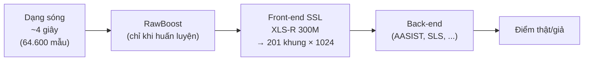
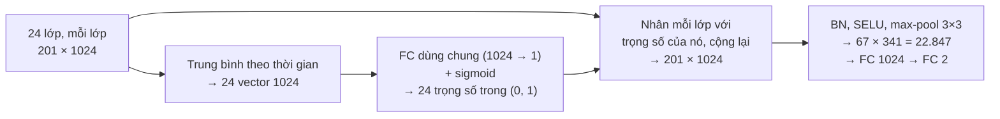

# Front-end SSL kết hợp back-end chuyên biệt

**Phạm vi:** hướng phổ biến nhất hiện nay. Dùng một mô hình tự giám sát (wav2vec 2.0, XLS-R) làm bộ trích đặc trưng, fine-tune cùng một back-end được thiết kế riêng. Hai đại diện: XLS-R + AASIST (Tak và cộng sự, Odyssey 2022) và XLSR-SLS (ACM MM 2024). Mọi bảng số liệu là **EER (%), thấp hơn là tốt hơn**.

## 1. Khung chung

- **Front-end:** XLS-R 300M, học trước trên 128 ngôn ngữ, chỉ từ tiếng nói thật. Đoạn 4 giây cho ra 201 vector 1024 chiều, mỗi vector ứng với 20 ms.
- **Fine-tune cả front-end và back-end** cùng lúc, learning rate rất nhỏ ($10^{-6}$) để không phá biểu diễn đã học.
- Khác nhau giữa các bài chủ yếu nằm ở **back-end** và **cách lấy đặc trưng từ front-end**.

## 2. XLS-R + AASIST (Tak 2022)

### Kiến trúc

| Khối | Làm gì | Kích thước đầu ra |
|---|---|---|
| XLS-R 300M | Lấy đầu ra của **lớp cuối** | 201 × 1024 |
| FC | Giảm chiều | 201 × 128 |
| Max-pool 2D + 6 khối residual | Coi đặc trưng như một "ảnh" tần số × thời gian | 64 × 42 × 67 |
| Self-attention gộp | Học trọng số để gộp theo trục tần số và trục thời gian | Vector tần số và vector thời gian |
| AASIST: graph attention | Mỗi dải "tần số" và mỗi đoạn thời gian là một **nút** của đồ thị; attention học quan hệ giữa các nút, cả trong cùng loại và giữa hai loại | |
| FC | Ra 2 lớp | 2 |

Ý tưởng của AASIST: dấu vết giả có thể nằm ở **sự kết hợp** của một dải tần và một khoảng thời gian. Đồ thị cho phép mô hình học những kết hợp đó.

### RawBoost

Tăng cường dữ liệu bằng cách thêm "nhiễu" ngay khi huấn luyện, không tạo thêm file:

| Loại | Mô phỏng | Hợp với |
|---|---|---|
| 1. Nhiễu tích chập tuyến tính và phi tuyến | Méo do micro, kênh truyền | LA (điện thoại) |
| 2. Nhiễu cộng xung, phụ thuộc tín hiệu | Lỗi lượng tử hoá, méo do thiết bị | LA |
| 3. Nhiễu cộng dừng, không phụ thuộc tín hiệu (nhiễu màu) | Nhiễu nền, nén | DF (nén mp3, m4a) |

Bài dùng 1 + 2 cho LA và 3 cho DF.

### Kết quả

Huấn luyện trên ASVspoof 2019 LA. Mỗi ô ghi **tốt nhất (trung bình)** của 3 lần chạy:

| Front-end | Self-attention | RawBoost | 2021 LA | 2021 DF |
|---|---|---|---|---|
| Sinc (AASIST gốc) | | | 11,47 (11,95) | 21,06 (22,11) |
| wav2vec 2.0 | | | 6,15 (6,46) | 7,69 (9,48) |
| Sinc | ✓ | | 8,73 (11,61) | 23,22 (25,08) |
| wav2vec 2.0 | ✓ | | 4,48 (6,15) | 4,57 (7,70) |
| Sinc | ✓ | ✓ | 7,65 (7,87) | 24,42 (25,38) |
| **wav2vec 2.0** | ✓ | ✓ | **0,82 (1,00)** | **2,85 (3,69)** |

- **Front-end SSL đóng góp nhiều nhất:** chỉ đổi front-end, DF giảm từ 21,06% xuống 7,69%.
- **RawBoost bổ sung cho SSL:** với front-end SSL, RawBoost giúp nhiều hơn hẳn so với front-end sinc.
- **Cấu hình RawBoost phải hợp với miền đích:** trên DF, dùng cấu hình của LA cho 6,64% thay vì 2,85%.
- **Back-end đơn giản vẫn tốt:** thay AASIST bằng max-pool + một lớp đồ thị + FC được 1,19% (LA) và 4,38% (DF).

### Đọc kỹ

- **Con số hay được trích (0,82% và 2,85%) là lần chạy tốt nhất**, không phải trung bình. Trung bình 3 lần là 1,00% và 3,69%.
- Tác giả tự nhận so sánh với các bài trước **không công bằng**, vì front-end được học trước trên rất nhiều dữ liệu ngoài.
- Ngoài miền thật sự kém hơn nhiều: cùng loại mô hình (W2V2-AASIST) có EER 11,19% trên In-the-Wild, và 42,6% trên một benchmark đa ngôn ngữ có biến đổi âm thanh (RADAR 2026).

## 3. XLSR-SLS: chọn lớp có trọng số

**Nguồn cho mục này:** code `model.py` và README của tác giả, cùng số liệu của Speech DF Arena. **Chưa đọc được toàn văn bài** vì nơi đăng chặn tải tự động.

### Ý tưởng

XLS-R có 24 lớp Transformer. Tak 2022 chỉ dùng **lớp cuối**. SLS (Sensitive Layer Selection) dùng **cả 24 lớp** và học xem lớp nào quan trọng **cho từng câu**.

Lý do chung của lĩnh vực: các lớp khác nhau giữ thông tin khác nhau. Lớp thấp gần âm học hơn, lớp cao gần nội dung ngôn ngữ hơn. Lớp cuối được tối ưu cho mục tiêu tự giám sát, không phải để giữ dấu vết giả. Lập luận cụ thể của bài cần kiểm tra lại khi có toàn văn.

### Cơ chế (theo code)

| Đặc điểm | Nội dung |
|---|---|
| Trọng số phụ thuộc đầu vào | Mỗi câu có bộ trọng số riêng, tính từ chính nội dung của từng lớp |
| Back-end | Rất nhẹ: không có đồ thị hay attention, chỉ pooling và 2 lớp FC |
| Huấn luyện | ASVspoof 2019 LA, learning rate $10^{-6}$, batch 5, cross-entropy có trọng số, 50 epoch |

**So với cách khác:** một số mô hình khác cũng cộng có trọng số mọi lớp, nhưng với **trọng số cố định** sau khi học xong, giống nhau cho mọi câu.

### Kết quả

| Tập | EER (README) | EER (Speech DF Arena) |
|---|---|---|
| ASVspoof 2021 LA | 2,87 | 2,86 |
| ASVspoof 2021 DF | 1,92 | 1,91 |
| In-the-Wild | 7,46 | 7,45 |
| Trung bình 14 tập của Arena | | 13,84 (tốt nhất trong các mô hình mã nguồn mở) |

So với W2V2-AASIST trên In-the-Wild: 7,45% so với 11,19%.

## 4. So sánh hai cách

| | XLS-R + AASIST | XLSR-SLS |
|---|---|---|
| Lấy đặc trưng | Lớp cuối | Cả 24 lớp, trọng số theo từng câu |
| Back-end | Phức tạp (đồ thị, attention) | Đơn giản (pooling + FC) |
| 2021 DF | 2,85 (tốt nhất) / 3,69 (TB) | 1,92 |
| In-the-Wild | 11,19 (Arena) | 7,45 |

Bài học chung: **cách lấy đặc trưng từ front-end** có thể quan trọng hơn **độ phức tạp của back-end**.

## 5. Ưu và nhược điểm của hướng này

| Ưu điểm | Nhược điểm |
|---|---|
| Nhiều code công khai, dễ tái lập | Hầu hết chỉ học trên ASVspoof 2019 LA (20 người nói, tiếng Anh) |
| Front-end SSL cho cải thiện lớn và ổn định | Ngoài miền vẫn kém: 7–11% trên In-the-Wild, hơn 40% trên dữ liệu đa ngôn ngữ có biến đổi |
| Kích thước vừa phải (~300M), fine-tune được trên GPU tầm trung | Nhiều bài chỉ báo kết quả tốt nhất thay vì trung bình |

## 6. Câu hỏi tự kiểm tra

1. Trong hướng này, front-end và back-end lần lượt làm gì? Phần nào đóng góp nhiều nhất theo Tak 2022?
2. RawBoost có 3 loại nhiễu nào? Vì sao cấu hình cho LA và DF khác nhau?
3. Vì sao 0,82% và 1,00% đều là "kết quả của Tak 2022"? Nên trích con số nào?
4. SLS khác cách chỉ dùng lớp cuối ở đâu? Trọng số của SLS khác trọng số cố định ở đâu?
5. Vì sao kết quả tốt trên ASVspoof 2021 chưa đủ để nói một mô hình tốt?
